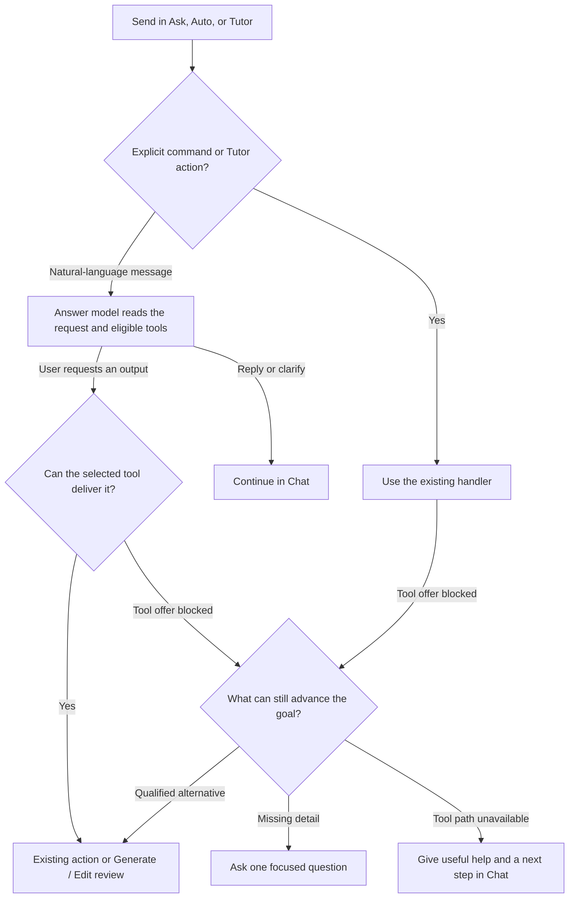

# Rabbit Hole — Ask, Auto, and Tutor workflow

Routing reference for the Tutor handoff. The shared reply path is the target design. The staged rollout is tracked by `CHAT.01` and `CHAT.02` in checklist §4.5.

## Workflow

| Mode | Ordinary message | Explicit action |
| --- | --- | --- |
| Ask | Answer using the authorized context. Honor an eligible tool request and pause unsolicited Tutor initiative. | Use the named command or explicit Tutor action. |
| Auto | Reply, clarify, or request an eligible tool based on the full message. Auto-suggest controls unsolicited Tutor proposals. | Use the selected command or action. |
| Tutor | Use the shared reply path with the current lesson context. | Roadmap acceptance, targeted edits, and **Next card** use the Tutor controller and the accepted step. |

The model sees the full prompt and the eligible function definitions, including each function’s name, argument schema, output, use cases, and limits. The server validates the selected output, inputs, access, and tool readiness before review. A proposed alternative follows the existing approval, and the learner chooses any change to an explicit requirement.

## Rollout and checks

- `CHAT.01` lets a recoverable JEV failure continue once through the text-only reply path in the same thread and removes the tool-check banner and buttons.
- `CHAT.02` moves the ordinary-message decision into the answer turn after parity checks for the affected modes and enabled capabilities. Legacy JEV routing stays available for scopes awaiting qualification.
- The shared test corpus has 20 intent cases and 20 Send cases under `packages/control-plane/test/fixtures/chat-routing/`. The Send cases are split by mode. Capture the validated route before any tool execution.

Reviewed handoff snapshot `6b3fff7e1585f6814271f0290d9d91f3bf8e5445`. Deployed code examined at `8deb778fa2b0442b4ac494f9d94e88fffd72a6c3`.

https://github.com/Rabbit-Hole-App/Rabbit-Hole/commit/6b3fff7e1585f6814271f0290d9d91f3bf8e5445
