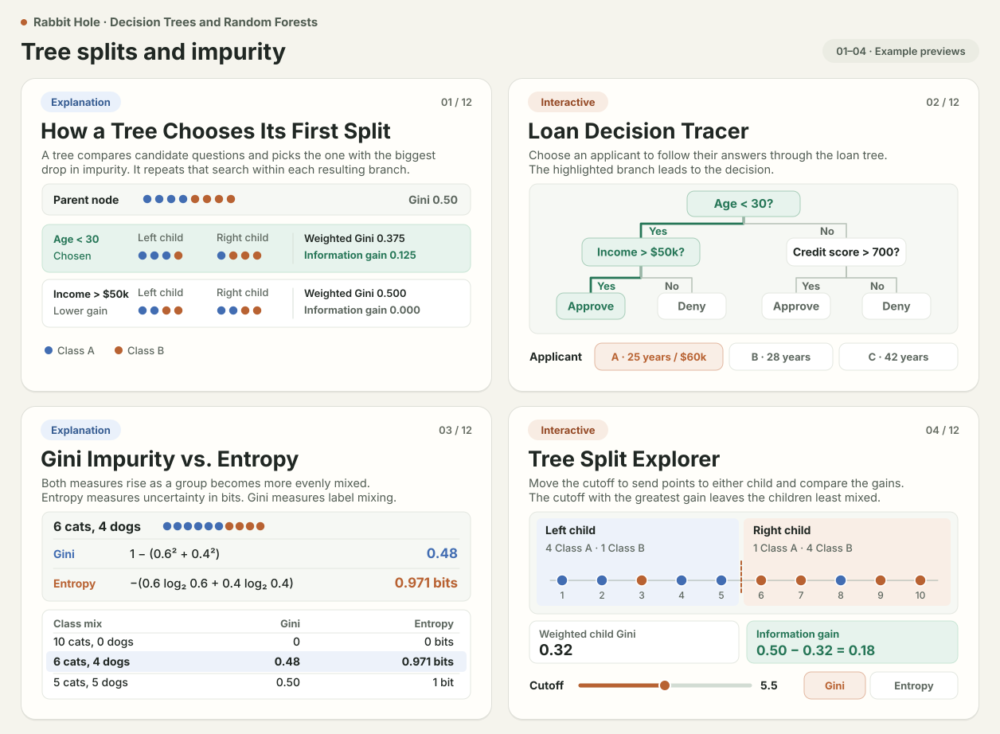
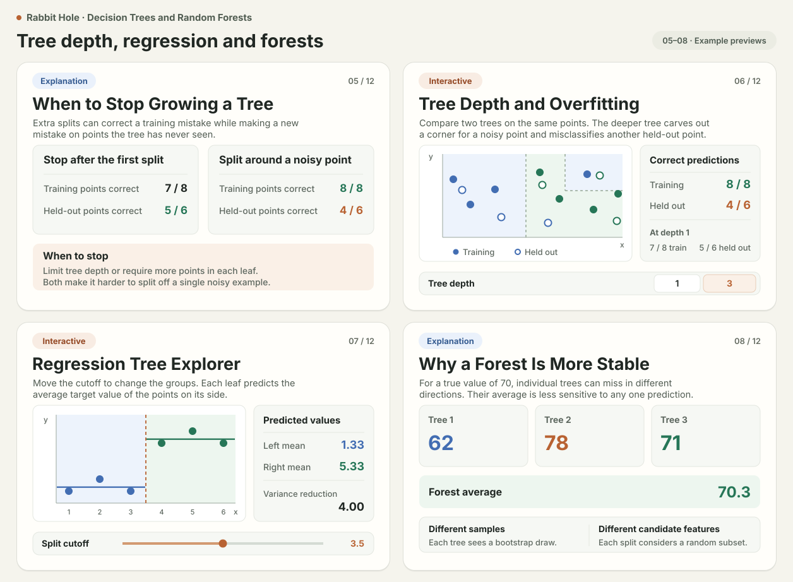
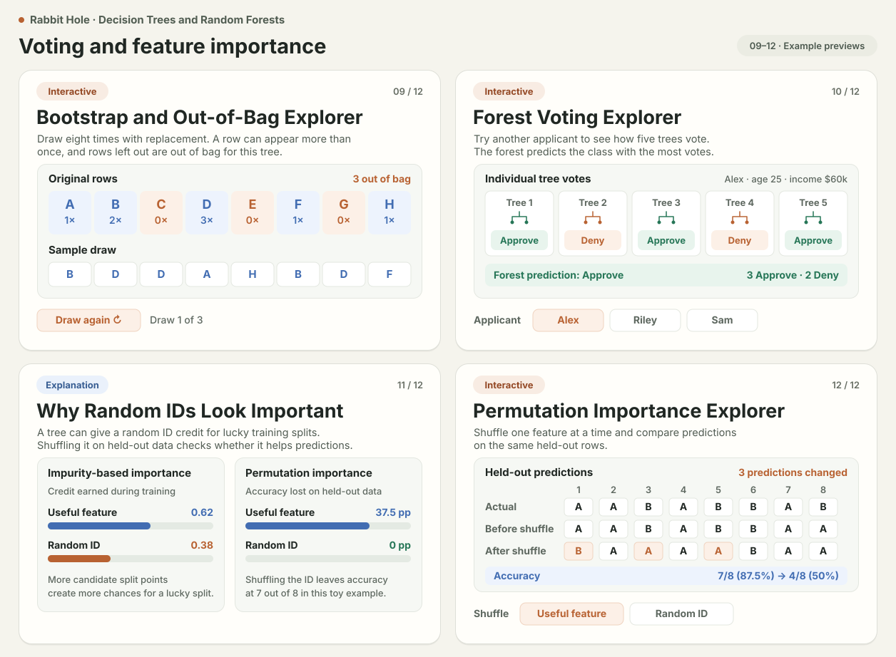

# Decision Trees and Random Forests card reference

Use [en.md](en.md) as the canvas source. This lesson snapshot comes from [AI Engineering From Scratch, Phase 02](https://github.com/rohitg00/ai-engineering-from-scratch/tree/main/phases/02-ml-fundamentals) and retains its [MIT license](LICENSE).

The twelve previews show example outcomes for five Explanation and seven Interactive requests. They are hand-authored SVG references. The interactive scenes show one example state apiece.

## Prompts and expected cards

| # | Command | Learner prompt | What to look for |
|---|---|---|---|
| 1 | `/explain` | How does a decision tree figure out what question to ask first? | A worked comparison of two candidate splits. It shows why the higher-gain split is picked and how the tree repeats the process in each child. |
| 2 | `/interactive` | Can I try a few different applicants in the loan example and see how the tree decides who gets approved? | An applicant selector and a highlighted path to Approve or Deny. At age 25 with income of 60,000 USD, the path tests age below 30, then income above 50,000 USD, and ends at Approve. |
| 3 | `/explain` | What’s the difference between Gini and entropy? Can you walk me through the cats and dogs example? | Six cats and four dogs give Gini **0.48** and entropy **0.971 bits**. Compare that group with a pure group and a 50/50 group. |
| 4 | `/interactive` | Can I move the split myself and see why one cutoff is better than another? | A movable cutoff across labeled points. Class counts, weighted child impurity and gain update as points switch sides. The bigger gain identifies the better cutoff for the current criterion. |
| 5 | `/explain` | Why would I stop a tree from growing if it keeps getting better on the training data? | A worked example in which an extra split improves training accuracy while hurting held-out accuracy. Explain how a depth limit or minimum leaf size can prevent that split. |
| 6 | `/interactive` | Let me make a tree deeper and see when it starts fitting noise. What happens to its predictions on points it hasn’t seen? | A depth control redraws rectangular decision regions over the same points. Separate training and held-out scores show the trade-off. |
| 7 | `/interactive` | Can I move the split in a regression tree and see how the predicted number changes on each side? | A cutoff separates fixed points. The two horizontal predictions update to the mean on each side. If the preview dataset is used, the 3.5 cutoff gives leaf means of **1.33** and **5.33**. |
| 8 | `/explain` | Why does a random forest usually give more stable predictions than a single tree? | An example of trees making different errors and their aggregate prediction. Explain how bootstrap samples and random candidate features make the trees more diverse. |
| 9 | `/interactive` | Can I draw a bootstrap sample and see which rows get picked more than once and which get left out? | The original rows, the draw with replacement, per-row counts and out-of-bag rows. Drawing again updates all three consistently. |
| 10 | `/interactive` | What happens if the trees disagree? Let me try a few examples and see how each tree votes. | Changing the case updates the individual votes, tally and prediction. At least one case has a split vote, such as **3 Approve, 2 Deny**. |
| 11 | `/explain` | How can a column of random IDs end up looking important to a random forest? | Compare training-time impurity-based importance with held-out permutation importance. Explain how many candidate split points give a random ID more chances to appear useful during training. |
| 12 | `/interactive` | Let me shuffle a useful column and a random column separately so I can see what happens to the model’s accuracy. | Select a feature to shuffle. Show changed predictions and before/after accuracy for the same held-out rows. In the worked example, shuffling the useful feature lowers accuracy more. |

## Visual references

### 1–4 · Tree splits and impurity

### 5–8 · Tree depth, regression and forests

### 9–12 · Voting and feature importance

## What to check on generated cards

- Record the build or commit, Depth, exact request, returned card or failure, and a screenshot for each row. Use the same lesson source. Compare the concept, calculations, controls and layout with the reference. Fresh runs may choose different example data and styling.
- Put one or two sentences defining the idea or explaining the visual above the scene, then one or two sentences telling the learner what to do. Keep the control next to the scene. Prefer one primary control with a clear selected value.
- When a choice changes a decision, look for both the result and its reason. For the loan tracer, the highlighted path and outcome should agree with the applicant. A short response such as “Age 25 is below 30 and income is above 50,000 USD, so the tree approves” should track the current selection if the card offers prose feedback. For a numeric experiment, the moving geometry and readouts can explain the result directly.
- These seven Interactive references are untimed experiments. Their controls change an input, select a case or take one action. A native playback row belongs on a scene with elapsed time, such as toss-and-drop. A deliberate sequence can use an indexed step control when that is the concept being taught.
- To check an Interactive card, change the primary control, inspect what moved or recalculated, then reopen the card to verify that the selected value and result agree. Record the output separately from this reference.
