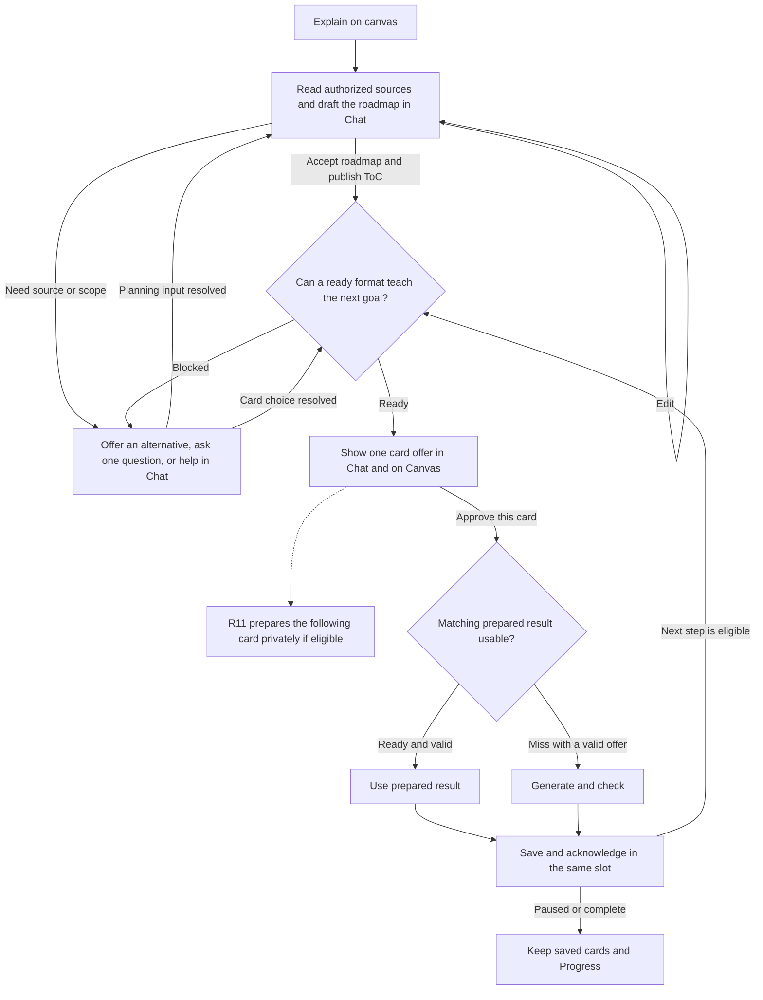

# Rabbit Hole — Explain on Canvas workflow

This workflow starts when the learner chooses **Explain on canvas** or clearly asks for a lesson on the Canvas with a resolved source. A file drop acknowledges the source and offers the existing choice in Chat. An informational question uses the Chat reply path. A request for one card uses its own review. The ordinary message decision is in [ask-auto-tutor-workflow.md](ask-auto-tutor-workflow.md).

## Workflow

## Decision rules

- **Start the lesson once.** The button and a clear typed lesson request use the same Tutor action and the authorized source, thread, instruction and Depth. A drop into an occupied Chat uses the existing **Start new chat / Stay here** choice. Resolve a missing source or scope in that Chat.
- **Approve what to teach.** The reviewed roadmap sets the goal, scope, Depth, order and explicit requirements. Suggested formats guide review. **Accept roadmap** publishes the accepted version to the existing ToC.
- **Confirm how to teach the current step.** Before showing an actionable offer, confirm one format or tool can deliver the accepted goal with the current source, inputs and settings. A qualified alternative uses the same step and Chat. Ask the learner before changing a requirement such as narration or interactivity. Changes to the goal, scope or Depth use **Edit roadmap** and reacceptance.
- **Approve and deliver one card.** Chat and Canvas share the same offer and slot. **Accept** approves the first card and **Next card** approves the current later offer directly. Command-specific **Generate / Edit** uses the same Chat entry and required review. Approval binds the actual tool, settings and source revision. Use a valid prepared result or generate and check the approved card, then save and acknowledge it in that slot before offering the next eligible step.
- **Recover at the blocked stage.** Offer a qualified alternative, ask one focused question, or give useful help in Chat and a next step. Resume the same draft or step when the learner supplies what is needed. A partial reply leaves the card undelivered. Accepted generation follows the existing failure and reconciliation path.

## R11 prepares one card ahead

On a new lesson, the first card is generated on approval. While Card N is on offer, enabled R11 can privately prepare Card N+1. Start with qualified lightweight explanations and tables in **Explanations only** when Auto-suggest is on and the selected mode permits unsolicited work. Tutor shows the next offer only after the current card is saved and acknowledged and the next step qualifies. The next card body stays private until its own approval.

| At the next approval | Same Chat entry and Canvas slot |
| --- | --- |
| Prepared result is ready and matches | Recheck versions, access, output checks and reconciliation, then settle the approved card once and save it. |
| Matching preparation is still running | Show the usual progress during a bounded wait. Reuse the result if it becomes valid. Keep unresolved work in the existing reconciliation path. |
| Preparation is unavailable or resolves unusable | Use the normal approved generation path if the offer is still valid and generation is allowed. |
| The offer has changed | Recheck the preparation against the new inputs. Show the revised offer for its own approval. |

The platform covers preparation before acceptance. Ask, Auto-suggest off, Cancel or End stops new speculative work. For an eligible manual continuation, **Propose next step** requests an offer and **Next card** approves it.

## Capability scope

Use the tools currently enabled and qualified for the step. The full R1–R16 design can add source retrieval, OCR, research, computation, practice and adaptation at the relevant decision. Finish the Core Tutor MVP first, then deliver R11 before R12. R12 adapter implementation is on hold pending the owner's go-ahead.

The learner flow and R11 behavior are specified in [tutor-roadmap-v1.4.md](tutor-roadmap-v1.4.md) §§3, 11.2. The implementation and local tests are in [tutor-implementation-checklist.md](tutor-implementation-checklist.md) §§4.1.1, 6.8, 8.0.
