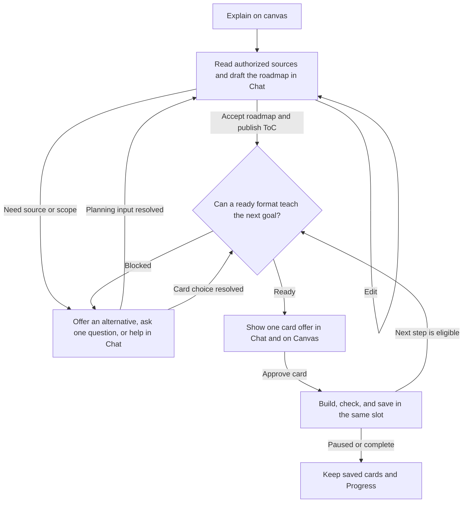

# Rabbit Hole — Explain on Canvas workflow

This workflow starts when the learner chooses **Explain on canvas** or clearly asks for a lesson on the Canvas with a resolved source. A file drop acknowledges the source and offers the existing choice in Chat. An informational question uses the Chat reply path. A request for one card uses its own review. The ordinary message decision is in [ask-auto-tutor-workflow.md](ask-auto-tutor-workflow.md).

## Workflow

## Decision rules

- **Start the lesson once.** The button and a clear typed lesson request use the same Tutor action and the authorized source, thread, instruction and Depth. A drop into an occupied Chat uses the existing **Start new chat / Stay here** choice. Resolve a missing source or scope in that Chat.
- **Approve what to teach.** The reviewed roadmap sets the goal, scope, Depth, order and explicit requirements. Suggested formats guide review. **Accept roadmap** publishes the accepted version to the existing ToC.
- **Confirm how to teach the current step.** Before showing an actionable offer, confirm one format or tool can deliver the accepted goal with the current source, inputs and settings. A qualified alternative uses the same step and Chat. Ask the learner before changing a requirement such as narration or interactivity. Changes to the goal, scope or Depth use **Edit roadmap** and reacceptance.
- **Approve and deliver one card.** Chat and Canvas share the same offer and slot. **Next card** accepts the ready offer directly. Command-specific **Generate / Edit** uses the same Chat entry and required review. Approval binds the actual tool, settings and source revision. Build, check, save and acknowledge the same card before offering the next eligible step.
- **Recover at the blocked stage.** Offer a qualified alternative, ask one focused question, or give useful help in Chat and a next step. Resume the same draft or step when the learner supplies what is needed. A partial reply leaves the card undelivered. Accepted generation follows the existing failure and reconciliation path.

## Capability scope

Use the tools currently enabled and qualified for the step. The full R1–R16 design can add source retrieval, OCR, research, computation, practice and adaptation at the relevant decision. The current delivery priority is the Core Tutor MVP. R12 adapter implementation is on hold pending the owner's go-ahead.

The learner flow is specified in [tutor-roadmap-v1.4.md](tutor-roadmap-v1.4.md) §3. The implementation and local tests are in [tutor-implementation-checklist.md](tutor-implementation-checklist.md) §4.1.1 and §8.0.
