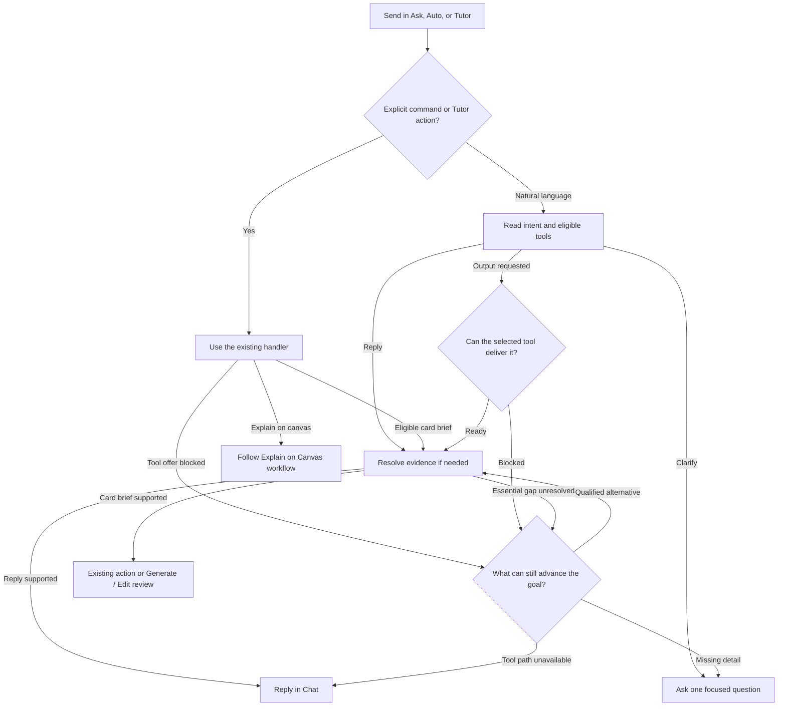
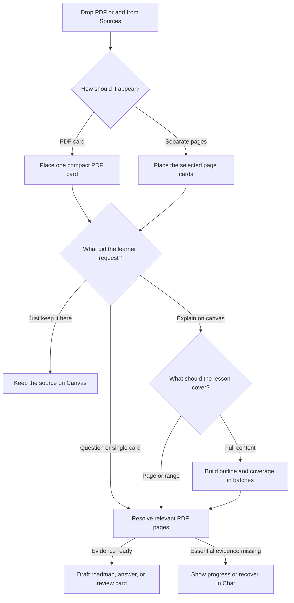
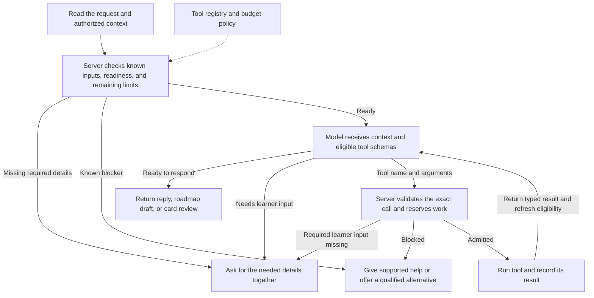
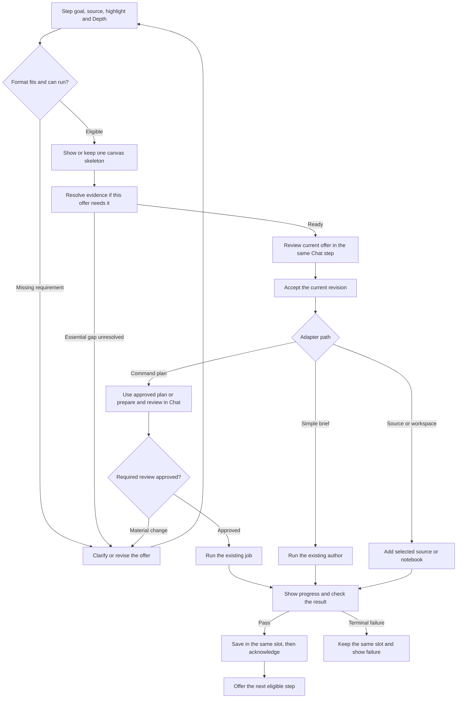

> Depth names (renamed 2026-11-08): Brief = Overview, Balanced = Standard, Detailed = Deep. The names in this file below are updated where they name the learner's Depth; stored values written with the old names are read through an alias map (`packages/control-plane/src/chat-depth.js` `DEPTH_ALIASES`).

# Explain on Canvas — Tutor product roadmap

**Rabbit Hole · Version 1.4 · MVP flow update · 7 November 2026 · WHAT we are building**

**Companion:** [Tutor implementation checklist v1.2](tutor-implementation-checklist.md) describes HOW: current files and functions, changes, interfaces, owners, local commands, test assertions and delivery evidence. Read both before implementing. This roadmap defines the learner experience and release boundaries; the checklist must implement that experience without inventing another UI or approval flow.

**Reviewed main:** `e447525a83c6e9809f2f1cdaa27071c31a3a0b3f`. This audit reviews the 21 commits after `72d6536657af269bb894511220975fd2254246ed`. The expanded R1–R7 audit passed **496 distinct local Node tests across 46 files**; the initial 213-test batch is included. Production release workflow [185](https://github.com/Rabbit-Hole-App/Rabbit-Hole/actions/runs/42331915345) succeeded for this SHA. The complete updated core flow still needs the work and acceptance evidence recorded below.

**Latest reviewed implementation SHA** `04219878da7360131138c9059ce74854a51a1c0e` on `main`, against reviewed handoff `19eb73418d4c1cd8657f5aab6e0b659ead09df7a`. The review and release evidence below update the earlier pinned findings. See §2.1.2.

**This MVP flow update supersedes conflicting earlier v1.4/v1.3 instructions for active work.** The complete Tutor conversation, parameters, draft review, editing and progress now live in existing Chat messages. Only accepted roadmap entries are published to the existing ToC. Every proposed/accepted step has a synchronized Chat entry and a persistent canvas slot, placed near its highlighted source passage with two-way navigation. Full-document context, one ordinary author call and no citation-review publication gate remain required. Sections 3–8 specify the complete interaction; section 14 records replaced rules. Preserve the remaining R1–R16 scope. The historical cleanup v0.1 file is not the current cleanup execution plan.

**Delivery scope:** The owner-approved HTML references are now published in the separate [ui](ui/) folder and linked at the relevant workflow steps. This update publishes those references and reconciles these two Markdown documents; it does not implement or deploy product code. Approval of a reference is distinct from implementation, deployment and functional acceptance. Read the approved UI contract in section 4.6 before implementing.

## Contents

- [1 Product outcome and operating boundaries](#1-product-outcome-and-operating-boundaries)
- [2 Current implementation and the immediate correction](#2-current-implementation-and-the-immediate-correction)
- [3 The complete learner flow](#3-the-complete-learner-flow)
- [4 Chat, Table of Contents and Progress](#4-chat-table-of-contents-and-progress)
  - [4.7 Ordinary messages and tool requests](#47-ordinary-messages-and-tool-requests)
- [5 Context, scope and source references](#5-context-scope-and-source-references)
  - [Long Markdown supporting passages (R7a)](#long-markdown-supporting-passages-r7a)
  - [5.4.1 R7b — PDF sources on Canvas](#541-r7b--pdf-sources-on-canvas)
- [6 Proposal, generation and delivery lifecycle](#6-proposal-generation-and-delivery-lifecycle)
- [7 Canvas placement and source navigation](#7-canvas-placement-and-source-navigation)
- [8 Pacing, feedback and practice](#8-pacing-feedback-and-practice)
- [9 Formats and Tutor capabilities](#9-formats-and-tutor-capabilities)
  - [9.4 R12 command selection and the shared Tutor flow](#94-r12-command-selection-and-the-shared-tutor-flow)
  - [9.5 R13 repository evidence with Graphify](#95-r13-repository-evidence-with-graphify)
- [10 Uncertainty, research, safety and privacy](#10-uncertainty-research-safety-and-privacy)
- [11 Credits, persistence and failure recovery](#11-credits-persistence-and-failure-recovery)
- [12 Release ladder and cleanup dependencies](#12-release-ladder-and-cleanup-dependencies)
- [13 Verification and production delivery](#13-verification-and-production-delivery)
- [14 Decisions, superseded rules and traceability](#14-decisions-superseded-rules-and-traceability)
- [15 Actions and expected results](#15-actions-and-expected-results)

## 1 Product outcome and operating boundaries

### 1.1 What the learner receives

The learner drops a document onto a canvas. Rabbit Hole opens the right-side Chat and immediately acknowledges the upload. The learner chooses a conversation when needed, asks for an explanation, reviews and edits a finite roadmap in Chat, then accepts it for publication in the Table of Contents. Main explanations live on the canvas; the Tutor explains every proposed step and its progress in the chosen Chat. The learner accepts one teaching step at a time from either surface.

The experience must feel continuous: a visible proposal beside the relevant source passage becomes a generating skeleton and then the explanation in the same location, while its Chat entry shows the same state. The learner can navigate from the highlighted Markdown to its generated card and back. The learner must not watch a placeholder vanish, search for its result elsewhere, or repeatedly tell the Tutor to continue when Auto-suggest is on.

The initial reliable slice is an owned desktop canvas, one readable Markdown source, a chosen scope, and ordinary explanation/table cards. The complete slice includes the first **and second** accepted cards, persistence, navigation, one next proposal, stopping, cancellation and correct charging. The delivered Explanation layout and its Markdown tables and Mermaid diagrams are required in the core Tutor MVP. See section 3.9 for the card contract.

### 1.2 What a roadmap is

A roadmap is the agreed learning outcome, scope, Depth, explanation/practice mode, ordered steps and finite endpoint for the current canvas. Its draft and acceptance conversation live in Chat; its accepted steps, delivery states and navigation appear in the existing Table of Contents. The server owns the accepted state. It is not a new course, journey, syllabus, separate lesson screen or second contents panel. A finite endpoint remains part of planning even though the old visible Stopping point block is removed from the ToC.

A step is one coherent teaching addition. A skill is a concept or ability tracked by evidence; it is not a compulsory additional UI or a personal goal the learner must create. The outcome names something the learner should be able to do. Delivered steps show coverage; understanding requires a separate self-report or assessment.

### 1.3 Sprint boundaries

**Current owner decisions — supersede older release/design instructions:** Finish the complete core Tutor MVP first. Claude Code may push docs and code to main, set `MVP_ALLOWED_SHA` for the exact tested release candidate, run the existing release launcher and monitor production without another owner command. Keep the existing isolated clone deployment required by that launcher as release verification; production is the delivery target. No new no-clone mode is requested. Disregard the earlier Contents Q1–Q7 discussion/hold; implement the current docs and file 01 in this sprint. Use five agents with one integrator and separate backend, Chat/ToC, canvas/Explanation and verification ownership. Run affected tests/build per release and finish checklist section 8.0 before the final handoff. Continue implementing and releasing without waiting for owner manual checks between tasks or releases. Local tests use doubles, with no paid model calls. Reuse `chat_message_meta`/`scope_json` where sufficient; an unavoidable production migration still needs the owner's command, while independent work continues. Remaining R7 extensions may be deferred; preserve existing enabled R7a behavior. R8a is next after Core Tutor, starting with the written Explanation card (§10.2.1). Deliver R10 for **Explanations only**, then add assessed-practice adaptation after R9 qualifies that path (§8.4). Deliver R11 before R12. R12 implementation remains on hold.

- Prioritize the ordinary Markdown core and its actual learner flow before optional formats or cleanup database removal.
- Reuse the current app, components, state, command handlers and placement helpers. Do not reintroduce the retired browser Tutor planner.
- Record nonblocking defects in `docs/features/explain-on-canvas/OWNER-INBOX.md` with the affected action and next task. Do not turn them into extra release gates.
- Ship to main/production using the existing MVP launcher, including its required isolated clone deployment, focused tests/build/smoke and recovery. This latest owner decision supersedes the earlier no-clone direction. Use deployed main and the approved HTML as styling authority; the clone is release verification, not a new design baseline. No no-clone tooling rewrite is needed.
- Existing production authorization and approved budgets remain in force within their scope. An unknown or exhausted budget is not new spending authority; production database deletion and new infrastructure retain their specific approvals.
- Desktop first. Phone layout, a new reward system, cross-user reuse, arbitrary code execution and Animation-engine changes are not part of the core correction.

## 2 Current implementation and the immediate correction

### 2.1 Evidence at the pinned main

| Area | What is present or observed | What must not be inferred |
|---|---|---|
| R1 feedback, R2 settings, R3 source references | Existing contracts, routes, state and Node-rendered controls/reference foundations reviewed and tested at the pinned SHA; task statuses reconciled in checklist section 5.1. | New Chat/slot/source-link UI and owner manual acceptance are separate; do not keep proven foundations unchecked. |
| R4 core and R6 Auto-suggest | Roadmap modules are on main; the production app config sets `ROADMAP_ENABLED` and `ROADMAP_AUTO_ENABLED` to true. The earlier reviewed production workflow succeeded; this audit has not established the served status of the newest source commits. | Config and workflow success do not establish complete learner acceptance. |
| Owner's real Markdown attempt | The owner reports the first card generated, but the second was withheld with a source-matching message. | No passing two-card end-to-end verdict exists from that report. The exact failed claim requires the private stored result. |
| Current author context | `a1e4094` now sends the full fitting document plus title/goal/claims/outcome, using `roadmap-card-3` and trusted `repairs:0`. | Narrow-scope planning still slices its input; accepted-plan binding, original instruction and actual request/allowance reconciliation still need targeted verification. The writer never inherits planner memory implicitly. |
| Current publication | The ordinary path now disables the per-card support checker and records grounding `not_run`, while retaining schema, source revision and safety checks. | This is already implemented source, not proof of complete production acceptance. Remaining automatic author retry policy needs reconciliation. Current safety coverage must be reported accurately; expanded source screening is a separately evaluated follow-up, not a new gate for this fix. |
| Current two-card test | The three `roadmap-document-context.test.js` regressions passed locally at the reviewed main. The writer gets the whole bounded document and step brief, grounding is recorded as not run, and two accepted cards are saved and acknowledged. | The fixture uses external doubles and direct SQL board writes. Full section 8.0 route/save coverage and owner manual production acceptance remain required. |
| Current proposal/ToC UI | World-positioned slots, source-range navigation, Chat transcript rendering and server Tutor-thread binding are present. `TableOfContents` now owns one scroller with a `top` slot for `RoadmapToc`. | The ToC still renders the roadmap parameter/action block before ordinary headings. It needs the accepted-only tree in file 01. Chat lifecycle rows are derived from current roadmap state and need durable per-step message identity. Slot geometry needs private reload persistence. |
| R5 proposal editing/reuse | Pending Edit uses the existing preview/apply/discard flow. Five previews per proposal and 30 per learner per UTC day are checked. `ROADMAP_EDIT_ENABLED` is true in the production app config. | Preserve the implemented edit foundation. Complete the composer-target UI, accepted edited-title/brief binding and the broader reuse subset separately. Config and focused tests establish their own scope of evidence. |
| R7a long Markdown | Deterministic index/summary/retrieval/coverage and bounded long-plan foundations locally verified; migration 0042 and enabled production config retained. | Source-selection outbox/new-UI/manual extensions may be deferred. Current authoring uses passage fallback above 40,000 characters. R7a.04 adds supporting excerpts at card generation. PDF planning is tracked separately under R7b. |
| Cleanup | P1–P5 changes/receipts are present. Archive-sensitive joins remain; P6 backfill/join removal/drop and P7 closeout are not established complete. | Do not reuse cleanup v0.1's old migration number or wait for table deletion before fixing the Tutor core. |
| R8–R16 | The ladder retains these capabilities; some branch work was reported earlier. | Treat branch work as material to reconcile, not proof of integration, activation or acceptance. |

**Reviewed corrections and the remaining core flow**

| Flow segment | Reviewed status | Next work |
| --- | --- | --- |
| Markdown import | New Markdown opens in the existing Full content layout. | Preserve it while completing immediate Chat acknowledgment and Start new chat / Stay here routing in UI.01. |
| Chat | Existing Chat renderer and server-bound Tutor thread are reused. | Persist one logical message per step, retain history after completion, and put parameters/draft/editing in the chosen thread. UI.01/03/04/08. |
| Contents | The separate 50vh roadmap scroller is removed. | Project accepted entries into the existing outline and move draft/parameters/actions into Chat. UI.02/03. |
| Proposal/source navigation | Slot privacy, obstacle avoidance and contextual raw-Markdown range matching are retained. | Persist geometry, preserve edited identities and finish the approved View section / hover View card controls. UI.04/06/07. |
| Accept and author | The existing two-card successful path passes locally. Recovery actions are removed and a safety refusal suppresses automatic successors. | Finish accepted-input and quote binding, and remove the automatic author retry still asserted by current tests. CORE.02–07. |
| Delivered Explanation and next action | Existing card and proposal foundations are available. | Implement shared Explanation prompt/depth rules and rich Markdown in CORE.09. Finish the fixed header/downward disclosures and viewport-bottom Next card / Cancel using files 04/06 and 02. |

The intended order is still drop → acknowledge/choose Chat → Explain → draft and parameters → accept roadmap → accepted ToC → one pending card → accept → validate/save/acknowledge → one next proposal → second saved card → finite completion. The successful local regression covers part of this order. The rows above identify the additional work for the approved product flow.

The current docs and UI references are reviewed on `chatgpt/tutor`. Claude Code imports that handoff into main before implementation. The checklist's section 1.7 specifies the repeated fetch, document sync, implementation receipt and commit-review loop.

### 2.1.1 R1–R7 completion reconciliation

The earlier "nine completed" count covered only narrow correction checkboxes. It omitted 18 R1–R3 table tasks and existing R5–R7 work. Every table task and checkbox through R7 in the companion checklist is now reviewed. Compound requirements are split where a tested foundation is complete but a new behavior remains. Superseded no-clone work is struck through; receipt bullets and standing constraints are not unfinished implementation tasks. No release rung is declared fully owner-accepted.

| Rung/task group | Checked | Open | Total | Meaning |
| --- | ---: | ---: | ---: | --- |
| R1 | 5 | 1 | 6 | Existing foundations checked; updated slice/manual receipt open. |
| R2 | 5 | 1 | 6 | Existing Depth/settings checked; immutable accepted roadmap settings open. |
| R3 | 5 | 1 | 6 | Existing reference engine checked; new viewer/source-link receipt open. |
| R4 | 2 | 12 | 14 | Rollup tasks; partial rows map to detailed CORE/UI below. |
| R5 | 8 | 7 | 15 | Existing preview/Apply/keyboard/link guards checked; author/composer/reuse/geometry work open. |
| R6 | 6 | 1 | 7 | Existing trigger/composer/delivery guards checked; persistent Chat/offscreen integration open. |
| R7a | 15 | 4 | 19 | Existing index, retrieval and coverage checked. Card authoring context is pending alongside three deferred extensions. |
| R7b | 0 | 15 | 15 | Docling PDF workflow planned as a separate release. R3 excerpts are counted separately. |

R4's detailed correction lists contain **29 / 50 checked CORE items** and **22 / 72 checked UI items** after the 7 November review. These are detailed subtasks of the R4/integration rollup above in the companion checklist, not extra completed releases. BE and per-release receipts remain separate evidence tasks. Do not sum overlapping rollups and subtasks into a misleading project percentage. Checked UI foundations mean source/Node verification; owner manual production acceptance is still separate.

**Still required for the core:** complete planner context for selected scope; accepted instruction/title/Depth/version binding; one ordinary author dispatch across terminal failures; actual request quote equality; durable Chat acknowledgment/routing/revision and per-step messages; accepted-only ToC; persisted/final saved geometry; new source highlights/hover links and viewport-bottom Next card; shared Explanation prompts, caps, pinned header, downward sections, tables/Mermaid; then missing BE cases, build and release receipts. Existing safety, access, atomic money, feedback, settings, references and metadata-offer foundations are reused.

The owner permits deferring remaining R7a extensions. R7b is a separate release under §5.4.1. The current four enabled production config flags stay unchanged. After Core Tutor, take R8a next with the first Explanation slice in §10.2.1. See §8.4 for staged R10 delivery and §11.2 for R11 before R12.

### 2.1.2 Current implementation review

The review follows the code from `e447525a83c6e9809f2f1cdaa27071c31a3a0b3f` through `8deb778f` to `04219878da7360131138c9059ce74854a51a1c0e`. The latest main handoff sync is `7f579187d`, from `chatgpt/tutor` at `0c73b7bd`. Use checklist §1.7 to bring in the current reviewed handoff before the next task.

Production run [42382264445](https://github.com/Rabbit-Hole-App/Rabbit-Hole/actions/runs/42382264445) released build `e9e642a9b76d0d52` on 7 November 2026. The clone-backed MVP record and five production smoke checks passed. The workflow used the owner's broad-gate bypass. Signed-in behavior and the owner's manual UI acceptance have their own evidence. Keep the enabled core, Auto-suggest, edit and long-Markdown flags on their current paths.

| Area | Current review |
| --- | --- |
| Core Tutor | Bounded Markdown reaches the selected-scope planner. The accepted-input quote, single-author path, real Chat entries, first and next slots, shared Explanation guidance and accepted outline projection are present. Checklist §2.1.3 records which assertions pass and what remains open. |
| Contents and card actions | The 7 November decision restores the separate Contents composer for its own conversation. Roadmap lifecycle stays in right-hand Chat. Current code adds card naming, section links, source-chip navigation, removal and restore. Review actual pending-slot, exact-passage and completed-roadmap navigation before accepting those items. |
| Selection, generation controls and reliability | The area capture now has progress and a per-card evidence report. Fix the repository code-chip crash and associate image coverage with the exact crop bytes received by the model. Keep the newer shared Depth, Stop and Go to plan controls and address the exact remaining cases in checklist §2.1.3. |
| Tool rollout | Fail-soft routing is present. `CHAT_ANSWER_TOOLS` is unset in the production configuration and the previous fixture report has 11 misses. Keep R8a as the next evidence-tool priority once the core blockers are addressed. R7a.04, Docling R7b, R9/R10/R11, and the R13 Graphify upgrade/registry plan remain open. The standalone Explanation/Interactive split does not lift the hold on R12 Tutor adapters. |

### 2.2 Owner-reported release snapshot

The following is the earlier owner-supplied release report. Section 2.1 records the newer reviewed main, configuration and local evidence. Numbered deployment releases are different from capability rungs R1–R16. Reconcile later code and served identity before checking implementation items complete.

| Release | Owner-reported state | Scope and remaining qualification |
| --- | --- | --- |
| 76 | Deployed; not accepted | Core Tutor; `ROADMAP_ENABLED` and `ROADMAP_AUTO_ENABLED` on. |
| 79 | Deployed; not accepted | R5 proposal editing; `ROADMAP_EDIT_ENABLED` off. |
| 80 | Deployed; not accepted | R7a long Markdown; `ROADMAP_LONG_MARKDOWN_ENABLED` off. |
| 81, 82 | Deployed; not accepted | Fix A: honest errors, Tab, Contents scrolling, Accepting state and quotation handling. The live split Contents panel still needs replacement. |
| 84 | Deployed; not accepted | Checker evidence contract. |
| 85 | Last deployed release, reported at 15:13 PT; waiting for owner testing | Whole document to the writer, one call, no citation gate, removal of from-scratch chip/recovery block and reuse rule. |
| 86 | Ready, waiting for owner | Canvas slot beside Markdown, generating in place and card filling the slot. |
| 87 | Ready after 86, waiting for owner | Remove Retry/Replace/Omit; failed step skipped; no auto-offer after safety refusal. |
| 88 | Being verified | Remaining Fix C passage matching plus A1, B1 and C1. Those labels retain their existing implementation meaning; this table does not invent a verification result. |
| 89 | Being built | Fix B: Tutor in Chat, Depth step, roadmap acceptance in Chat and old panel hidden. |

The owner also reports that the final Contents redesign, enabling R5/R7a, P6/P7 cleanup, R8 and R9 are not started. The approved [Table of contents reference](ui/01-table-of-contents.html) now contains the accepted tree only; the removed parameter/decision blocks belong in Chat. The release snapshot above remains historical; publishing a reference does not verify a product release. New requirements below can extend the work described by 86–89; their existence or release numbers do not prove that every new requirement has been implemented.

### 2.3 The next production outcome

The corrected core must deliver the whole flow in section 3:

1. Open Chat on source drop; acknowledge promptly without waiting for full-document reading; route an occupied conversation using **Start new chat / Stay here** before offering **Explain on canvas**.
2. Read the full supported source for planning, then show the draft, learning parameters, **Accept roadmap** and **Edit roadmap** inside Tutor Chat messages. Publish only the accepted roadmap to the ToC and provide **Open table of contents**.
3. Present matching title, description, source excerpt and format in one canvas proposal and one Chat step entry. Use the same acceptance, cancellation, editing and navigation identities from both.
4. Plan and author against the same authorized source revision. Each ordinary card gets the full document and accepted brief, with one authoring call and no per-card citation judge or automatic author retry.
5. Keep the same canvas frame and Chat entry through accepting, generating, applicable checks, saving, delivered and genuine failure. Retain safety, renderability, access, billing and persistence checks and report checks actually run.
6. Place successive slots near their highlighted passages, preferring free space on either side of the Markdown and top-to-bottom visual progression. Avoid existing material and controls, persist their world geometry and provide persistent source-to-card icons.
7. Save and reload two consecutive accepted cards, with exactly one synchronized next proposal after canonical delivery when Auto-suggest permits it. Never add a Retry/Replace/Omit recovery UI or automatically offer a next card after safety refusal.
8. Keep one accepted Contents tree with its ordinary outline controls and separate fixed composer under §4.2. Put Tutor roadmap parameters, stopping and approval controls in right-hand Chat.

9. Continue ordinary Chat replies through a recoverable tool-routing outage, following [section 4.7](#47-ordinary-messages-and-tool-requests). Qualify the shared answer path separately by mode and enabled capability set.

These are corrections to R2/R3/R4/R5/R6 and their integration, not a new ladder rung that postpones them. The checklist's `CORE.*` and `UI.*` work maps the missing contracts to code. The ordinary **Explanations only** core can ship independently; acceptance of **Explanations + practice** additionally requires the minimal real R9 practice/assessment integration in section 8.2. Other later tools do not block ordinary Markdown acceptance.

## 3 The complete learner flow

The [Explain on Canvas workflow](explain-on-canvas-workflow.md) shows the shared lesson entry, two approvals and in-place recovery. The sections below specify the existing Chat, Canvas and ToC behavior for each stage.

This section is the ordered product contract. Implement each transition in the existing Chat, canvas and ToC; do not infer a second panel, separate chat or extra action vocabulary. Section 4 defines the shared labels and surface responsibilities; sections 5–8 define context, lifecycle and placement details.

### 3.1 Step 1 — Drop material, open Chat and acknowledge immediately

1. Import the dropped Markdown as the ordinary source card. Preserve its contents, canvas position and existing collapsed/Full Content presentation. Dropping any material opens the right panel and selects **Chat** so the learner can see the Tutor's response; only sources supported by the enabled adapter receive a claim that they can be explained.
2. Acknowledge the upload as soon as the card/source identity and filename are available. This acknowledgment can be based on metadata: it must not wait for full-document reading, indexing, summarization or roadmap generation. If import is still processing, say that accurately and keep the message visible; do not pretend its contents have been read.
3. Show the acknowledgment inside the Tutor's conversation transcript. Opening/selecting Chat does not pan the canvas, accept a proposal, authorize a purchase, erase typed text or move keyboard focus out of an active editor. Source-ready events for the same import are coalesced, with one acknowledgment/routing decision rather than repeated messages.
4. An explicit new drop may reveal Chat once. If the learner subsequently closes the panel or selects another tab, background import/progress events do not repeatedly reopen it. A modal or ongoing answer must not lose focus or content; the upload entry can be queued in the correct conversation without interrupting that work.

### 3.2 Step 2 — Choose the conversation when the current chat contains work

1. Inspect the current conversation before adding the explanation invitation. It is occupied if it already has conversation messages **or** the composer contains a nonempty unsent draft. The upload acknowledgment just created does not make an originally empty conversation count as occupied.
2. In an occupied conversation, acknowledge the file and present **Start new chat** and **Stay here** in that Tutor entry. For example: “You've added **Decision Trees.md**. Start a new chat for this document or stay here?” This is the routing choice, not the explanation invitation or a roadmap acceptance.
3. **Start new chat** creates/selects a new conversation through the existing chat system. Retain the former conversation and its unsent draft exactly as ordinary conversation switching requires. Bind the upload's source reference, pending explanation invitation and subsequent roadmap messages to the new conversation. Do not delete/reimport the canvas source or copy the previous conversation's private text into the new one.
4. **Stay here** keeps the current conversation and unsent draft. Bind this source's invitation and subsequent flow to that conversation; do not replace the draft with Tutor instructions.
5. Render the explanation invitation only after one of these choices. A fresh empty conversation skips the chooser and receives the invitation directly. Merely opening Chat, toggling a panel or making it visible is not a choice or acceptance.
6. Route the same source event once, including double clicks, tab changes and reload. A pending chooser is not a competing roadmap. If this learner already has an unfinished roadmap on the canvas, preserve it and explain that boundary in Chat; choosing a new chat does not bypass the single-roadmap rule. This MVP does not silently include or replace its source through Edit roadmap. The learner can explicitly use the existing **End roadmap** action before starting a separate roadmap for the new source, retaining prior cards/history. Expanded multi-source incorporation remains R10.

### 3.3 Step 3 — Offer Explain on canvas before full reading finishes

In the selected conversation, the Tutor says: “You've added **Decision Trees.md**. Would you like me to explain it on the canvas?” Use the actual filename, with exactly **Explain on canvas** and **Just keep it here**. This message acknowledges the upload; it does not claim that the whole document has already been read. Free typing stays available.

**Just keep it here** dismisses this invitation only. The source stays on the canvas; no generation, learner charge or global mute follows. If the learner leaves the invitation alone, do not generate a roadmap automatically.

An explicit source drop is the trigger for this acknowledgment, conversation routing and **Explain on canvas / Just keep it here** invitation in every mode, including **Ask** and **Auto-suggest off**. Do not suppress the invitation because of either setting. Showing it does not start reading for a roadmap, generate a card, purchase anything or silently change the learner's mode/Auto-suggest preference. The learner's explicit **Explain on canvas** choice starts the following flow even in Ask; it is different from unsolicited Tutor initiative. Ask/off still gate subsequent unsolicited offers and speculative work. Explicit roadmap/card decisions and manual **Propose next step** remain available in the chosen conversation without changing those settings.

**Operator switch (backend only, no learner UI).** The server flag `ROADMAP_ON_DROP_ENABLED` sits beneath `ROADMAP_ENABLED` and is global (every learner and canvas). The value `false` makes the invitation route answer an explicit drop report (idle key `drop-...`) with `invitation: null, suppressed: { reason: "on_drop_off" }`: the source card is still added, nothing is offered or started, and no quota is reserved. Unset or any other value is the behavior described here. It does not touch typed lesson requests, existing roadmaps and their views, an invitation already offered, or the `ROADMAP_ENABLED` 404. Not set in any wrangler config. Only Markdown drops are reported to the roadmap today (PDFs are R7b), so only Markdown is affected. Code: `roadmap-invitations.js` (`roadmapOnDropEnabled`), wired in `roadmap-routes.js`.

A clear typed request to start a lesson on the Canvas, with an authorized source and a resolved thread, goes through the same **Explain on canvas** action through the shared message routing in section 4.7. The typed instruction carries the learner's goal and scope into the draft. An informational question uses the ordinary Chat reply and a request for one card uses its existing review. If the intended source or lesson scope is unclear, ask one focused question in the same Chat before starting a draft. Reuse the source and thread binding so the invitation and typed action converge on one lesson.

### 3.4 Step 4 — Read the whole supported source and prepare the draft

After **Explain on canvas**, the Tutor reads the complete authorized, supported Markdown revision and generates the draft roadmap using the learner's existing instruction and chosen scope. The immediate acknowledgment is already visible; full reading now happens for planning, not as a prerequisite to acknowledging the drop. With R8a, resolve a specific public evidence gap before drafting only when it affects the requested goal, scope or sequence (§10.2).

Show a Tutor Chat entry such as **Generating roadmap** with the existing spinner/shimmer treatment. No Tutor status, parameter bar, floating conversation or roadmap controls are added above/below the chat transcript. A progress bar/percentage is permitted only when backed by actual measured progress; otherwise use an indeterminate indicator.

Read the entire bounded document even when the learner wants a particular topic. “I know decision trees; explain random forests” produces a forest-focused draft while retaining the surrounding document as context. Do not invent a subject summary before reading, silently truncate an over-limit source or claim that every upload fits one prompt. Section 5 defines long-source and unavailable-source behavior. When a material ambiguity prevents a useful draft, ask one focused question in this same Chat.

### 3.5 Step 5 — Show the roadmap draft and parameter box in Chat

Use [03 — Chat roadmap](ui/03-chat-roadmap.html) for this Chat message, its two containers and its actions. When the draft is available, the Tutor says it has prepared the roadmap and displays it **first in that Chat conversation**. The draft entry includes the following parameter box, following the supplied screenshot's information hierarchy:

| Parameter | Required presentation and behavior |
| --- | --- |
| Roadmap parameters | Heading of the bordered parameter container. Retain the short concrete learning capability as its body; **Learning outcome** is not the visible container heading. |
| Scope | **Full content · filename.md** by default for an uploaded supported Markdown. A supported **Selected passage** choice binds a stable source revision/range. A scope is not the source viewer's display mode or current scroll position. |
| Depth | A direct three-position slider labelled **Brief**, **Balanced**, **Detailed**, showing the selected value. No extra button that opens another slider. |
| Roadmap | Dropdown labels **Explanations only** and **Explanations + practice**. Capability readiness is governed by section 8.2; no selectable inert mode. |
| Roadmap draft | A separate bordered container below **Roadmap parameters**, headed **Roadmap draft** in sentence case; ordered step titles, useful short descriptions and suggested formats let the learner review the actual plan before acceptance. Keep any format or behavior the learner explicitly requires as a requirement. |
| Decision actions | **Accept roadmap** and **Edit roadmap** in the same Tutor Chat entry. |

The finite endpoint remains represented by the outcome and planned steps and can be explained in Chat prose. Do not recreate the former separate **Stopping point** block or **Accept plan / Edit plan / End roadmap** footer in the ToC.

Changing Depth, scope or explanation/practice mode revises the draft as needed. While regeneration is pending, disable acceptance of the superseded draft, show the current Chat progress and preserve the requested parameters. The learner accepts the actual displayed revision, never a stale plan that arrived later. Parameters and planning changes are platform-funded and do not authorize card generation.

### 3.6 Step 6 — Edit and regenerate the draft in the existing Chat

**Edit roadmap** adds a small roadmap-targeting pill to the existing Chat composer and focuses it when that will not overwrite existing input. The learner types the requested change in ordinary Chat, then the Tutor produces the revised draft in this conversation, again with **Accept roadmap / Edit roadmap**. The pill identifies which roadmap/revision is being edited; it is not a second composer or a new editing panel.

Preserve an existing unsent draft; do not silently replace it with an instruction. A cleared/cancelled targeting pill exits the edit intent without ending the roadmap or deleting the source. Keep earlier draft messages as history, mark them superseded and disable their stale acceptance actions. Use the newest relevant learner instruction without losing the original requested outcome.

The same explicit **Edit roadmap** entry is available from the active roadmap's Chat summary after acceptance. It prepares a new unaccepted draft for **future** work. The old accepted plan remains authoritative until reacceptance, delivered cards/history remain intact, and an already accepted in-flight card completes against its frozen inputs. This minimal explicit revision loop belongs to the MVP; later R10 adds broader evidence-driven adaptation.

### 3.7 Step 7 — Accept in Chat and publish the accepted ToC

Use the accepted tree in [01 — Table of contents](ui/01-table-of-contents.html), including its existing numbering, descriptions, manual checkboxes and folding; do not invent a second ToC when the Chat link is clicked. **Open table of contents** uses the existing main shared blue primary button with white text and its darker hover, as shown in [03 — Chat roadmap](ui/03-chat-roadmap.html). **Accept roadmap** commits the reviewed plan version once. The Tutor confirms acceptance in Chat and includes **Open table of contents**, which opens/selects that panel and the accepted roadmap. Do not automatically switch away from Chat on acceptance.

Publish the accepted steps into the existing H1/H2/H3 contents tree with manual headings, descriptions, status, folding and navigation. Roadmap parameters, draft review, editing, stopping and approval stay in right-hand Chat. The Contents panel also has its own outline conversation and fixed composer under the 7 November decision in §4.2.

Roadmap acceptance freezes the reviewed goal, scope, Depth, order and explicit requirements. It authorizes the next offer to be prepared. Each card has its own approval for actual generation. If keyboard ownership permits, make the first ready proposal the active Tab target. Keep the learner's focus if they start typing before it arrives.

### 3.8 Step 8 — Present the same proposed card on the canvas and in Chat

**Confirm the tool for this step.** Start from the accepted learning goal, required behavior and suggested format. Before the offer is actionable, confirm the actual available tool or built-in format can meet those requirements with the authorized source, inputs, settings and Depth. If it cannot, recover in the same Tutor Chat step. Offer a qualified alternative, ask for the detail that unlocks the work, or give useful help in Chat and a concrete next step. Ask before changing a required format or behavior. A partial reply leaves the card undelivered. Keep any existing slot tied to this step. Changes to the learning goal, scope or Depth use **Edit roadmap** and acceptance of the revised plan. When R8a applies, resolve or reuse the evidence for this exact step before the offer is actionable (§10.2).

The pending canvas slot and its Tutor Chat entry contain the same proposed **title, description, exact highlighted source excerpt when resolvable, and format**. The Tutor explains that this is the proposed next card, not an already generated result. Missing/ambiguous source anchors are labelled honestly and do not generate an invented quotation.

Use [02 — Canvas card skeleton](ui/02-canvas-card-skeleton.html) for the skeleton, attached first **Accept [Tab] | Cancel**, generation state, action colors and bottom next-card pill. Do not add the redundant sentence “Accept or press Tab to generate this card.” Place the slot near the relevant Markdown passage using section 7. For the first proposal, the attached canvas pill is **Accept [Tab] / Cancel** and the Chat purchase action is **Accept**. For a ready subsequent proposal, the purchase label is **Next card** on both surfaces. On the canvas, **Next card | Cancel** is one persistent pill at the bottom center of the canvas viewport; it is not attached to the generated card or placed in the scrollable world layer. Eligible plain Tab still invokes the canonical pending acceptance action, without adding an unapproved visible hint to the next-card pill. It accepts and generates that already-visible proposal directly; no second Accept follows. The existing inline Quick Edit shortcut remains. In the Chat step entry also expose **Edit card**, **Cancel**, **Go to card** and **Go to highlighted text** when their targets/actions are valid. **Go to card** navigates to this existing pending slot; it does not generate it. **Go to highlighted text** resolves/navigates to the actual source passage; disable or explain an unavailable target rather than jumping to unrelated text.

**Edit card** targets this proposal/card in the existing Chat with a small pill, using the established edit/version behavior. Editing a pending proposal changes its proposal version and requires the learner to accept that updated offer; it is not implicit acceptance. Delivered-card editing preserves the existing card/history and uses the existing explicit edit path; a new paid generation needs its own authorized action. Do not silently regenerate a delivered card just because **Edit card** was clicked.

One step/proposal identity connects both surfaces. Clicking **Accept** (first card), **Next card** (ready subsequent card), **Cancel** or **Edit card** in Chat changes the same underlying offer as the canvas actions. Disable stale/conflicting controls together. A simultaneous Chat click, canvas click and Tab cannot create extra author calls or charges.

R12 uses this same slot and step identity. Its generation commands show their existing **Generate / Edit** review inside the Tutor Chat entry, with the review and authorization rules in [section 9.4](#94-r12-command-selection-and-the-shared-tutor-flow).

### 3.9 Step 9 — Accept, generate, save and fill the same slot

The learner presses eligible **Tab**, **Accept** for the first proposal or **Next card** for an already-ready subsequent proposal in either surface. These are the same acceptance transition; **Next card** must not first create another offer and ask for Accept again. Immediately retain the proposal frame, title, description, source excerpt, world position and width, and show **Accepting**. At acceptance, validate and bind the exact offered format, settings, source revision and inputs. Once accepted, transition the same slot to **Generating** and applicable checking/saving states with a spinner/shimmer. It never disappears while a response, safety decision, board save or acknowledgment is pending.

The associated Chat step entry updates to the same lifecycle state, retaining the title, description and source excerpt. This is one entry per step updated as work advances, not a new message for every poll/token/heartbeat. Use factual status: a proposed card is proposed; generated content is not announced as saved/ready before its durable delivery completes.

For each fresh ordinary explanation, send the full supported pinned document plus the accepted plan/step brief to one authoring call. The writer does not inherit the planner's memory. There is no per-card citation reviewer, content repair loop or automatic author retry on this path. Full context removes the artificial narrow-context failure mechanism; it does not make network, provider, safety, source-access or persistence failures impossible.

Fill the same frame with the real explanation at the stored top-left/width, growing downward when necessary. Save its real card ID and geometry before acknowledging delivery. Only then confirm that the card is ready in Chat and the ToC. The delivered Chat entry keeps **Go to card**, **Go to highlighted text** and **Edit card**; its pending **Accept / Next card / Cancel** controls are removed. Source highlights and their card-link icons now point to this saved card.

**Delivered Explanation · core Tutor MVP.** The existing frame keeps its position and width. Its fixed header shows **Explanation**, the prominent accepted roadmap step title, and **Source: en.md** with **View section** when that source is available. The title stays the same across Depth settings. Scroll the main explanation independently of the header and disclosure controls. A disclosure opens below the controls and grows the same card downward, preserving the main text, its height and its scroll position.

The shared Explanation writer instructions explicitly allow Markdown headings, lists, pipe tables and fenced Mermaid flowcharts in the main body and each optional section. Tables and diagrams render inside the same Explanation card. The ordinary standalone Table format remains available. Use the existing canvas card, typography and source controls. [04 — Explanation card](ui/04-explanation-card.html) · [06 — Explanation depth and Markdown fixtures](ui/06-explanation-depth.html)

| Accepted Depth | Maximum characters of card content |
| --- | ---: |
| Overview | 600 |
| Standard | 1,000 |
| Deep | 1,500 |

The maximum includes the title, rendered Markdown text, table cells, visible diagram labels and every optional section's label and content, including collapsed content. Depth is fixed for the accepted generation. The mockup's tabs, counts and example lesson copy are for review. The authoring and rendering contract ships in the core MVP. The shared teaching guidance below is required for the core Tutor MVP. The lesson copy in the HTML files is illustrative.

A lost save/acknowledgment reconciles this same result and card ID. It never generates a replacement or charges again. A genuine generation failure keeps a truthful failed/skipped state in the same slot and Chat entry, without **Retry**, **Replace** or **Omit** buttons. Section 6.3 defines failure continuation and the safety-refusal stop.

**Reusable Explanation generation · core Tutor MVP.** `make_explanation` supports a direct learner question plus Depth, with source material when available. The Tutor's existing authorized artifact path can create that card without creating a Markdown roadmap. Roadmap steps use the same Explanation teaching guidance, content budgets and renderer. The roadmap adapter supplies its accepted title, goal, claims and source identity.

| Depth | Teaching objective |
| --- | --- |
| Overview | Explain the central idea and essential mechanism in everyday language. A concrete example can make the idea easier to follow. |
| Standard | Explain how and why the mechanism works, with enough reasoning to apply it to another case. |
| Deep | Develop the reasoning and relevant assumptions, limitations or connections. Work through a calculation or consequence when it helps. |

The main body answers the question on its own. Optional sections can add a worked example, prediction or further reasoning. Choose headings and structure to suit the subject. Use a table for comparisons across shared attributes and a Mermaid flowchart for branching decisions, relationships or a process. Either format is available at every Depth. Explain what the learner should notice in a visual.

The planner supplies one coherent learning idea per step, scoped to the selected Depth budget. An `explanation` step can contain prose, a table or a Mermaid flowchart within one card. Its accepted title remains the title at every Depth. The writer controls the explanation's structure using shared Explanation guidance. The checklist's CORE.09 assigns the prompt and validation changes to the existing planner and artifact request builders.

### 3.10 Step 10 — Keep passage navigation and visual order understandable

A saved card with a verified source anchor has a persistent highlight in the rendered Markdown. Its nearby **View card** control appears on section hover or keyboard focus and uses the same scan-text icon as **View section**. Activation frames the actual saved card and briefly emphasizes it with the existing blue selection outline. Keep learner highlights separate and group multiple valid targets under one local chooser. Section 7.5 specifies the highlight for each content type. [05 — Markdown source links](ui/05-markdown-source-links.html)

New slots progress visually from top to bottom around the Markdown, choosing left or right according to the passage and available canvas space, with above/below as fallbacks. They avoid the Markdown, existing cards/materials, pending slots and attached controls. Accepted step order remains the pedagogical order: source geometry never silently reorders the plan. Once a slot is shown, internal Markdown scrolling does not drag it around the canvas. Section 7 defines collisions, collapsed sources and honest unresolved-anchor fallbacks.

### 3.11 Step 11 — Offer the next card in both places

After the current accepted card is generated, saved and acknowledged, reveal exactly one next eligible proposal when **Auto-suggest** is on, the current mode permits unsolicited offers and scope remains. Its canvas slot and Chat step entry arrive together with the same fields as the first; the acceptance button is now **Next card** on both surfaces. Clicking either **Next card**, or pressing eligible Tab for that active proposal, approves that same ready card once. R11 can serve a matching prepared result through the same approval (§11.2). It does not request another proposal or require another Accept click. The Tutor is aware of every roadmap-created card and keeps its corresponding Chat entry current. Metadata can be prepared early, but unfinished work must not expose a second active offer.

The next offer is quiet: do not pan the canvas, change the active panel or take composer focus. When it is offscreen, its Chat entry still provides **Go to card**. Keep readiness/progress inside Chat. The explicit canvas exception is the approved bottom-center **Next card | Cancel** pill: keep it within the canvas viewport, visible during canvas scrolling/panning and separate from the world-positioned cards and the Chat panel. Do not add a second next pill beside a card, a navigation-only Next step ready control or a strip above/below Chat. Hide/disable the pill when no eligible next proposal exists, during acceptance/generation and after end/final completion; Cancelling that pending next offer preserves every delivered card.

With **Auto-suggest** off or Ask suppressing automatic follow-ups, **Propose next step** in Chat explicitly requests one pending proposal and its metadata only. Once that next proposal is ready on both surfaces, **Next card** approves and delivers it in one flow. Keep the distinction exact: **Propose next step** proposes; **Next card** purchases the already-ready next proposal. Never use **Next card** to propose metadata and then require an additional Accept. While a roadmap is active, suppress independent Next Steps hooks so two systems do not compete. Restore ordinary hooks when no roadmap is active.

Cancelling an unaccepted proposal intentionally removes that offer, records cancellation in its Chat/ToC history and pauses automatic progression. A later manual **Propose next step** can request the next independent eligible step; it does not silently recreate the cancelled offer. A failed ordinary step is marked failed/skipped; progression requires canonical failure settlement and a successor eligibility/prerequisite decision. A safety refusal stops automatic offering, even if a later step appears independent.

### 3.12 Step 12 — Pause, end or revise without losing delivered work

Switching to Ask, turning Auto-suggest off or pausing stops new unsolicited work and eligible speculative work. It does not erase the accepted plan or cancel already accepted entitlement. **End roadmap** is a Chat action available from the active roadmap's Chat summary; it stops new proposals while retaining sources, delivered cards, history and evidence. It does not live at the bottom of the ToC.

Stop offering cards at the agreed stopping point, when the accepted outcome is covered, or when the effective execution bound is reached. Chat distinguishes completion from a bound reached before the outcome, and the ToC shows delivery and coverage. R10 can adjust the estimated count for remaining work as described in §8.4. Deeper exploration or a material change to the roadmap requires **Edit roadmap** and reacceptance. Unanswered practice stays pending. A source change, deleted card or revoked access has an honest historical or missing state and never triggers silent regeneration.

## 4 Chat, Table of Contents and Progress

### 4.1 Responsibilities of each surface

| Surface | Its job | It must not become |
| --- | --- | --- |
| Canvas | Source material, one pending proposal, stable generating skeletons, delivered explanations/practice and their spatial/source relationships; attached first Accept/Cancel, the bottom-fixed Next card/Cancel pill and existing card controls. | A second conversation, vanished generation jobs, duplicate next controls or Tutor chat strips. |
| Existing Chat transcript | Upload acknowledgment/routing, invitation, parameters, draft preview, acceptance/editing, one lifecycle entry per step, next requests, failures and navigation links. | Separate controls above/below the messages, a second composer or repeated progress-message spam. |
| Existing Chat composer | Ordinary typing plus small contextual roadmap/card edit pills; existing mode, Depth, Auto-suggest and command controls. | A second Tutor-specific input region or a place where the Tutor overwrites an unsent draft. |
| Table of Contents | One accepted heading/step hierarchy with descriptions, status, folding and navigation. Its separate outline conversation has a fixed composer below the tree. | Draft review, roadmap parameters, stopping, accept/edit/end controls, a second roadmap list or mastery scoreboard. |
| Progress | Private self-reported and assessed evidence, including canvas evidence without a personal goal. | A roadmap editor or a count that treats delivery/acceptance as understanding. |

“Everything happens in Chat” governs Tutor conversation, planning, decisions and progress. It does not remove the requested canvas skeleton, its first-card **Accept [Tab] / Cancel** or subsequent-card bottom-fixed **Next card / Cancel** controls, source-link icon, ordinary card controls or ToC navigation. All newly introduced Tutor message/button/parameter UI belongs inside actual Chat message entries; do not mount it in a header/footer outside the transcript.

### 4.2 One accepted-only ToC

Use the existing H1/H2/H3 presentation, hierarchy, numbering, indentation, expand/collapse behavior and navigation. Accepted roadmap steps appear in this same tree with descriptions and typed identity/status metadata. Preserve manually authored headings, existing manual done states and their semantics. Delivered content, coverage, manual completion and assessed understanding are distinct states; one must not automatically set the others.

The existing accepted tree scrolls in one region above a fixed Contents composer. The owner decision recorded in main at `e9dc5dd85` supersedes the no-composer clause and the corresponding layout detail in [01 — Table of contents](ui/01-table-of-contents.html). Use file 01 for the accepted tree, headings, numbering and styling. Keep roadmap draft parameters, the Stopping point block and roadmap acceptance/edit/end controls out of the Contents panel.

Contents has its own Tutor thread, unsent draft and context pills. The small **TOC conversation** window above the composer expands and minimizes. Clearing it starts an empty conversation and leaves the old thread in Chat history. **Add to chat** on a Contents row adds a pill to the Contents composer. The ordinary Chat composer retains its own messages, drafts and attachments.

Selecting an accepted entry navigates to its pending slot or delivered content if present. A future planned step with no artifact can be selected without pretending a card exists. A removed card retains a historical entry with a removed-content indicator. **Open table of contents** from Chat selects this panel/roadmap; acceptance by itself leaves Chat visible.

### 4.3 Existing panel and composer controls

- Preserve the right-panel tabs: Chat, Find, Table of Contents, Comments, Progress and applicable Project companion tabs. Progress remains a tab; do not add a companion column.
- Preserve the existing upload/context `+`, mode selector, slash slot, microphone and Send controls.
- Keep **Auto**, **Ask** and **Tutor**. Rebuild Tutor behavior without deleting the three modes.
- Reuse the current Depth component and small **Auto-suggest** toggle in the composer, with the current icon system. Do not rename the toggle or invent a new settings toolbar.
- Depth is per learner/canvas and governs supported ordinary answers and generated formats. The Chat roadmap parameter box and shared preference read the same settings model, with explicit draft-versus-accepted version binding. An accepted card's settings remain frozen; changing a preference does not silently rewrite an accepted plan. Auto-suggest is remembered per learner.
- Ask keeps ordinary answers in Chat and suppresses unsolicited Tutor follow-ups/speculation. It does not suppress the acknowledgment, routing or invitation triggered by an explicit drop, nor the learner's explicit **Explain on canvas**, roadmap acceptance or manual next-card actions. Keep the selected mode/Auto-suggest preference unchanged. Switching to Ask pauses unsolicited new initiative while already accepted work may complete and persist.

### 4.4 Depth, size and learning assumptions

**Overview**, **Standard** and **Deep** change explanatory detail and help estimate how many steps are useful. The current Core Tutor implementation uses execution ceilings of 5, 10 and 15 steps respectively. Plan fewer when the outcome needs fewer and avoid repeated introductions to known material. R10 separates the adjustable estimate from the server's finite execution and spend bounds (§8.4).

A teaching step is one coherent addition, not a textbook hidden inside one accepted item. The current ordinary path produces one explanation/table. The future maximum of three independent elements per step is a ceiling when combined formats ship. Adapt to context and learner evidence; no fixed two-explanations/one-practice lesson pattern.

Initial learner assumptions belong in the proposed roadmap in Chat. If source, title and instruction do not establish a necessary starting point, ask one focused question. Do not infer mastery from a job title, cancellation or Tab press.

### 4.5 Shared action and copy templates

Use one shared action template/registry across Tutor Chat, proposal slots and source navigation. Labels describe the object consistently; do not introduce synonyms such as **Ask for a change**, **Accept plan**, **Edit plan**, **View explanation** or an ambiguous purchasing **Next** button. Internal API/action names may remain unchanged.

| Intent/state | Required label | Location and effect |
| --- | --- | --- |
| Occupied-chat upload routing | **Start new chat** / **Stay here** | Upload Chat entry; choose destination while preserving existing conversation/draft. |
| Invitation | **Explain on canvas** / **Just keep it here** | Tutor Chat message; request draft or dismiss this invitation. |
| Draft decision | **Accept roadmap** / **Edit roadmap** | Draft Chat entry; commit displayed revision or target existing Chat input. |
| Accepted roadmap navigation | **Open table of contents** | Chat confirmation; open/select the accepted tree. |
| First pending card purchase | **Accept**; canvas shortcut hint **[Tab]** | Accept and generate the first visible proposal once from Chat/canvas/eligible keyboard. |
| Ready next-card purchase | **Next card** | In Chat and the bottom-fixed canvas **Next card / Cancel** pill; accept and generate the already-ready proposal once, with no second confirmation. Eligible keyboard acceptance retains its existing guards. |
| Pending card cancellation | **Cancel** | Same action from Chat/canvas; remove offer and pause automatic progression. No delivered-card Cancel. |
| Card edit | **Edit card** | Chat step entry targeting current card/proposal; existing inline shortcut remains available. |
| Chat card navigation | **Go to card** | Frame the actual pending slot or saved card. |
| Chat source navigation | **Go to highlighted text** | Resolve the source and scroll its viewer to the verified section. |
| Explanation source navigation | **View section** | Scan-text icon beside **Source: filename** in the fixed header. |
| Markdown card navigation | **View card** | Same scan-text icon beside the highlight. Reveal on hover or keyboard focus, then frame and briefly outline the linked saved card on activation. |
| Manual next proposal | **Propose next step** | Chat when no offer is active; creates proposal metadata only. The resulting ready next offer uses **Next card** for its separate purchase. |
| Stop initiative | **End roadmap** | Active roadmap's Chat summary; retain delivered history. |

Use matching disabled/busy/stale states, keyboard/accessibility labels and action semantics from the same state model. Preserve the established active-slot geometry and renderer styles specified in the checklist. Spinner/status copy may say **Generating roadmap**, **Accepting**, **Generating** or **Saving** according to actual state; no separate control region is introduced to display it.

### 4.6 Approved UI references — read before changing the app

These six files are the visual references for the current MVP. Open their HTML, CSS and state examples before changing the corresponding product components. Reuse the approved layout and interaction details.

| File | What Claude Code must inspect and reproduce | Workflow locations |
| --- | --- | --- |
| [01 — Table of contents](ui/01-table-of-contents.html) | Existing header and tabs, one accepted H1/H2/H3 tree, numbering, descriptions, manual checkboxes, fold controls and heading tools. Apply the owner-approved separate Contents composer in §4.2. | Sections 3.7 and 4.2; checklist UI.02. |
| [02 — Canvas card skeleton](ui/02-canvas-card-skeleton.html) | Skeleton title, description, source excerpt, drag strip and frame; attached first **Accept [Tab] / Cancel**; same frame during generation; green affirmative actions and muted-red Cancel; subsequent **Next card / Cancel** fixed to the canvas viewport bottom. Use **Show Next card state** to inspect the bottom pill, then scroll. | Sections 3.8–3.11 and 6–7; checklist UI.04–08. |
| [03 — Chat roadmap](ui/03-chat-roadmap.html) | Tutor message with bordered **Roadmap parameters** and separate bordered **Roadmap draft**; Scope, direct Depth slider, explanations/practice dropdown; **Accept roadmap / Edit roadmap**; edit-target pill in the existing composer; accepted confirmation and main-style blue **Open table of contents**. Its ToC destination reuses file 01. | Sections 3.5–3.7 and 4.3–4.5; checklist UI.02–03. |
| [04 — Explanation card](ui/04-explanation-card.html) | Fixed Explanation label, prominent accepted title, and Source: filename with ScanText View section. The main explanation scrolls. Disclosure controls stay available and expand the card downward. | Sections 3.9 and 7.6. Checklist CORE.09 and UI.04. |
| [05 — Markdown source links](ui/05-markdown-source-links.html) | Hover over annotated prose, code, a diagram, an image or a whole section. The matching ScanText View card icon appears. Activate it to frame and briefly outline the exact linked card in blue. View section returns to the resolved source. | Sections 3.10 and 7.5–7.6. Checklist UI.07 and BE.13. |
| [06 — Explanation depth](ui/06-explanation-depth.html) | Same accepted title and delivered frame across Brief, Balanced and Detailed. Open the Deep example to inspect the rendered table below the controls and inspect the Mermaid flowchart in the main explanation. The HTML embeds both Markdown source fixtures. | Sections 3.9 and 12.1. Checklist CORE.09 and BE.06a. |

**Use deployed main as the product styling/component authority.** Never use a dev/preview deployment as the baseline, and never invent a replacement blue or hover color. Reuse main's shared `Button` and theme tokens: primary fill `--color-primary-fill` (`#1b6fc2`) and hover `--color-primary-fill-hover` (`#165ca3`), white text. Reuse the existing panel, Chat, skeleton, ToC and icon components. The owner explicitly approved green **Accept / Next card** and muted-red **Cancel** for these canvas pills; that local action-color change supersedes the older neutral/pale-blue pill rule. Use sentence case consistently; interpret the owner's wording rather than copying accidental capitalization. Do not add redundant instruction sentences below pills.

**The HTML illustrates appearance; the full workflow and persistence contract still govern implementation.** Demo buttons, fixture text, timers, simulated updates and DOM-only effects are not production logic. In particular, the Next-card demo is not permission to overwrite the previous card, lose its original source anchor, ask for a second Accept, fabricate progress, enable unqualified practice or discard ordinary unsent Chat input. Preserve saved cards and their highlights, create the successor's own slot, and use real canonical state. File 03 illustrates the roadmap message. Use the current Tutor Chat step from main for card offers, progress and delivery. For R12, put the existing shared Generate / Edit review inside that same step, following [section 9.4](#94-r12-command-selection-and-the-shared-tutor-flow). Preserve all existing production composer controls even where the focused mockup omits them.

Use files 04 and 06 for the delivered Explanation frame and supported Markdown. File 05 specifies the source highlight and reverse link. File 02 illustrates the proposal slot and its actions. Record implementation evidence separately from reference review.

### 4.7 Ordinary messages and tool requests

The standalone routing diagram and recovery path are in [ask-auto-tutor-workflow.md](ask-auto-tutor-workflow.md).

**Shared reply path for Ask, Auto and Tutor.** Use the existing Chat composer and answer turn for ordinary messages. The learner's full request, authorized canvas and selected source context, thread and Depth travel together. Conversation, questions about a tool and a request to produce something can use similar words. Decide from the meaning of the request and the current context. A greeting such as `hi` is a test case alongside other conversational turns. Eligible replies and card briefs share the Exa evidence tool in §10.2.

| Mode | Ordinary typed message | Explicit action |
| --- | --- | --- |
| **Ask** | Answer questions in Chat and honor a requested tool where the existing mode and command policy allow it. Ask pauses unsolicited Tutor initiative. | A typed or picked slash command uses its existing handler. Explicit drop, Explain on canvas, roadmap approval and manual next-card actions still work. |
| **Auto** | The answer model can reply, ask a focused question or request an eligible tool. The Auto-suggest preference separately controls unsolicited Tutor proposals. | Use the selected command or Tutor action's existing handler and review. |
| **Tutor** | Use the shared reply path with the authorized conversation and lesson context. | Roadmap approval, an explicitly targeted edit and **Next card** use the Tutor controller and accepted step. R12 selects an eligible format for that step's learning objective under [section 9.4](#94-r12-command-selection-and-the-shared-tutor-flow). |

**First ship the routing outage fix.** On main `8deb778fa2b0442b4ac494f9d94e88fffd72a6c3`, ordinary Ask and Auto sends use JEV before the answer request. An ordinary message in Tutor uses the Auto wire mode outside the Contents conversation. A recoverable routing failure currently returns an answer fallback that stops the send. Continue that uncommanded turn once through the authorized text-only reply in the same thread. Keep the same canvas, source references and Depth. Remove the tool-check failure banner, **Answer normally** and **Retry**. Show specific errors for authorization, invalid requests and explicit unavailable tools. An interrupted or stale send follows the normal cancellation behavior.

**Then qualify the shared path.** Let the existing answer model reply directly or request a structured tool handoff within its answer turn. Offer only capabilities that the current mode, canvas and server allow. Use the current command adapters, availability checks and signed **Generate / Edit** review where required. The app verifies the requested capability and inputs, and generation starts with the existing approval. A known plan can be revised through an explicit Edit or a clear refinement request bound to that plan's revision. A conversation beside a waiting plan can still receive a reply. Use ordinary Chat for the recovery choices below.

**Natural-language tool requests.** A typed message can ask for a command's result in everyday language. The answer model receives the eligible functions for this turn with their typed input schemas and descriptions of what they produce, when to use them and their limits. Shared system instructions govern when to reply, clarify or request a tool. Read the full request for its intended output, learning goal and required behavior. Compare the eligible tools on what their current engines can deliver, including narration, interactivity, supported settings and required inputs. Choose the best fit for the whole request. If a tool cannot be offered, continue with the recovery path below.

| Requested result | Candidate when available and qualified |
| --- | --- |
| A written Explanation card with prose, Markdown tables or Mermaid | `/explain`. Use the ordinary written-card path. |
| A playable teaching visual with controls for the concept | `/interactive` (internal ID `explain`). Verify that its engine supports the required controls. |
| A playable animated explainer with visuals timed to the concept | `/motion`. Current Motion supports visual video and its approved settings with audio off. |
| A narrated video that draws a derivation, process or worked example step by step | `/whiteboard` (internal ID `whiteboard-video`). Check narration and rendering readiness. |
| A live 3D scene the learner can adjust or play | `/animation`. The required output is an interactive scene. |

A playable animated video can suit Motion or Whiteboard. Choose based on the requested presentation and actual tool readiness. Reserve Animation for a request that needs a live 3D scene. The review shows the chosen tool and plan before the learner authorizes generation. The [routing evaluation](tutor-implementation-checklist.md#focused-chat-routing-tests-and-build) uses 20 learner-intent cases and 20 cases from **Send**, stored in [test fixtures](../../../../packages/control-plane/test/fixtures/chat-routing). The Send fixtures are split by Ask, Auto and Tutor so each can grow independently. Check the chosen route and whether it can meet the request, then stop before any tool runs.

**Recover when a tool cannot be offered.** Keep the original goal, authorized context and explicit requirements. Give the learner a next step in the same Chat turn.

1. If a qualified tool can still deliver what the learner asked for, offer it with a short reason and its existing review. Show any material tradeoff. A change to a required format or behavior needs the learner's choice before creating a revised offer.
2. If a missing input or an unresolved choice can unblock the work, ask one focused question. Use the answer to continue the same request with its context.
3. If a tool path is unavailable, make useful progress in Chat when possible. Give a short explanation, worked step or storyboard suited to the goal and say what the learner can do next.

This recovery happens before an offer is accepted. Use the normal approval and readiness checks for an alternative. Access and safety decisions still apply, and an already accepted job follows its existing delivery and reconciliation path. The text-only reply used for a router outage can give useful help directly in Chat.

Start with the existing in-answer Motion proposal. Verify parity for the affected set of enabled tools and modes before switching that scope from JEV preflight. Use the current classifier for scopes awaiting parity, as well as its qualified inline and safety roles. Reuse the answer model and existing dispatchers for one semantic decision on ordinary turns. Keep example phrases in test cases. The two deliverables and focused local tests are in [checklist section 4.5](tutor-implementation-checklist.md#45-chat-routing-and-reply-reliability).

## 5 Context, scope and source references

### 5.1 Three independent concepts

| Concept | Meaning | What controls it |
|---|---|---|
| Teaching scope | The topic/sections the learner wants this roadmap or step to explain. | Accepted plan and explicit learner revisions. |
| Authoring context | Authorized source material and accepted brief available to the content-authoring call. | Pinned source revision, supported context budget and task context. |
| Source anchor | The paragraph, code range, figure or page to highlight and navigate to. | Source reference metadata. |

An anchor is not the entire knowledge available to the writer. A selected-passage teaching scope may still use definitions elsewhere in the same authorized document. A viewport crop is not a backend extraction boundary. The resolved source anchor guides the slot's initial nearby canvas placement; the resulting world coordinates are then stored independently so internal source scrolling cannot move the slot or change teaching scope.

### 5.2 Ordinary bounded Markdown contract

For a readable Markdown document within the supported whole-source limit, planning and each ordinary card's authoring request receive the same full pinned document. The current baseline limit is 40,000 characters; implementation must also respect the actual model request/token budget. Reuse the authenticated source reader; never trust a browser-provided full document as proof of access.

Language follows the learner's explicit request, then the language of their question, then the source language for source-only entry. Ask one focused clarification if mixed-language ambiguity materially changes the intended explanation.

The author also receives the accepted outcome, selected teaching scope, current step title/description/goal, planned points to cover, Depth, language and learner instruction. Relevant delivered-step coverage can prevent repetition. These are separate fields; do not concatenate only a title and goal and assume the model remembers earlier planning calls. With R8a, include the relevant fetched web passages and their citation IDs as a bounded, separate input for the approved version. Preserve the full supported Markdown context.

The generator explains the current step, not every section merely because the full source is available. It may paraphrase, connect definitions and use clearly identified illustrative examples. It must not fabricate source quotations, external citations or claims that code was executed. When the source is incomplete or contradictory, use the uncertainty behavior in section 10.

### 5.3 One authoring call, with truthful publication checks

For fresh generation on this ordinary Markdown explanation/table path, acceptance permits one content-authoring call. Accepting a valid prepared result or linking an existing card starts zero new author calls; R11's prepared-result billing remains separate. Do not add an LLM citation judge, escalation, repair-author loop or automatic content regeneration between that call and publication. The planner and existing safety classifier are separate operations; “one authoring call” does not falsely claim that the whole Tutor uses only one model request.

Keep authorization, source-version binding, output schema/renderability, existing safety policy, payment and persistence checks. An invalid output or genuine unavailable/safety/access condition still needs a truthful failure path. This contract is not a promise that every provider call succeeds or every model assertion is infallible.

Ordinary paraphrasing, an illustrative question or a source anchor that covers less text than the full document must not be rejected by the removed exact-quotation gate. Grounding-review metadata for this path says **not run under the ordinary Markdown policy**. Do not relabel an unperformed review as passed or restore it later through proposal editing, linked content or speculative preparation.

Other capabilities keep their applicable rules: quiz-key/assessment validity, fetched-source provenance, calculator execution evidence, code/rendering validity and rich-media safety. This narrow change does not disable existing standalone command validators or safety across Rabbit Hole.

### 5.4 Sources that exceed the supported context

Do not promise that every document fits a single prompt. R7a provides a versioned whole-document outline, bounded summaries and retrieval of original sections for long Markdown. Summaries guide selection; the author receives a sufficient supporting context bundle, separate from the highlight anchor, with explicit coverage and omissions. R7b adds structured PDF page evidence. R13 adds commit-bound repository evidence through the Graphify-backed tools in §9.5. R15 extends visual interpretation to images, notes and broader OCR.

The first bounded-source correction does not require rebuilding R7 or a vector database. If the source is beyond the enabled capability, report the actual limit and ask for a supported teaching scope. Do not silently use the beginning of a long file, infer that an unread section is absent, or activate an unqualified adapter just to hide a limitation.

#### Long Markdown supporting passages (R7a)

A long Markdown roadmap can already look up original sections during planning. Today each card writer on that path receives the highlighted step passage and its approved brief. [R7a.04](tutor-implementation-checklist.md#r7a04-pass-supporting-markdown-to-the-card-writer) extends the writer input with relevant excerpts from the same pinned file.

For a card about choosing a tree split, the split-selection passage stays the teaching focus. If the lesson needs the Gini formula defined earlier in the file, retrieve that exact definition and give it to the writer as supporting context. Use the existing R7a section index and original-text retrieval. The initial adjustable budget is **two supporting excerpts and 6,000 supporting characters total**, within the existing author request limits. Prefer the approved step goal, its points to cover and any explicit supporting section references when selecting excerpts.

Resolve the excerpts before pricing acceptance. Bind the source revision and exact ranges to the accepted card so generation uses the same evidence. **View section** still opens the step's highlighted passage. The writer gets the approved brief, Depth, focus passage and retrieved supporting text in its usual single call. The bounded Markdown path continues to supply the full pinned file when it fits the 40,000-character limit.

When optional supporting text is unavailable, the card can use its supported step passage. When a required definition or example is missing, use the existing Chat recovery to narrow the step or ask one focused question. Record which original passages the writer received.

#### 5.4.1 R7b — PDF sources on Canvas

R7b lets a learner study a whole PDF, a chapter, or one page without laying out a long book across the Canvas. A PDF can contain prose, code, tables, formulas, diagrams, photos and scanned pages. Use Docling to extract the relevant page structure and retain figure crops. PDF.js continues to render the original PDF and the separate page cards. The [R7b checklist](tutor-implementation-checklist.md#63-r7b--pdf-text-and-page-references) specifies the worker, limits and tests.

##### Add the PDF, then choose what to study

1. **Drop a PDF or use Add to canvas from Sources.** Reuse the existing dialog with the filename and page count. Save a new PDF once, with its original page count and source revision. Reuse the stored source when adding it from Sources. The PDF card can appear as soon as the file is stored. Separate page cards render only the pages the learner chose to add.
2. **Start from the learner's intent.** Use the existing Chat acknowledgment and entry choices. **Just keep it here** leaves the file on Canvas. **Explain on canvas** or an equivalent request resolves the teaching scope before **Roadmap Draft**. A question about the PDF uses Chat, and a request for one card uses the selected command's existing review.
3. **Prepare the scope.** For a specific page or **Page range**, read that page or range before drafting. For **Full content**, build a document-wide outline and track page coverage in resumable batches. Show progress while preparing the scope. A whole-PDF draft uses an outline covering the requested scope and enough original page evidence to support the lesson. When important coverage is unavailable, offer to narrow the scope or let the learner continue with the supported sections after showing the limitation.
4. **Review and teach.** Show the PDF name, page scope and available coverage in the existing roadmap parameters and draft. Give each proposed step its actual source page or range. **Accept roadmap** publishes those entries to the existing ToC. Read the relevant original blocks before offering each step. Reuse the current review, single Canvas slot, progress and delivery flow. **View section** opens the original PDF at that page, with a highlight where the reference has verified coordinates.

| Learner case | Expected scope, placement and navigation |
| --- | --- |
| **PDF card** for a 400-page book | Keep one compact card. The learner can study a late range such as pages **312–316** directly. A generated slot sits beside the source card, including when its source page is deep inside the reader. |
| **Separate pages → Page range** | Draw only the chosen pages as page cards in original order, with their original PDF page numbers and a common source. An action from one page focuses that page. The learner can select the placed range or explicitly request other authorized pages in the lesson. |
| **Separate pages → All pages** | Preserve the explicit option to place all pages, with the existing progress and cancellation. Lesson reading still follows the chosen teaching scope and reads in bounded batches. |
| **Full content** from either layout | Study the authorized PDF through its outline and page references. The compact card or placed page cards keep their existing dimensions. Each roadmap row can take the learner to its source page, including a page with no separate Canvas card. |
| **Selected passage, figure or page** | Keep the existing R3 highlight or page reference as the focus. Use the nearby matching page card for initial placement when available, then the compact source card or the usual placement fallback. Persist the slot position once. Reader scroll and page jumps leave that position in place. |
| **Existing PDF in Sources or an older Canvas** | Use its stored paper or context-document identity and original page numbers. The current access rules govern the original and its derivatives. A visible page image on a copy provides access to the image under existing sharing rules. Opening or reading the PDF itself requires authorization for the stored source. |

Canvas placement, teaching scope and the pages supplied to a particular model call are separate. A roadmap for pages 312–316 can use different relevant blocks from those pages for different steps. A whole-PDF lesson still gives each model call bounded excerpts and selected figures. Show physical PDF page positions consistently, with printed labels as supplemental context where available.

##### Read PDF evidence through the shared registry

Expose the read-only **`read_pdf_pages`** capability under [the shared tool-call workflow](#931-shared-tool-call-workflow). PDF preparation for an explicit scope uses the same backend directly. **Ask**, **Auto**, **Tutor**, Explain on Canvas and eligible slash briefs can request pages from an authorized attached PDF when the context needs them. An ordinary question can use evidence already in context. For example, a question about page 318 reads that page, and a `/explain` request about a figure uses the relevant crop and caption before the existing review. For a Tutor-selected command, resolve needed PDF evidence before approval of its brief.

The reader returns page-aware prose, code, structured tables, available formulas and figure references, with an explicit account of pages or regions left out. Preserve code whitespace and the original figure or diagram. When the answer depends on the picture, provide its authorized crop through a supported image input and keep the page reference. Mark text transcribed by local OCR. A caption and an OCR result each cover the material they actually captured.

Store page results by PDF version, extraction revision and original page number. Use the same results across draft, step, Chat and command requests. Give model callers bounded evidence and separate statuses for pending, partial, blank, unreadable or failed pages. For an essential missing page, show progress while work is pending, offer retry or a narrower scope, or ask for a readable copy if needed. Keep readable pages usable. Exa can supply evidence for a separate public fact under §10.2, while the PDF reader supplies evidence about the learner's document.

R7b includes local PDF layout extraction, figure crops and bounded local OCR for selected PDF pages that need it. R15 owns broader image and note understanding and dedicated visual extraction. PDF reading and indexing use platform work limits. Learner generation still requires the existing approval and accounting path.

### 5.5 Version changes, missing sources and competing material

Bind a plan and its accepted card to an immutable source revision. A changed source does not silently alter an in-flight purchase or reuse a stale prepared result. Preserve previously delivered cards with their historical references; mark changed/missing anchors honestly.

The arrival of another source does not automatically start a competing roadmap. Keep one unfinished roadmap per learner/canvas. A new-chat routing choice changes the conversation destination, not this limit. Bind the source-ready event, chosen conversation, draft/revision, accepted plan and subsequent Chat step entries explicitly. For this single-source MVP, acknowledge and retain the new material but explain the existing-roadmap boundary in Chat. The learner may explicitly choose **End roadmap** before starting a separate roadmap for that source; preserve prior delivered/in-flight work. Incorporating multiple sources into one accepted revision remains R10. When material competes or is incomplete, clarify the intended supported source rather than silently synthesizing it. Messages and unsent drafts in the former conversation remain intact.

## 6 Proposal, generation and delivery lifecycle

### 6.1 One logical step, two synchronized views

A pending **proposal** is an offer. Acceptance creates a committed generation **skeleton**. The private canvas slot, Chat step entry, proposal version, accepted operation and eventual server-minted card ID have stable mappings. Reuse existing skeleton visuals and card renderers. A proposal is not an already generated card, and a model response is not saved delivery.

| State | Canvas presentation | Chat presentation and controls |
| --- | --- | --- |
| Proposed | Stored frame/position with title, description, exact source excerpt when available and format; attached first-card **Accept [Tab] / Cancel** or bottom-fixed subsequent-card **Next card / Cancel**. | One proposed-step entry with matching fields; **Accept** for first or **Next card** for ready subsequent proposal, plus **Edit card**, **Cancel**, **Go to card**, **Go to highlighted text** where valid. |
| Accepting | Same slot and useful text; immediate busy state; disable duplicate decision actions. | Same entry says **Accepting**; pending actions cannot race the accepted operation. Navigation remains available where valid. |
| Generating / applicable checks | Same frame, world anchor, width, title, description and excerpt with spinner/shimmer. | Same entry shows the actual generation/check state, with navigation. No premature generated/saved claim or repeated poll messages. |
| Saving/acknowledging | Actual content fills the same frame when ready; retain slot/result identity while persistence finishes. | Same entry says **Saving** when appropriate. No next offer before durable save and canonical acknowledgment. |
| Delivered | Real saved card at the stored top-left/width; ordinary card controls, source navigation and private feedback. | Same entry confirms readiness; **Go to card**, **Go to highlighted text**, **Edit card**. Remove pending **Accept / Next card / Cancel**. |
| Failed / skipped | Same accepted frame/title/position with actual failure class and accurate settlement state, rather than an endless spinner or deletion. | Same entry explains failure and failed/skipped status. No **Retry**, **Replace** or **Omit** actions; navigation only where valid. |
| Provider outcome or settlement unresolved | Retain same slot with a truthful pending/unknown operational state while bounded reconciliation runs. | Explain uncertainty without inventing a refund, successful card or successor eligibility. |
| Cancelled before acceptance | Intentionally remove this unaccepted offer; preserve cancellation history. | Mark its existing entry cancelled and disable stale actions. No generation/debit; automatic progression pauses. |

The continuity guarantee covers proposal acceptance through generated content and durable delivery, including transient network failures. Explicit pre-acceptance **Cancel** and deliberate learner deletion are intentional exceptions; a state transition, panel switch or failed request must not delete the slot. A failure remains visible as failed/skipped rather than disappearing in order to advance.

Chat renders canonical lifecycle events by step/proposal identity, so reconnect, polling, another tab or replay updates the existing entry. Preserve ordinary conversation history, but do not append another “Generating” message for every update. A completed earlier draft/step cannot mutate the current one through a stale response.

### 6.2 Keyboard, editing and concurrent actions

Plain Tab accepts exactly the active pending proposal when the canvas/proposal owns keyboard input. Shift+Tab, text fields, Chat composer, contenteditable areas, code editors, inline Quick Edit, open modals and IME composition keep their normal handling. A hover alone cannot authorize spending. A new message or next proposal does not steal keyboard ownership.

Chat/canvas **Accept** for the first proposal, Chat/canvas **Next card** for a ready subsequent proposal and eligible Tab share the same acceptance action key/version for that proposal. **Next card** is direct acceptance, not an extra proposal/confirmation transition. Double click, key repeat, two browser tabs and stale responses cannot create a second purchase or card. Acceptance/Cancel/Apply conflicts on one version resolve once against canonical state; the losing action receives current state rather than overwriting it. Immediately mirror disabled/busy/stale states across both views.

**Edit card** in Chat targets the existing proposal/card in the existing composer. Ctrl/Cmd+K retains the inline proposal editor; Apply updates the proposal version and Esc discards only that edit draft. Neither opens a new Tutor conversation nor purchases generation. Keep the attached first-card pill focused on **Accept [Tab] / Cancel**, and the bottom-fixed subsequent-card pill on **Next card / Cancel**; the required Chat edit action does not add an extra always-visible canvas pill button. A source excerpt and format changed by editing must update both views together. A delivered edit uses the current authorized editing path and preserves historical identity; no new author call is implied merely by targeting it.

### 6.3 Progress, failure and successor eligibility

Use the existing spinner/shimmer for unknown-duration work. A progress bar/percentage must represent backend progress, not a simulated countdown. Keep the title, description and excerpt available during generation and state clearly whether the system is authoring, applying an applicable check or saving. Tutor progress belongs in the slot and its Chat entry; no new global banner, above-chat strip or recovery panel.

Distinguish source-loading/access failure, insufficient credits, malformed/unrenderable output, provider failure, safety refusal/uncertainty and board-save failure. Do not call an old citation mismatch a safety refusal or restore the removed quotation gate. Full-document context makes a supported step authorable without the former narrow-context gate; it cannot guarantee all infrastructure and checks succeed.

The accepted failure contract is:

1. Keep the accepted slot and matching Chat entry visible, with the actual failure reason and known billing state. The ToC records failed/skipped coverage separately from delivered content; failure is not mastery or completed teaching.
2. Do not expose **Retry / Replace / Omit** recovery buttons in Chat, the slot, toast or ToC, and do not automatically dispatch another author call. Report this Tutor failure in its existing Chat entry and slot; do not add a separate Tutor toast. Ordinary unrelated application toasts keep their own scope.
3. A safety refusal stops automatic next offering. Safety uncertainty remains unresolved/held within the bounded policy until its outcome is known; neither refusal nor unknown is permission to advance mechanically into related content.
4. For other failures, continuation requires canonical settlement and an explicit successor eligibility/prerequisite decision. Auto-suggest may offer a genuinely independent successor only after that decision permits it. A dependent step stays paused with an explanation in Chat. Do not translate every failure into an unconditional `next` call.
5. A provider dispatch whose outcome is unknown stays unknown while reconciliation determines what happened. Do not assert zero provider expense, free failure or a final refund without evidence; do not spend again to conceal uncertainty.
6. Generation succeeded but save/acknowledgment failed is delivery reconciliation, not a skipped authoring step. Recover/insert the same authorized result/card ID and finish persistence; never regenerate it. A refunded failure cannot later be silently charged/delivered as if its old authorization remained settled.

A later independent learner request or accepted roadmap revision uses its own clear authorization; it does not silently revive a cancelled/failed offer or introduce a hidden retry path. Future work and prior delivered history remain distinct.

## 7 Canvas placement and source navigation

### 7.1 Place by passage, then retain the chosen world anchor

The relevant source passage is the primary initial placement guide. Place the pending skeleton near the **highlighted text**, so the eventual explanation has an understandable spatial relationship to the part it explains. Do not always align every card with the top/center of the Markdown box when a usable passage position exists.

For a measurable visible passage, map its rendered location through the source card's transform to canvas world coordinates once. Prefer the nearest suitable free space to its **left or right**, choosing the side according to available room and existing material. Use **above or below** when neither side has a suitable nearby area. The same rule applies to the first card and each subsequent proposed card.

As steps are generated, explanations should progress visually **top to bottom along the Markdown on either side**, following the positions of their highlighted passages and the available space. Do not pre-lay out the whole roadmap or create a rigid left/right alternation. This is a placement rule, not a rule to change accepted teaching order: if pedagogical step 3 refers to a passage above step 2, keep the accepted sequence and place step 3 near its actual passage without silently reordering the roadmap or moving step 2.

### 7.2 Avoid existing material without rearranging the canvas

Measure the candidate slot's complete occupied bounds, including its frame and attached control pill, not just text width. Treat the source Markdown, other source materials, generated/manual cards, pending/generating/failed slots, applicable group bounds and attached controls as obstacles. Exclude only the slot's own prior reservation when updating it.

Use deterministic free-space candidates: nearby left/right at the passage alignment, then practical above/below and outward/top-to-bottom alternatives with the checklist's spacing. Reserve the selected area before exposing the proposal so simultaneous views/jobs cannot choose the same space. Prefer an unobstructed nearby position; if a bounded search cannot find one, use the nearest practical fallback with honest limitations rather than looping forever, overlaying the Markdown by default or moving the learner's existing content.

Do not pan/zoom automatically, shove other cards aside or reflow the canvas when proposing or delivering a card. Anticipate the normal final card footprint when reserving space. Final content fills the same top-left/width and grows downward; do not relocate an accepted card to hide an unexpected size change. Avoid preventable overlap through initial reservation and available space, while preserving continuity when content growth or later learner edits exhaust that space. The requirement is active collision avoidance/best effort, not an impossible promise that arbitrary user layouts can never overlap.

### 7.3 Collapsed, offscreen or unresolved passages

A collapsed/truncated source, internally offscreen passage or unmeasurable range must not block a useful proposal. Resolve stable source identity/range independently of DOM visibility. If no trustworthy visible passage rectangle is available, use the source card's actual canvas bounds and the same free-space search as an honest fallback. Never force Full Content expansion, automatically scroll the viewer merely to place a proposal, invent a quote or pretend a guessed paragraph was matched.

Keep the real stored excerpt/range when available even if offscreen. If text matching is ambiguous or the revision changed, label the reference unavailable/changed instead of highlighting the first similar sentence. Source-box fallback is for unavailable geometry, not permission to ignore valid passage positions on the ordinary path. Highlight visibility and placement cannot clip the full authoring context or become another publication gate.

### 7.4 The slot does not follow source scrolling

Store the chosen world coordinates, width and source/step mapping when the proposal is shown. Preserve pending/accepted geometry across same-browser reload in private state; later cross-device pending-geometry synchronization can ship separately. Canonical server work/entitlement and saved delivered geometry still prevent another client from creating a duplicate card or purchase.

Internal Markdown scrolling, expanding/collapsing its viewer, changing tabs or receiving progress does **not** recompute existing slot positions. Canvas pan/zoom transforms source and card normally; the card is not pinned to screen coordinates. Preserve a deliberate learner drag and use that stored location for final delivery. Do not insert the result at the current viewport center or at a freshly measured paragraph location. Future proposals can independently measure their own passages; existing cards remain where they were placed.

The checklist gives spacing, width, colors, pill geometry and renderer reuse. Follow those measurements and the established component system rather than choosing another style during wiring.

### 7.5 Persistent source highlights and card-link icons

Show a subtle persistent Tutor annotation when an authorized saved card has a verified anchor in the current Markdown revision. Keep the **View card** button in an adjacent gutter that leaves text and media clear. It appears when the learner hovers over the annotated section or Tabs to the button. Keep the gutter stable when the icon is hidden. The tooltip is **View card** and the accessible name includes the destination card title. Restore valid annotations and their exact card targets after reload. [05 — Markdown source links](ui/05-markdown-source-links.html)

| Source anchor | Highlight in rendered Markdown |
| --- | --- |
| Prose | Tint the exact resolved inline text. |
| Code | Tint the resolved line or lines. Preserve indentation, syntax and horizontal scrolling. |
| Diagram | Outline the resolved rendered diagram block. |
| Image | Outline the resolved image boundary. Keep the image itself clear. |
| Whole section | Use a subtle side rail along the resolved heading and content group. |

The rendered highlight follows a verified source range or block in its pinned revision. Code and media anchors need a resolved block identity. A caption or repeated filename by itself cannot identify a target.

Keep three concepts separate: the persistent Tutor passage relationship, the temporary stronger emphasis used for navigation/selection, and learner-created saved highlights. Do not overwrite learner highlights or turn the source into many opaque colored blocks. Scrolling naturally reveals the annotation when that passage enters view; it does not move the linked canvas card.

A pending proposal may show its referenced passage emphasis, but must not show a dead icon claiming a generated card exists. Until delivery, **Go to card** in Chat navigates to the actual pending slot. Enable the generated-card source icon only when a real accessible saved target is available. If several cards refer to the same/overlapping passage, use one small local chooser with the actual card titles rather than overlapping icons; choosing one navigates only to that card.

If the card is deleted, access is lost, the source changes or the match is ambiguous, show/disable the missing relationship honestly. Do not jump to an unrelated card or a guessed duplicate quote. Preserve delivered history without a live link to nonexistent content. Source annotations must obey private/shared reference visibility; they cannot expose another learner's private proposal, roadmap relationship or unavailable card.

### 7.6 Two-way explicit navigation

**View section** on an explanation and **Go to highlighted text** in Chat resolve the stored source revision and range. On activation, frame the source if needed, scroll its own viewer to the correct section and emphasize that section briefly. **View card** in Markdown frames the exact saved card and briefly outlines it using the existing blue selection token. Chat **Go to card** also supports a pending slot. Both directions preserve card geometry, editing state and the plan. Navigation has no charge or acceptance effect. The icons on the explanation and Markdown use the same ScanText glyph. [04 — Explanation card](ui/04-explanation-card.html) · [05 — Markdown source links](ui/05-markdown-source-links.html)

Do not automatically pan, expand or scroll as a side effect of generation, next-offer readiness or highlighting. An explicit navigation action may perform the necessary framing/inner scroll; a missing target gets an honest message. Connectors/arrows remain optional when useful, not mandatory for every pair or a prerequisite to authoring.

A future combined step may deliver a few independent cards linked by private step identity. Give each its own stable slot/card ID and feedback; do not invent an automatic canvas group or large labelled step frame. Keep that relationship available to Chat and ToC navigation. Offscreen pending readiness is represented by its normal Chat step entry and **Go to card**, with manual **Propose next step** in Chat when no offer exists; there is no extra Tutor control above/below Chat.

## 8 Pacing, feedback and practice

### 8.1 Signals have different meanings

| Learner action or evidence | Meaning | It does not establish |
|---|---|---|
| Accept / Next card / Tab | Wants this addition and authorizes its applicable charge. | Understanding or successful practice. |
| Cancel | Declines this proposal at this time. | A prerequisite gap, dislike of a format, mastery or failure. |
| Thumbs up/down | Private per-card self-report of understanding/helpfulness in the agreed learning sense. | An objective assessment score. |
| Direct learner instruction in Chat | A preference, correction or request that can guide the next unaccepted step. A statement of understanding is a self-report. | A quiz score or rubric observation. |
| Answered practice | Evidence about the shown, version-bound task under its assessor. | General mastery of every related topic. |
| Unanswered practice | Accepted content the learner may answer later. | Failure or refusal to learn. |
| Delivered card | Content is saved and available. | The learner read or understood it. |

Show one thumbs pair under each generated card. Both selected states are blue. Keep the agreed hover-only visual treatment and existing keyboard access; selection alone must not pin the controls onscreen. Imported source cards and pending offers do not receive understanding feedback. Feedback is private and must survive reload without entering shared board JSON.

### 8.2 Explanations only or Explanations + practice

The Chat parameter box's required mode names are **Explanations only** and **Explanations + practice**. The ordinary explanations MVP can be delivered and accepted on its own. The full requested dropdown flow is not accepted until selecting **Explanations + practice** produces supported real practice through a minimal R9 integration, with the actual assessment path and private Progress evidence. Do not ship a selectable inert option or imply that displaying a dropdown completes R9.

Until that minimal integration is enabled, clearly expose only the available mode or show the unavailable practice option disabled with an honest explanation in Chat. Do not promise practice in an accepted roadmap that cannot deliver it. This qualification does not remove the requested mode or postpone its integration indefinitely; the checklist must track both the ordinary core and the additional practice-mode acceptance evidence separately. R9's remaining formats, richer assessment and progression scope stay in the release ladder.

Use practice where it helps the current learning outcome: a short retrieval check, application, explain-back or optional flashcard can reinforce a difficult idea. Timing considers the source, complexity, recent formats, learner instruction, thumbs and actual assessment evidence. There is no hard-coded two-to-one cadence, compulsory homework sequence or repeated quiz after every card.

If the learner answers immediately, use that evidence to choose or revise the next unaccepted step. If the learner answers later, continue with context and the existing plan where dependencies permit it. Do not freeze all explanations while a quiz is unanswered or replace an accepted/generating card because a delayed answer arrived.

### 8.3 Assessment and private Progress

Reuse the retained Explain-back rubric assessor for open responses. Multiple-choice grading uses the exact question/options/key snapshot shown, with an immutable activity identity and integer revision. A stale answer is graded against its valid snapshot or rejected with the changed question; never silently rebound to a new key. Assessment remains free to the learner.

Track learning without requiring a personal goal. Use an internal evidence container compatible with the existing stores; the learner should not have to understand hidden goals, claims or database sections. Progress separates self-reports from assessed evidence, with source/card navigation where available. Preserve deliberate personal goals alongside canvas evidence.

If evidence suggests a prerequisite gap, adapt an unaccepted step on the same canvas or ask one focused question. Do not infer the gap from Cancel alone. A Rabbit Hole opens only when the learner chooses it; preserve ordinary manual Rabbit Hole behavior and a return point.

### 8.4 Revision and nonredundancy

The MVP includes explicit **Edit roadmap** in Chat both before and after acceptance. Changes to scope, Depth, outcome or explanation/practice mode produce a new draft for **Accept roadmap**; they do not mutate the accepted version in place. Until reacceptance, the existing accepted roadmap remains authoritative. Reacceptance governs only future/unaccepted work; preserve delivered content/history and let an already accepted in-flight card complete against its frozen source, settings and charge identity. Invalidate/reconcile stale pending proposals and speculative work without duplicate purchases or silently changing an accepted result.

Deliver **Explanations only** adaptation first, after Core Tutor. Adapt eligible future explanation steps from the learner's explicit Chat instructions, relevant private thumbs feedback and delivered context. Honor the latest applicable instruction. A thumbs signal can help choose a different treatment, and ambiguous feedback can lead to one focused question. **Already understood** records the learner's choice about coverage as a self-report. Propose a change against the current roadmap and source version, show the reason in the existing Chat and Canvas offer, and use normal card approval. Keep the accepted mode, already accepted work, delivered cards and charges intact. Ask, Auto-suggest, Cancel and End still govern unsolicited offers. This delivery works with R9 disabled and no practice evidence.

Once R9 qualifies practice generation, scoring and private Progress, add valid version-bound practice results to the same decision path as a separate input. Recheck the active goal, task version and evidence validity when applying a change. Keep the learner's mode choice. **Explanations + practice** becomes selectable only through the qualified R9 path. Changing mode uses the existing **Edit roadmap** and reacceptance. Expanded source and card-version revisions remain separate R10 work.

Learner-created slash-command or Quick Edit cards remain outside the roadmap unless explicitly linked. They can still contribute private feedback/evidence. Linking a suitable existing card as the next step is a zero-generation-charge action, not a claim that new content was authored.

Treat the planned card count as an adjustable estimate. Before the agreed stopping point, Tutor can offer a justified prerequisite or a shorter path within the same accepted goal, scope, Depth and mode. Respect explicit ordering requirements and any learner-set limit. Show the change and reason and keep each new card behind its own approval. The server still enforces finite execution and spend bounds. If an execution bound is reached before the outcome, offer an explicit bounded continuation. Material changes to the goal, scope, Depth, mode or agreed order or stopping point require a revised roadmap and reacceptance.

A different version uses a fresh checked offer for future work and fresh approval for any new purchase. Earlier delivered cards and assets stay usable.

## 9. Formats and Tutor capabilities

### 9.1 The Tutor chooses a format for the learning need

Choose from capabilities actually enabled for this source, account and environment. Consider the accepted outcome, source, learner instruction, Depth, relevant evidence, previous formats and what already exists on the canvas. Do not map a topic mechanically to a modality: video can explain an idea, not only change over time; text can explain a process. Avoid repetition without alternating formats for its own sake.

One step may combine a few complementary elements when that explains one coherent idea. Start with one. The provisional ceiling is three independent cards per step, not three cards required. Before accepting, the learner sees the proposed title, description and format combination. Plan acceptance does not authorize those cards; the specific step acceptance does. Expand formats incrementally; unavailable tools never become promises in the plan.

### 9.2 Complete retained command catalogue

This is the intended Tutor catalogue, checked against the current command registry and including the planned Explanation/Interactive split. The ordinary roadmap adapter supports explanation text and tables. Each later adapter qualifies separately. `/goal` remains learner-operated and is excluded from Tutor generation.

| Command | Category | Format/action and constraint | First Tutor integration |
| --- | --- | --- | --- |
| `/explain` | Explanation | One written Explanation card with optional Markdown tables or Mermaid diagrams. Reuse the ordinary writer, renderer and Depth. | R4 |
| `/interactive` | Explanation | One playable **Interactive** visual with supported controls. Reuse the existing interactive engine under internal command ID `explain`. | R12.09 |
| `/practice` | Practice | Explain-back and supported multiple-choice practice; grade with the retained assessment path. | R9 |
| `/quiz` | Practice | A question, choices and feedback bound to the immutable question actually shown. | R9 |
| `/flashcards` | Practice | Question/answer recall cards. Reveal or self-rating alone is not assessed mastery. | R9 |
| `/code` | Either | Python example or learner exercise as a snippet. Do not claim execution without an execution receipt. | R12.02 |
| `/graph` | Explanation | Interactive function graph or data plot using the actual supported primitive. | R12.03 |
| `/diagram` | Explanation | Node/arrow or Mermaid diagram, with renderability validation. | R12.04 |
| `/notebook` | Either | Empty notebook initially. Prepared code or exercises are a later extension; no automatic code execution. | R12.05 |
| `/image` | Explanation | Generated image. Acceptance precedes expensive generation. | R12.06 |
| `/motion` | Explanation | Animated explainer video using the existing Motion engine. | R12.07 |
| `/whiteboard` | Explanation | Narrated whiteboard video, internal `whiteboard-video`; this is the returned capability, not the earlier removed drawing tool. | R12.08 |
| `/cad` | Explanation | Dimensioned CAD model using the existing engine and checks. | R12.10 |
| `/animation` | Explanation | Live interactive 3D scene, through its existing engine. Animation internals are outside this Tutor sprint. | R12.11 |
| `/3d` | Explanation | Technical 3D scene built through Blender. | R12.12 |
| `/browser` | Explanation | Saved webpage card with authorized fetched content and provenance. | R12.13 |
| `/photos` | Explanation | Photo search and a credited photo, not generated-image authorization. | R12.14 |
| `/youtube` | Explanation | Find and add an existing YouTube video; do not claim an unwatched video supports a statement. | R12.15 |
| `/arxiv` | Explanation | Find and add a research paper, distinguishing metadata from inspected content. | R12.16 |
| `/wikipedia` | Explanation | Find and add a Wikipedia article with source identity. | R12.17 |

The catalogue governs planning eligibility as well as rendering. A future adapter is not enabled merely because its standalone slash command works. Typed commands and Tutor-selected steps can reuse the same engine while keeping their distinct authorization and lifecycle.

On the reviewed main, the public `/explain` entry still covers multiple formats. In the standalone split, use the visible label **Explanation** and public `/explain` for the written card with a distinct internal ID. Use **Interactive** and public `/interactive` for the playable card, keeping internal ID `explain` and replaying saved drafts, proposals and jobs with their original bindings. New typed and picked commands select the requested format directly. List both under **Tutor** in the shared `/` picker, Ctrl+K and **View → Slash Commands**. Give each its own preview and **Use example** prompt. The written example uses the actual Explanation card with a Markdown table, and the playable coffee-cooling example uses `/interactive`.

### 9.3 Tools are capabilities, not a new visible toolbar

Tutor tools read authorized source content, inspect current canvas coverage, read relevant private learning evidence, search/fetch when needed, calculate, and later inspect images or execute in a sandbox. They do not add a new learner-facing tools panel.

| Capability | Why the Tutor needs it | Delivery boundary |
| --- | --- | --- |
| Authorized canvas/source reader | Understand the document and existing content without making the learner paste it again. | Core; larger sources in R7. |
| Outline, section retrieval and coverage | Work honestly with documents beyond the bounded full-context path. | R7a/R7b. |
| PDF page reader | Return structured page blocks and selected figure evidence from an authorized attached PDF. | R7b `read_pdf_pages`, with the shared Docling worker under §5.4.1. |
| Codebase reader with Graphify | Find definitions, callers, imports and related code, then retrieve original source lines from the pinned commit. | R13 reuses the existing repository indexer, graph tools and source reader through the shared registry. See §9.5. |
| Private evidence reader | Adapt from relevant practice and self-reports without requiring a personal goal. | R9/R10. |
| Shared Exa discovery plus guarded evidence fetch | Resolve a material public fact for a reply, roadmap draft or card brief. | R8a. Reuse the existing Exa and fetch infrastructure and qualify each caller under §10.2. |
| Restricted calculator | Produce reproducible numerical results from a bounded expression. | R8b; before arbitrary execution. |
| Source navigation/highlight | Show which portion a card relates to and navigate in either direction. | R3/core correction; no context clipping. |
| Figure/image/OCR reader | Understand a diagram, screenshot or scan with uncertainty and coverage reported. | R15 extends the PDF page and local OCR foundation in R7b to broader visual and note inputs. |
| Sandboxed execution | Run authorized examples or exercises and report actual output. | R16; no invented execution before it. |
| Existing command adapters | Create the accepted format through its existing lifecycle. | R12, one adapter or small coherent batch at a time. |

#### 9.3.1 Shared tool-call workflow

The application reads the shared registry and supplies eligible function schemas to the existing answer, planning or command path. Each registry entry describes the function, required inputs, output and limits. Use the current typed capability catalogue and call-validation seams. The model can respond, ask for a detail or propose a function call with arguments. The server admits and runs calls and returns their typed results to the same request. Use Exa as the first new qualification of this shared workflow under the R8a build order in §10.2.1. Qualify `read_pdf_pages` for authorized attached PDFs under §5.4.1 with the same eligibility, admission and typed-result rules.

- **Preflight uses registry metadata and current state.** Read the request and authorized context, including any explicit command. Check known requirements for the requested output, mode and source access, enabled handlers, and remaining limits before offering eligible tools. For a clear missing learner input, group the required details the app can already identify into one message. A known unavailable path can go straight to a supported reply or qualified alternative. Ordinary messages use the existing answer turn to resolve intent and select from the eligible schemas.
- **Admission uses the exact proposed call.** Validate the tool name, arguments, current scope, access, safety, and any execution or purchase approval. Resolve fields from trusted context first. Ask for a remaining required learner detail if it becomes clear only from the chosen call. Use a typed refusal for invalid or unavailable calls and the normal recovery path. A card command's paid work follows its own existing review and acceptance.
- **The owner sets limits and the server tracks usage.** Use the configured per-tool, request or lesson, learner and platform caps where applicable. Preflight checks known availability. At dispatch the server checks and reserves the exact authorized work against current remaining capacity and reconciles its outcome. A later tool uses the same request budget and the latest availability. Apply R8a's search and read bounds in §10.2.1.
- **A result can inform the next decision.** Feed back only scoped evidence, observed results or a typed failure, then finish as soon as the output is supported. Continue for another essential gap only within the same limits. A provider timeout, changed access or unresolved result uses the existing recovery. Reconcile unknown outcomes before any eligible retry.

Official references for the application-owned tool-call loop and dispatch checks.

- https://developers.openai.com/api/docs/guides/function-calling
- https://platform.claude.com/docs/en/agents-and-tools/tool-use/how-tool-use-works
- https://modelcontextprotocol.io/specification/2025-11-25/server/tools

### 9.4 R12 command selection and the shared Tutor flow

**Choose for the learning outcome.** In the existing roadmap draft/revision pass, read the learner's instruction and edits, the step goal, the highlighted passage, its pinned source context, Depth and language, and relevant delivered coverage. State what the learner should be able to do and separately specify the behavior the card must provide. For example, testing what happens when a decision-tree cutoff changes requires a supported control and branch labels that update. A fixed branch diagram can serve a step about tracing a fixed decision. The source highlight identifies the teaching focus and navigation target. The author can use relevant definitions elsewhere in the pinned source under section 5.

**Check the format before offering it.** The server supplies the planner with the enabled and supported command variants, what each can show or let a learner do, and their required inputs. Use the existing roadmap planning roles to record the outcome and suggest a format. Confirm the actual ready command at the card offer under section 3.8. R12 adapters remain on hold until the owner gives the go-ahead. [Section 4.7](#47-ordinary-messages-and-tool-requests) covers the separate ordinary Chat decision and staged JEV transition. Use its output distinctions when choosing between a playable explainer, a narrated whiteboard video and an interactive 3D scene for a Tutor step. JEV continues its qualified inline and safety roles. Verify the selected variant against its actual runtime, source access and evidence, required interactions, supported settings, and the command's readiness and work bound. For instance, Motion settings that disallow audio cannot satisfy a narrated demonstration, and a measured plot needs real data. If the planned tool cannot be offered, use [the recovery path](#47-ordinary-messages-and-tool-requests) inside the existing Tutor Chat step. Offer a qualified alternative for the same learning outcome, ask for the one detail needed to continue, or give useful help and a next step in Chat. A clarification or partial reply does not mark the step delivered. The alternative uses the same step and required review. Use the simplest eligible format that delivers the goal. Qualify each R12 command with [20 selection-only learner prompts](tutor-implementation-checklist.md#r12-routing-tests-for-each-command) during its adapter work. Include both familiar capability wording and requests without the command name or obvious keywords. Give each command its own fixture file as it is implemented.

**Resolve facts for the selected offer.** After choosing a format and before its review is actionable, read any needed authorized source evidence, including PDF pages through §5.4.1. Apply the shared R8a evidence check for any material public gap in [section 10.2](#102-research-and-calculation). Reuse applicable evidence and search only for an unresolved public fact the card requires. The same check can serve a standalone generated command brief. Source-supported and creative offers can qualify with zero Exa calls. A fact-dependent offer requires adequate evidence. If a gap remains, use the same-step recovery above. Bind the excerpts and citation IDs to the reviewed version and show its sources in Chat. A material evidence change uses the existing revised review and approval.

| R12 path | Commands | What the learner reviews |
| --- | --- | --- |
| Command plan | `/whiteboard`, `/motion`, `/animation`, `/cad`, `/image`, `/interactive` | The command's own plan or signed prompt and applicable settings. Reuse the shared generation review schema and card. |
| Simple brief | `/code`, `/graph`, `/diagram`, `/3d` | A short brief assembled from the step and supported inputs without a separate model call. Use the existing author and any qualified renderer or worker. |
| Source or workspace | `/browser`, `/photos`, `/youtube`, `/arxiv`, `/wikipedia`, `/notebook` | A validated URL or actual learner-selected result, or the purpose of the empty notebook. Use the existing selection and insertion actions. |

**UI references for all three paths.** Use [02 — Canvas card skeleton](ui/02-canvas-card-skeleton.html) for the frame, shimmer and canvas actions, [03 — Chat roadmap](ui/03-chat-roadmap.html) for the surrounding Chat flow, [05 — Markdown source links](ui/05-markdown-source-links.html) for navigation, and [01 — Table of contents](ui/01-table-of-contents.html) for the accepted step tree. The review body is the existing `GenerationProposalCard` from main with that command's schema, fields and Edit or Edit details behavior. The delivered artifact uses the command's existing renderer. [04](ui/04-explanation-card.html) and [06](ui/06-explanation-depth.html) describe the core Explanation renderer.

1. **Show one skeleton, then review in the existing Tutor Chat step.** Use the same slot, source excerpt, navigation and Chat lifecycle as sections 3.8–3.9. Keep the original canvas position and card identity through review, edits, generation and delivery. For a generation command, show the current plan or brief and its relevant fields in the shared Chat review card with **Generate / Edit**, and **Cancel** where supported. **Edit** targets that exact revision and retains the slot. An edit creates a revised offer when it changes what is approved. Source and workspace actions use their existing selection and add/accept controls.
2. **Authorize the current offer.** When the required review is ready, Chat **Generate** approves the exact reviewed revision through the same Tutor acceptance as eligible canvas **Accept / Next card / Tab**. Those canvas actions cannot skip a required review or confirm a hidden revision. If a command needs paid plan preparation, accept a bounded offer before that work, show planning in the same slot, then show its real plan for review in the same Chat step. The command's required **Generate** approval uses the same accepted card and allowance. Motion and Image can carry a reviewed signed proposal in the initial offer. `/interactive` follows the scoped R12.09 D2(b) rule when its brief fits the accepted offer. A material change to the plan, settings or work bound requires approval of the revised offer before further paid work.
3. **Use the core progress and delivery behavior.** Once work starts, show the actual phase in the same skeleton and Chat step, with the existing spinner/shimmer when progress is indeterminate and a progress bar when the engine supplies measured progress. Validate the actual output against the promised behavior and the command's existing checks. Fill the original slot, save its final card ID and geometry, then acknowledge and update Chat and ToC. Only then offer the next eligible step. For a terminal failure, retain the truthful failure state in the same slot and Chat entry and reconcile the existing charge or refund under the command policy.

The [implementation checklist](tutor-implementation-checklist.md#r1201-register-the-accepted-command-boundary-and-per-adapter-release-checks) specifies the readiness, review and delivery checks. Release adapters individually once their own requirements pass.

### 9.5 R13 repository evidence with Graphify

Rabbit Hole already builds a Graphify code graph when importing a repository. Project Chat can query it and read the same commit's source. R13 brings those capabilities into the shared registry for **Ask**, **Auto**, **Tutor**, **Explain on canvas** and eligible command briefs with an authorized Project or attached repository scope. The [R13 checklist](tutor-implementation-checklist.md#610-r13-project-canvases) specifies the upgrade and wiring.

1. **Index the authorized repository commit.** Upgrade the existing repository worker to `graphifyy==0.9.103`, the latest stable release verified on 7 November 2026. Use its local code extraction. New builds use the new pin. Previously saved graphs, selections and code links resolve through their existing commit snapshots.
2. **Find the relevant code.** Resolve the Project or attached code selection and its commit before exposing the tools. Reuse the existing search, graph, symbol, relationship and path operations. For example, a question about how Tutor prices a card can start at the quote function and follow its calls to the writer request builder. Graphify's extracted and inferred relationships help choose which ranges to open.
3. **Read the exact source.** Retrieve numbered lines for the relevant definitions and calls. Use the originals with the learner's question or approved goal, scope and Depth. For Explain on Canvas, resolve code evidence before drafting the roadmap and before reviewing a card that needs it. Reuse the existing review and generation flow. A source reference opens the original repository, commit, file and line range.

The shared registry offers code tools only for a readable pinned snapshot. Keep graph-only results, original lines read and skipped files distinct. A graph path describes static relationships. Use the original code to explain the behavior the source supports. If a needed snapshot or range is unavailable, show that coverage and use the existing Chat recovery to narrow the request or ask a focused question.

## 10. Uncertainty, research, safety and privacy

### 10.1 Unfamiliar or incomplete source material

Lack of model prior knowledge is not a reason to fabricate. Read the supplied material as evidence, preserve its terminology, and distinguish what it states from an illustrative explanation or inference. A clear document can be explained even if its subject is unfamiliar to the model. Conflicting sources, missing premises, unreadable content or ambiguous intent require one focused clarification when they materially change the answer.

If an external fact is needed, use an enabled research tool within its scope and budget. If research is disabled, inconclusive or inappropriate, say what is missing or unknown. Never silently fill gaps, claim the whole document was read when only selected evidence was available, or treat an index summary as the original evidence. Do not impose a per-card quotation examiner on ordinary bounded Markdown explanations to implement this honesty requirement.

### 10.2 Research and calculation

#### 10.2.1 Exa research tool

R8a exposes one read-only evidence tool for authorized replies, roadmap drafts, accepted roadmap steps and standalone card briefs. Each call identifies the output and version, the missing fact, and why that fact affects the result. Return scoped evidence references and passages, coverage, and a typed outcome such as `ok`, `partial`, `needs_clarification`, `unsupported` or `unavailable`.

Build R8a in this order.

1. **Make the Exa evidence operation work.** Reuse the existing discovery and guarded page reader. Verify public query checks, bounded work and evidence from pages actually read with local fixtures.
2. **Wire Exa through the [shared tool-call workflow](#931-shared-tool-call-workflow).** Reuse the typed registry and existing callers. Qualify eligibility and preflight, exact call admission, owner-configured limits and typed results in the same request. Exa is the first new tool to qualify through this flow.
3. **Integrate and qualify R8a at its entry points.** Start with a written Explanation for an accepted [Explain on Canvas](explain-on-canvas-workflow.md) step. Then qualify roadmap drafts, [Ask, Auto and Tutor](ask-auto-tutor-workflow.md) replies, and eligible standalone card briefs. Verify cited evidence in the corresponding draft, reply, review or saved card before enabling each caller. Calculator and Sandbox qualify in their own rungs.

1. **Check existing evidence.** Read the authorized source and reuse applicable evidence that is fresh enough for the claim. Research can address a material gap, a current fact, a source conflict or an explicit verification request. Proceed with the available evidence when it covers the needed facts. Honor a source-only instruction or an explicit request for fresh verification within the authorized scope and budget.
2. **Search a public query.** Send Exa the minimum authorized public concept after a server-side egress check. Keep private source passages, secrets, learner evidence and private repository content inside Rabbit Hole. If the question cannot be made public within scope, offer the supported part or ask one focused question.
3. **Read the pages.** Start with the existing Exa `auto` discovery path and guarded original-page fetch. Prefer sources with authority over the fact and the relevant date or version. Recheck URLs and redirects, bound time, bytes and content types, and treat retrieved material as untrusted source data. A search hit or provider synthesis can guide discovery. Use passages actually read as evidence.
4. **Check coverage and stop.** Stop when the facts needed for this output have direct support. A current primary source may suffice for a straightforward fact. Seek independent corroboration when a material claim is disputed or consequential. Record the final URL, title, supporting excerpt, retrieval time, applicable version or date, and any partial coverage or disagreement. Distinguish sourced facts from Tutor's explanations, inferences and illustrative examples.
5. **Bound the work.** Start with an Exa search for the scoped gap. Use the approved candidate, page, time and spend limits below. Make a targeted follow-up only while a material gap and remaining budget justify it. At a limit or an inconclusive result, use the supported portion or ask a focused question. Research depth follows the evidence need and available budget. Overview, Standard and Deep set teaching detail.

**First Explanation slice.** Use a supported Markdown lesson and the ordinary accepted-step card flow. Qualify a source-supported step with zero Exa calls, a step that needs one public fact, and an essential gap that research cannot resolve. For the researched card, bind the evidence to the offer before approval. Give the writer the pinned Markdown, approved step and relevant read passages, then save one Explanation in its existing slot with its cited **Sources** and **Copy link** controls. Use the existing recovery for an unresolved gap. The first caller is tracked in checklist §6.4, R8a.03.

The platform funds authorized research. Use the existing safety, access, quota and reconciliation boundaries for each request. Bind citations to passages from pages actually read and keep citation IDs, scope and versions available to the final output. The ordinary Explanation authoring contract remains in §5.3.

**R8a pilot policy parameters.** Put the approved limits in one versioned, server-side `research` policy block in the existing roadmap policy. The owner records the policy version, parameter values, pilot allocation and eligible caller in the release configuration. Start the written Explanation slice with the values below. Verify the approved configuration and provider quote before enabling live research.

| Parameter | Starting value | Meaning |
| --- | --- | --- |
| `maxSearchesPerPass` | `2` | One Exa `auto` search and at most one targeted follow-up for a remaining gap at the starting value. |
| `maxCandidatesPerSearch` | `5` | Maximum candidate URLs requested in each search. |
| `maxPageReadsPerPass` | `4` | Total original-page reads for the same research pass. |
| `passTimeoutMs` | `20000` (20 seconds) | Wall-clock deadline for the entire research pass. |
| `maxSpendMicrosPerPass` | `100000` ($0.10) | Provider spend cap for a reply, draft or card offer's research pass. |
| `maxSearchesPerLesson` | `6` | One learner's searches across the lesson, including draft revisions and cards. |
| `maxSearchesPerLearnerWindow` | `12` | One learner's searches across R8a entry points in the rolling window. |
| `usageWindowSeconds` | `86400` (24 hours) | Rolling window for the learner and R8a platform window caps. |
| `maxSpendMicrosPerPlatformWindow` | `1000000` ($1) | Platform-wide R8a spend in that window, within the existing app-wide guard. |
| `maxPilotSpendMicros` | `5000000` ($5) | Cumulative R8a spend for the owner-approved pilot allocation. |

Treat dollar values as integer microdollars in the server policy. Use the same approved policy in preflight and dispatch. Count each admitted search, including a follow-up. Budget every paid R8a operation, including bounded query formation when needed. The ordinary card generation uses its own approval and charge.

Tune these parameters in the owner-approved policy and record the new version. New admissions apply the current limits against the same pass, lesson, learner and pilot usage. Keep those identities and reservations through tuning, reloads, edits and deploys. At each provider dispatch, reserve against all applicable remaining caps. Settle provider-reported cost and release confirmed unused reservations. Keep unknown costs reserved until reconciled. When a cap or deadline is reached, return the supported result or ask a focused question for an essential gap.

Exa's published Auto Search base price is **$0.007 per request** for up to ten results, or **$0.014 for two discovery requests** at that rate. These figures cover search only. Use the existing conservative server quote for admission and check it against the configured account terms. The pilot uses guarded original-page reads for evidence. https://exa.ai/pricing

Exa references for search modes, extracted content and freshness, and bounded search loops.

- https://exa.ai/docs/reference/search
- https://exa.ai/docs/reference/get-contents
- https://exa.ai/blog/what-is-a-search-agent

#### 10.2.2 Ask, Auto and Tutor

Use the shared research tool after resolving the learner's intent and authorized context. For a question or brief about the learner's attached PDF, read the needed pages under §5.4.1. R8a supplies evidence for an independent public gap in the selected reply or card path. Each mode and explicit action follows its existing authorization and review rules.

| Entry | Where to resolve evidence |
| --- | --- |
| **Ask** | Before composing a Chat answer that needs an external fact. Use the question, authorized context, Depth and relevant fetched passages. |
| **Auto** | After deciding whether to reply or offer a tool, check what that selected output needs. Reuse the same evidence path for the answer or eligible card brief. |
| **Tutor** | Use the shared answer path for replies and the checks below for lesson drafts and steps. Apply the existing Auto-suggest, mode and pause rules to unsolicited follow-ups. |

#### 10.2.3 Explain on Canvas and slash-card workflows

| Output | Evidence timing and inputs |
| --- | --- |
| **Roadmap Draft** | Once the learner requests a lesson and source access and scope are resolved, read the authorized material first. Search before the draft only for gaps that change the goal, scope, order or a current fact the plan depends on. The planner receives the requested outcome, scope, Depth, supported source context and relevant web passages. Keep versioned evidence available for later steps. |
| **Explanation card** | Before the offer is actionable, check the source and evidence already collected. Search again for a new material gap or required refresh. The writer receives the approved step brief or standalone `/explain` request, pinned source context, Depth and language, and the selected evidence passages and citation IDs. A bounded Markdown source follows §5.2. |
| **Tutor-selected command cards (R12)** | After format selection, resolve any required factual gap through R8a before the offer review. Attach the applicable excerpts and citation IDs to the exact reviewed brief. Scope, actual engine readiness, learner-supplied inputs and native approval each use their existing checks. Source and workspace insertion use their existing handlers. |
| **Standalone generated slash cards** | The selected handler supplies the prompt, authorized selection, tool settings and factual requirements. Resolve evidence before the command's existing **Generate / Edit** review where it has one. Bind cited evidence to the reviewed version and use those same inputs when the learner approves generation. Commands that start directly resolve evidence through their existing authorized path. |

Bind evidence to the reviewed draft or brief version. A material change to the inputs for an offer uses the existing revised review and approval flow.

For the first R11 release, private preparation can reuse pinned evidence already resolved for the following card. If a required gap remains, resolve it through the ordinary next-card flow. Include evidence identity and version when checking whether a prepared result is reusable.

#### 10.2.4 Source controls

| Surface | Source presentation |
| --- | --- |
| **Chat answer** | Attach references to the claims they support and use the existing neutral **Sources (n)** disclosure below the answer, closed by default. |
| **Roadmap in Chat** | Show a closed **Sources (n)** disclosure at the bottom of **Roadmap Draft** when external evidence shaped the plan. Keep it with the accepted version. Evidence used for a single card appears with that card. |
| **Command review in Chat** | Show the same closed disclosure within **Generate / Edit** when external evidence informs the brief. |
| **Saved Canvas card** | Show a small **Sources** icon in the existing card action area on hover or keyboard focus, with access through the existing touch actions. Clicking it opens a popover anchored to the card. Reuse the existing card action styling and popover behavior. Each title opens its source page and a **Copy link** button beside it copies the final URL. Use the actual source filename and **View section** for the pinned original document when applicable. |

Start with a configurable maximum of **five distinct cited web links per reply, roadmap version, or card version**. Apply the same card limit in its review. Deduplicate by final URL and show the title, domain and supporting passage, plus the date when freshness matters. Show only sources used for that output. Select supported claims and citations together so each retained claim keeps its reference. Save the cited evidence with the corresponding approved version and card for reload. The web-link cap is separate from the search/read budget and existing local source navigation.

#### 10.2.5 Restricted calculator

The restricted calculator accepts a validated expression and bounded inputs. It does not evaluate arbitrary JavaScript, Python, shell, network or filesystem operations. A computed result includes expression/inputs, method/version and output so it can be reproduced. Arbitrary execution is a separate later capability with separate isolation and authorization.

### 10.3 Contextual safety with deterministic enforcement

Retain the existing safety boundary before publication and before expensive preparation where applicable. Classifiers supply evidence; code enforces the allowed actions. A classifier timeout or `unknown` outcome is not permission and is not proof that the learner asked for prohibited content. Preserve bounded resolution, a truthful message and the applicable refund behavior without infinite checking or hidden generation retries.

The policy must consider purpose and context, not just keywords:

| Source/request | Expected handling |
| --- | --- |
| Ordinary education, including medical/anatomical, historical or literary material | Permit appropriate educational explanation; do not refuse solely because sensitive words appear. |
| Medical, legal, financial or other high-stakes interpretation | State uncertainty and source limits, avoid unsupported personalized conclusions, and use appropriate authoritative evidence when available. |
| Sexual content | Distinguish educational context from disallowed sexual generation. Do not sexualize minors or facilitate exploitation. |
| Violence, hate or wrongdoing in a document | Permit necessary analysis; do not transform the material into instructions for harm or endorsement of abuse. |
| Personal distress or self-harm signals | Use the existing supportive safety response and appropriate pause/escalation behavior; do not continue a harmful lesson mechanically. |
| Source text instructing the system to ignore rules, expose secrets or call tools | Treat it as source data, never authority. |
| Private or identifying information | Minimize unnecessary repetition, preserve access controls and do not expose it through research, analytics, sharing or reuse. |
| Classification failure or ambiguous case | Hold the unsafe/unknown publication path, explain the limitation, retain honest operational state and resolve/refund within the existing bound. |

These are capability requirements and the retained policy direction, not a claim that every future modality has been evaluated. The checklist names the current JEV/safety implementation and per-capability tests. The Markdown correction removes a citation gate; it does not remove safety or widen other engines' policies.

### 10.4 Private state and publication

Proposals, drafts, accepted authorizations, evidence, feedback, internal source indices, generation results awaiting checks and learning metadata are private to the acting learner. Delivered authorized cards can follow ordinary canvas sharing. A share/fork must not expose hidden proposals, raw evidence, model logs, unapproved assets or private step relationships. Failed or pending generated assets cannot be retrieved through a guessed GET/asset URL or copied through a fork.

Initially execute the roadmap as the canvas owner. R14 adds editors deliberately: distinguish source/canvas owner, acting learner and payer; revalidate access before source reads, work, delivery and result reads; stop on revoked access. Readers do not receive private Tutor controls or Progress. A fork starts without the original learner's roadmap; retain only source references the new learner can legally access.

### 10.5 Evidence and operational limits

Store enough provenance to explain a failure without logging raw private documents or exposing model reasoning. Record identifiers, versions, coverage, actual checks, typed failure reasons, dispatch counts, cost and timing. Do not request or store hidden chain-of-thought. A concise decision reason and evidence identifiers are sufficient.

Bounds on source size, tool work, steps, output and paid calls must be explicit and measured. A limit should produce an honest supported alternative or clear limitation, not silent truncation. The sprint does not require building every future tool before shipping the corrected core.

## 11. Credits, persistence and failure recovery

### 11.1 What the learner authorizes and pays for

- Upload acknowledgment/routing, invitations, source identification/indexing, roadmap drafts/revisions, proposal metadata and Quick Edit, scoped research, applicable checks and assessment are platform-funded. Roadmap planning/edit messages in the existing Chat belong to this planning work, not an extra hidden ordinary Chat bill. Selecting **Start new chat** does not create a purchase.
- An explicit **Accept** click for the first proposal, **Next card** click for a ready subsequent proposal or eligible Tab authorizes that specific accepted step once. **Propose next step** creates metadata only and never purchases generation. The desktop Tutor UI does not show prices, including Tutor-mode paid command flow. Standalone Auto/Ask behavior retains its existing price policy.
- A plan acceptance, scroll, source highlight, preview, thumbs feedback, navigation or Auto-suggest toggle never purchases a card.
- Check allowance for the whole accepted step atomically. If insufficient, leave the whole proposal pending and use existing credits recovery; do not partially purchase a multi-element step.
- Settle delivered elements and release unused holds. A failed element's learner charge is refunded/released under the existing contract while actual provider expense remains recorded. A refund does not imply the provider call was free.
- Repeat clicks, Tab, reload, concurrent devices, lost responses and job replay cannot create another charge or accepted operation.
- A newly requested different version or genuinely independent later learner request requires its own bounded authorization where applicable. Do not present Retry/Replace/Omit actions, silently revive a failed/skipped offer or automatically author again. Reconciliation of the existing result is the same operation and must not spend again.

Server identity, not a client amount or model output, determines payer, authorized request, capability and allowance. The actual full-context author request must fit its reserved bound. A price-free UI does not permit an unbounded or mismatched internal purchase.

### 11.2 Preparing one step ahead

R6 makes the next **proposal** ready automatically; it does not imply that a paid card has already been authored. R11 adds speculative preparation separately.

For R11, start with qualified lightweight explanations and tables in **Explanations only**. With Auto-suggest on and an eligible Auto or Tutor mode, privately prepare at most one following card while the current card is on offer. On a new lesson, the first card generates after approval. Reveal the next offer only after the current card is saved and acknowledged and the next step is eligible. Keep one visible offer and hold the prepared card body and assets privately until that card's own approval.

The platform funds preparation. On **Next card** or eligible Tab, reuse a prepared result only if it still matches the approved plan, source, tool, Depth, instruction and policy versions, with current access, passing checks and reconciled provider operations. Settle the learner's accepted charge once and save the result in the existing slot. Prepared acceptance has zero new provider expense. While matching preparation is running, show progress in the same slot and Chat entry during a bounded wait. Reuse when it qualifies. A resolved miss can use the ordinary bounded generation path under the same approval for the same still-valid offer. An unresolved attempt follows reconciliation, and a revised offer requires fresh approval. Expensive media and paid planning stay acceptance-first.

Store result ID, owner/namespace, format, source/version/coverage, plan/step/proposal version, prompt/model/policy identity, creation time, validation and asset references, provider expense and lifecycle. This preserves future reuse options; **cross-user reuse is not enabled**. Retention applies only to unaccepted preparation. Pausing is not expiration, and delivered/accepted assets never enter speculative cleanup.

See the [Explain on Canvas workflow](explain-on-canvas-workflow.md) for the preparation branch and learner cases.

### 11.3 State and recovery

The server remembers the roadmap and work lifecycle. Client reloads render canonical state; they do not reconstruct authority from sessionStorage. A lost client does not prevent a completed accepted job from being reconciled. Stage alarms, progress on reads and a bounded daily sweep recover unfinished work with idempotent effects.

Generation, validation, board saving and delivery acknowledgement are distinct states. Save the actual card at the existing slot before acknowledging delivery. If the save or acknowledgement fails, retain/recover the same result/card identity without another model call. Do not mark a ToC entry delivered because a provider replied.

Errors use the same visible slot and Chat step entry, with the actual failure class and known billing state. Report it in those two existing places, without a separate Tutor toast or Retry/Replace/Omit action. Do not add a global banner, recovery panel or status chip, and do not automatically regenerate. Keep failed/skipped history visible. A safety refusal stops automatic next offering; any other failure advances only after canonical settlement and successor/prerequisite eligibility as defined in section 6.3. Unknown provider outcomes stay unknown until reconciled; a missing save acknowledgment recovers the same output.

Pause/Ask/Auto-suggest off stops unsolicited new initiative and eligible speculative work, not already accepted entitlement or the explicit-drop acknowledgment/routing/invitation. Explicit requests remain separate from background initiative; no mode/preference is changed to fulfill them. End roadmap stops new proposals and retains delivered cards/history. Deleting a delivered card leaves the ToC delivery record with a removed-content indication; it does not claim the learner forgot or automatically refund a valid generation.

## 12. Release ladder and cleanup dependencies

### 12.1 Ship the corrected core first

Keep the existing R1–R16 identifiers. They describe capability releases, not sixteen equally sized tasks or a requirement to wait for all of them. Split a large rung into useful smaller releases. Keep local preparation of independent later work moving while the lead integrates the next ready candidate.

The immediate ordinary sprint deliverable is: **drop Markdown → Chat opens and acknowledges → occupied-chat routing when needed → Explain on canvas → full-source draft with parameters and Edit/Accept in Chat → accepted tree published in ToC with Chat link → matching Chat/canvas proposal near the source passage → one shared click/Tab acceptance → same-slot real first card and synchronized Chat update → persistent source-link icon → saved reload → exactly one matching next proposal → same-slot real second card**. Include explicit roadmap revision, cancellation and honest failure states. Correct this loop before expanding unrelated tools; do not polish the removed citation reviewer. Separately qualify **Explanations + practice** only after the actual minimal R9 generation/assessment path works.

| Release | Learner outcome | Dependency and next boundary |
| --- | --- | --- |
| R1 Feedback | Per-card thumbs feed private self-reported Progress. | Existing. Preserve behavior while fixing slot/card integration. |
| R2 Depth/Auto-suggest | Shared preference/Chat roadmap parameters and remembered Auto-suggest. | Existing settings; relocate the direct roadmap slider to Chat and freeze/version accepted settings for real author requests. |
| R3 Source references | Bidirectional card/passage navigation, persistent subtle source highlights/icons and passage-adjacent placement. | Existing reference foundations; finish exact matching, accessible links/chooser, collision avoidance and stable world geometry. Reference identity does not restrict author context. |
| R4 Core roadmap | Drop → Chat acknowledgment and routing → draft/parameters/Edit/Accept in Chat → accepted ToC → synchronized step lifecycle, durable cards and billing. Core Explanation work includes shared teaching guidance for direct questions and roadmap steps, Depth caps, a pinned header, downward disclosures, Markdown tables and Mermaid. | Existing foundation enabled with MVP correction and acceptance work outstanding. Include the planner and writer prompt changes in CORE.09 and the checks in BE.06a. The separately enabled empty-canvas invitation follow-up can ship after the Markdown flow. |
| R6 Automatic proposals | One next canvas proposal and matching Chat entry after saved/acknowledged delivery; no camera/focus theft or poll spam. | Existing foundation enabled; prove first/second delivery and failure/safety successor rules. Manual **Propose next step** stays in Chat. R11 speculation is separate. |
| R5 Edit/reuse | Edit card in Chat and Ctrl/Cmd+K share the existing proposal-edit foundation. Explicit linking can reuse suitable content. | The production app config enables R5 at the reviewed main. Complete the current MVP composer/edited-brief contract and qualify broader link/drag/Add-to-Chat behavior separately. |
| R7a Long Markdown | Versioned outline, bounded summaries, original retrieval and explicit coverage beyond bounded full-context source input. | Existing foundations locally verified and production config enabled. The card writer follow-up is R7a.04. Remaining source-selection outbox, UI and manual extensions may be deferred. |
| R7b PDF sources | Compact PDF card or separate pages, page/range/full-content lessons and on-demand PDF evidence for Chat and card work. | Planned separate release. Docling, bounded local OCR and original page references under §5.4.1. Preserve R3 selected-PDF references. |
| R8b Calculator | Verified bounded computations within the explanation. | Small independent tool; can precede web research. No sandbox dependency. |
| R8a Research | One scoped web evidence tool for Ask, Auto, Tutor, Explain on Canvas drafts and steps, and supported standalone card briefs. | Next after Core Tutor. Build the Exa operation and wire the shared tool-call workflow, then qualify the written Explanation card first under §10.2.1. Qualify the other callers separately. |
| R9 Practice/Progress | **Explanations + practice** produces supported practice and private assessed evidence without a personal goal. | Minimal real generation/assessment integration is required to accept that selectable MVP mode; ordinary explanations can ship first. Retain immutable quiz snapshots, outbox and remaining practice/evidence scope as separate R9 work. |
| R10 Adaptation | Future steps respond to learner instructions and feedback without losing delivered work. | Deliver explanations-only adaptation after Core Tutor. Add assessed-practice evidence after R9 qualifies it. Track expanded source and version revisions separately. |
| R11 One-ahead preparation | While one card is on offer, privately prepare at most one eligible following explanation or table. | Deliver after Core Tutor and before R12. Requires stable lifecycle, versions and money binding. Reuse a checked, reconciled result on normal approval. |
| R12 Command adapters | Tutor can choose the remaining registered formats. | Track each command in the [R12 command checklist](tutor-implementation-checklist.md#r12-command-checklist). Complete the shared acceptance contract first, then release each adapter when it meets its own requirements. Require R8a only for offers that need web evidence. |
| R13 Projects | Use a Project's authorized code in Chat, Explain on Canvas and eligible card briefs, with original file and line links. | Qualify the Graphify upgrade in the existing indexer, then expose its repository tools in the shared registry under §9.5. Reuse the normal Tutor flow without requiring a personal goal. |
| R14 Editors | Authorized editors run their own private Tutor state/evidence on a shared canvas. | Actor/owner/payer access matrix is required; no unrelated full gate. |
| R15 Images/notes/OCR | Interpret scans, figures and notes with extraction uncertainty and coverage. | Dedicated visual source adapter beyond the R7b PDF page extraction and local OCR scope. |
| R16 Sandbox | Execute authorized bounded code and report actual results. | Separate isolated execution service; not needed for snippets or the earlier calculator. |

R5, R7, R8 and R9 can be prepared independently where their files/contracts do not collide. Integration order follows the next complete learner outcome, not historical numbering. Feature-off code still needs correct boundaries; “flag off” is not proof of harmlessness or completion.

### 12.2 Cleanup stays separate from new feature acceptance

P1–P5 were reported live in the earlier release chain. Current source still contains journey-dependent reads; P6/P7 are not complete merely because the visible old Tutor was removed. The copied `cleanup-v0.1.md` is historical and is **not** an executable current migration plan. Its old migration numbers and join-removal timing must not be reused.

Preserve the verified order: retire journey writers/routes first; finish and verify the archived-goal backfill per environment; deploy P6a code removing joins while old tables still exist; then execute the separately authorized P6b schema-source/drop window; finally P7 verifies the cleanup receipt and documentation. Keep retained reusable SQL builders in the retained store before deleting their old module. This avoids reopening archived goals or running join SQL against dropped tables.

Tutor integration depends on the cleanup phase that changes the same interfaces/files. It does **not** wait for a blanket P7 receipt or unrelated database drop. Do not put P6b on the core repair's critical path. Database writes/drops remain explicit environment-specific operations under their existing authorization, not implicit in a documentation edit.

### 12.3 Small parallel lanes, one integration owner

For the current correction, use three implementation lanes when independent work is ready: (1) source/author/check policy and money, (2) canvas slot/keyboard/delivery, (3) Chat routing/parameters/ToC/source navigation. A lead owns shared wiring and release integration. A verifier starts on a committed candidate. Combine lanes when changes overlap; more agents are not automatically faster.

Keep the next useful source/practice/tool work prepared behind its own capability boundary without repeatedly rebasing the current release. Name exact file writers, route/model/migration ownership and dependency patches. No two lanes independently change the same integration file or push competing production candidates. Report tested behavior and blockers, not only files edited.

## 13. Verification and production delivery

### 13.1 Test locally without waiting for the owner

The checklist specifies runnable test commands, prerequisites, current versus new tests and expected assertions for every rung. Use local deterministic provider doubles to exercise the **real** pipeline and inspect the actual outgoing model request. A double that returns a finished card before source loading or generation does not prove full-context authoring.

For the immediate release, prove the complete updated flow with distinct scenarios:

- Drop into a fresh empty Chat; drop with existing messages; drop with only an unsent draft; Chat initially closed. The panel opens, metadata acknowledgment precedes full-source reading, the chooser appears only when needed, old history/draft survive either choice and the invitation follows the chosen conversation exactly once. Repeat in Ask and with Auto-suggest off: the explicit-drop invitation still appears, preferences remain unchanged and no roadmap/card starts without explicit choice.
- Draft generation and parameters render inside actual Chat entries. Depth/scope/mode edits regenerate the correct version; **Edit roadmap** uses the existing composer pill; stale drafts cannot be accepted. Accept publishes the accepted tree and the Chat navigation link without forcing a panel switch. Verify the accepted tree and independent Contents composer under §4.2, with roadmap parameters and decision controls in right-hand Chat.
- A pending card's title, description, excerpt, format, identity and action state match across Chat and canvas. First-card **Accept**, ready-next **Next card** and eligible Tab race to one accepted operation for the same proposal; **Next card** never adds a second confirmation step. Cover Tab focus exclusions, targeting/edit versions and cancel/pause semantics. One Chat entry per step updates without polling spam; delivered entries have no Cancel.
- Full source beyond the former 8k passage and narrow teaching scope reach the actual first and second author requests. Assert one ordinary author dispatch per card, zero ordinary citation calls, applicable safety, real allowance binding and correct refunds/unknown expense/idempotency.
- Measure passage-adjacent left/right and above/below fallback placement with real obstacles and attached controls; verify top-to-bottom progression without semantic plan reordering. Scroll/collapse/expand/reload without moving stored geometry, preserve user drags and the final top-left/width, and confirm generated content fills the same slot.
- Verify a delivered Explanation's accepted title and Depth cap from the persisted output. During the owner's manual check, scroll the main text and open a disclosure. The header and controls stay available, the card extends downward, and the main reading position stays put. Inspect inline Markdown tables and Mermaid in the same card, including in an expanded section.
- Persistent source highlights/icons and Chat/card navigation reach actual targets. Test overlapping links/local chooser, source revision ambiguity, absent/offscreen/collapsed passages, deleted cards and keyboard access. A pending or missing target never yields a dead generated-card link.
- Save-before-acknowledge, lost response, reload and reconciliation preserve one actual card and charge. Genuine failure stays visible without Retry/Replace/Omit; safety refusal suppresses automatic next; other failure requires canonical successor eligibility. A save failure does not author again.
- Exactly one next proposal appears on both surfaces after acknowledged delivery; with Auto-suggest off/Ask, **Propose next step** creates only metadata and the ready **Next card** action buys once without a second Accept. Explicit accepted-roadmap revision preserves delivered/in-flight history and controls future work only. Finite completion/end/pause stop unsolicited work.

Run the companion checklist's [focused Chat routing tests](tutor-implementation-checklist.md#focused-chat-routing-tests-and-build) for changes in section 4.7. Verify replies under classifier failure and tool/review parity on the normal Ask, Auto and Tutor entry points.

Test minimal R9 generation, immutable assessment and private evidence separately before claiming **Explanations + practice** works; a disabled dropdown is not that acceptance. Include real D1/workerd behavior where database/query/runtime changes require it; a permissive fake cannot prove D1-specific limits.

Claude Code completes the checklist's section 8.0 local backend/Node flow tests and build before handing off the matching deployed main candidate for the owner's manual check. That check covers geometry, focus, scrolling, navigation and the delivered Explanation behavior in files 04 and 06.

Do not repeatedly ask the owner to reproduce a failure that can be replayed from a stored private job/result or local fixture. Inspect authorized records, reconstruct the exact source/plan/proposal/model policy inputs and run the narrow reproduction. If the authenticated production session is unavailable, state that limitation precisely and keep independent fixes/tests moving.

### 13.2 Direct production sprint path

The owner has authorized Claude Code to push docs and code to main, set `MVP_ALLOWED_SHA` to the exact tested candidate and complete production releases hands-off. Keep the existing isolated clone deployment required by the MVP launcher. Retain build, affected tests, focused smoke, exact SHA/tree/build, schema/secrets preflight, recovery and rollback. Use only the broad-CI/gate bypass already supported by that launcher; record skipped checks honestly. Production is the final target.

~~Implement a new no-clone release mode.~~ Superseded by owner decision 2B. Current `mvp-fast-path.mjs::REQUIRED` already requires build, affected-tests, smoke and preview; `mvpVerdict` validates the exact clone/build/recovery record and production checks the exact SHA allowance. Reuse this path. Do not wait for the owner's manual UI testing before continuing or releasing the next core slice. Complete local backend evidence and release checks first; owner manual checking follows the completed deployed core.

After deployment report the served SHA/build, flags/migrations actually checked, smoke result and authenticated functional result separately. Test on production under the existing authorized account/spend limits. The docs update does not itself deploy application changes, apply migrations or increase a paid-test cap.

### 13.3 What blocks the sprint and what goes to the inbox

A reproducible failure of the supported core flow, wrong/duplicate charging, data loss, access leak, missing required migration, nonrenderable accepted output or unbounded work is a release blocker for that affected capability. Fix the smallest cause and rerun the relevant checks.

Cosmetic refinement, unused later formats, broad unrelated CI flakes, additional convenience controls, speculative optimizations and nonblocking edge cases go to `OWNER-INBOX.md` with symptom, evidence, impact, affected release and next action. Keep shipping independent ready work. Do not label a first-card success as complete while the second-card path is still broken.

### 13.4 Completion evidence is explicit

Use separate labels: **implemented**, **locally verified**, **deployed**, **enabled**, **functionally accepted**. A test added to main is not a test result; a passing mocked test is not a real-model result; a release job is not an authenticated learner flow. Receipts identify candidate SHA, commands/case counts, actual provider/model when exercised, call/charge counts, source/context coverage and remaining limitations.

## 14. Decisions, superseded rules and traceability

### 14.1 Latest decisions that replace older prose

| Earlier instruction/assumption | Current requirement |
| --- | --- |
| Read/summarize the whole source before acknowledgment; wait for idle Chat before any visible response. | Open Chat on drop and acknowledge metadata promptly without stealing focus; full reading happens for the requested roadmap. |
| Suppress the upload invitation in Ask or with Auto-suggest off. | An explicit drop always triggers acknowledgment/routing and the invitation; settings remain unchanged and continue to gate later unsolicited offers. |
| Always put the invitation into the current chat. | With prior messages or a nonempty draft, **Start new chat / Stay here** first; preserve old history/draft and bind the entire source flow to the chosen conversation. |
| Draft plan, roadmap parameters, direct Depth slider or roadmap edit live in ToC. | Put them in right-hand Tutor Chat. The Contents tree shows accepted roadmap rows and its independent outline conversation follows §4.2. |
| Separate Stopping point block and Accept/Edit/End footer in Contents. | Remove these from ToC; retain finite planning semantics and Chat actions. |
| A new synonym for every edit, or a Next action that sometimes only proposes. | Shared vocabulary in section 4.5: **Edit roadmap**, **Edit card**, **Accept** for the first proposal, **Next card** to accept a ready next proposal, metadata-only **Propose next step** and exact navigation labels. |
| A step's 8k passage is all the author may know. | Full authorized bounded document plus accepted roadmap/step instruction for each author call; passage is reference/initial-placement metadata. |
| Every ordinary card needs a citation/support verdict and escalation. | No per-card LLM citation gate for this ordinary path; record not run. Safety/schema/source access/billing remain. |
| Full context means generation cannot fail; repair/retry is the recovery UI. | Genuine failures remain possible and truthful. One author dispatch, no automatic author retry and no Retry/Replace/Omit UI. Reconcile unknown outcomes and the same saved result. |
| Every failed step immediately auto-advances. | Safety refusal stops automatic offers; other failure requires canonical settlement and successor/prerequisite eligibility. |
| Tutor Chat only announces the roadmap, or says a proposed card has already been generated. | One synchronized Chat lifecycle entry per step with matching title/description/excerpt/format and truthful state, including every next proposal. |
| Canvas proposal vanishes after acceptance; content appears at current viewport center. | Same private world slot through acceptance/generation/saving/delivery/failure, plus same Chat step entry. |
| Place beside the generic source box even when its passage is measurable. | Passage-adjacent left/right first, above/below fallback, top-to-bottom visual progression; avoid all material/control bounds and preserve accepted step order. |
| Follow the passage as the Markdown viewer scrolls. | Measure once for initial placement, persist world geometry, preserve intentional drag and never move the slot on internal source scrolling. |
| Source highlights are only transient hover/navigation effects. | Persistent Tutor highlights follow each supported rendered anchor type. The adjacent **View card** icon appears on hover or keyboard focus after saved delivery. Keep temporary emphasis and learner highlights separate. |
| Pending/missing targets can expose generic View explanation links. | Chat can navigate to an actual pending slot; source generated-card icons require an actual accessible saved card. Missing/ambiguous links are honest. |
| Next step ready or generating controls appear outside the chat messages. | Readiness/progress/actions are inside the matching Chat entry and existing canvas slot; no added above/below-chat Tutor control region. |
| All accepted-roadmap edits wait for R10. | Explicit Chat draft/reaccept loop for future work is MVP; R10 retains richer evidence-driven adaptation. |
| Rendering a practice dropdown completes practice mode. | Selectable **Explanations + practice** requires actual minimal R9 generation/assessment; ordinary explanations may ship independently. |
| Separate Roadmap above a second contents list or split panel. | One existing accepted H1/H2/H3 tree with descriptions/status/navigation and one content scroller. |
| Progress companion column. | Existing right-panel Progress tab. |
| Green/red tall or capsule-shaped accept/cancel. | Retain neutral/pale-blue attached pill geometry in checklist: 28px high, 4px radius, 8px below slot. |
| New global recovery/progress panels. | Existing slot plus its Chat entry; no separate Tutor toast or removed recovery buttons. |
| All later rungs wait for cleanup P7/schema drop. | Only actual shared-interface dependencies block integration. |
| ~~Remove the existing clone predicate and create a no-clone release mode.~~ | Superseded by the later owner 2B decision: keep the launcher's existing isolated clone deployment; no new mode. Production remains the target and styling authority. |
| Every R1–R16 task is still new work, or a release label proves completion. | Reconcile current code; preserve implemented foundations, distinguish owner-reported releases and verify each new behavior before checking completion. |

### 14.2 Decision identifiers remain stable

| IDs | Retained meaning / updated location |
| --- | --- |
| D1, D4, D20, D28, D35 | One initiative, End roadmap, readiness timing, dismissal/Auto-suggest, capability flags: §§3, 4, 8, 11. |
| D2 | Trusted ordinary adapter with one full-context author call; standalone written `/explain` and `/interactive` use their respective paths: §§5, 9. |
| D3, D26, D32 | Hidden learning evidence container, honest Progress, immutable practice grading: §8. |
| D5, D13, D17, D40–D42 | Source/language/project/research/calculator/OCR staging: §§5, 9, 10, 12. |
| D6, D7, D14–D16, D24–D25, D31, D38–D39 | Atomic acceptance, deletion, quotas, retention, hidden prices, speculation and accounting: §11. No new testing budget is implied. |
| D8–D9, D18–D19, D33, D37 | Private proposal/world slot, independent cards, Tab ownership, placement, Quick Edit and private step relationship: §§6–7; implementation measurements in checklist. |
| D10, D29–D30 | Existing configured models, bounded routing/safety, server state: §§10–11 and checklist registry. No model substitution inferred from a generic role name. |
| D11–D12, D22–D23 | Remembered settings and all three modes: §4. |
| D21 | Minimal allowlisted telemetry, no raw private source or hidden reasoning: §10.5. |
| D27, D44 | Eventual editors with actor/owner/payer matrix on the MVP path: §§10.4, 12. |
| D34 | Keep cleanup Home/Next Steps as ordinary Chat entry, not retired Tutor routes: §12.2 and checklist cleanup tasks. |
| D36 | Truthful failure/settlement and same-result reconciliation preserved; Retry/Replace/Omit UI and automatic author retry removed; safety and successor boundaries explicit: §§6.3, 11.3. |
| D43 | Contextual safety, deterministic enforcement and honest unknown handling: §10.3, expanded/tested per capability. |
| D45 | As few elements as sufficient, provisional maximum three, one ordinary card first: §9.1. |

The latest user flow adds the following traceability, without renumbering the R ladder or claiming implementation:

| Flow requirement | Product contract | Implementation/acceptance boundary |
| --- | --- | --- |
| Drop, immediate acknowledgment, conversation destination | §§3.1–3.3 | R4/core Chat routing, preserving drafts and one source event. |
| Full reading, Chat parameter/draft/edit/accept loop | §§3.4–3.7, 4.5, 5, 8.4 | R2/R4 explicit draft/revision integration; no draft ToC UI. |
| Accepted-only contents tree and link | §§3.7, 4.2 | R4/R6 UI integration. The 7 November decision supplies a separate Contents composer below the accepted tree. |
| Matching card proposal, persistent slot and Chat lifecycle | §§3.8–3.9, 6 | R4/R5/R6 actions, identities, saving and billing. |
| Passage-adjacent placement, stable geometry and source icons | §§3.10, 7 | R3/core canvas matching, obstacle placement and accessible navigation. |
| Exactly one next offer, manual next, cancel/failure/pause/end | §§3.11–3.12, 6.3, 11.3 | R4/R6 canonical continuation and truthful settlement. |
| Actual practice dropdown support | §8.2–8.3 | Minimal R9 integration separately accepted; remaining R9 retained. |

Legacy M0–M15 identifiers are historical traceability, not a second release dependency graph. The companion checklist preserves R task identifiers and maps corrections to concrete current files. Later provisional choices do not become blockers for ordinary Markdown. New checklist items remain unchecked until the corresponding code and evidence are reviewed; this document edit or an owner's release-status report is not completion evidence.

## 15. Actions and expected results

| Learner/system action | Expected visible result | Expected state / money behavior |
| --- | --- | --- |
| Drop material while right panel is closed | Panel opens on Chat; Tutor promptly acknowledges filename/import state in a message. | No full-reading wait, camera movement, focus theft, card purchase or assumed content understanding. |
| Drop readable Markdown into a fresh empty Chat | One acknowledgment/invitation with **Explain on canvas / Just keep it here**. | No occupied-chat chooser or generation before explicit request. Duplicate source-ready events do not duplicate invitation. |
| Drop into Chat with messages or only an unsent draft | Acknowledgment and **Start new chat / Stay here**, followed by invitation after the choice. | Preserve old history and draft; bind source/flow to chosen conversation once. |
| Choose **Start new chat** | Existing chat system selects a new conversation for the source invitation. | Source stays on canvas; old conversation/draft remain; no extra active roadmap or purchase. |
| Choose **Stay here** | Invitation and subsequent flow remain in the current conversation. | Existing draft text is not overwritten. |
| Drop while Ask or Auto-suggest off | Chat opens, acknowledges/routes and displays **Explain on canvas / Just keep it here** after any destination choice. | The drop is the explicit trigger; no mode/preference change or automatic roadmap/card generation. Later unsolicited offers still obey Ask/off. |
| Choose **Just keep it here** | This invitation is dismissed; source remains. | No global mute or learner charge. |
| Choose **Explain on canvas** | **Generating roadmap**, then full draft/parameter box/step preview in a Tutor Chat entry. | Authorized full-source planning; no accepted card yet. |
| Change Depth/scope/mode on a draft | Revised draft in Chat, old acceptance disabled while pending. | Source viewport is independent; latest displayed version is the acceptance target. Practice eligibility must be real. |
| Choose **Edit roadmap** | Small target pill in existing Chat; learner instruction produces revised **Accept roadmap / Edit roadmap** draft. | Preserve unsent text, delivered/in-flight work and prior history; no automatic card purchase. |
| Choose **Accept roadmap** | Accepted tree published to ToC; Chat confirmation includes **Open table of contents**; first matching Chat/canvas offer appears. | One accepted plan version; remain in Chat; no automatic purchase of all steps. |
| Choose **Open table of contents** | Existing panel opens one accepted hierarchy with descriptions/status and the independent Contents composer below. | Roadmap parameters, stopping and approval stay in right-hand Chat. Opening the panel is navigation. |
| Show a pending card | Matching title, description, exact available excerpt and format in Chat and a nearby canvas slot. | One proposal identity; no invented quotation or duplicate offer. |
| Click first-card **Accept**, ready-next **Next card** or eligible Tab on either surface | Same slot and Chat entry show Accepting, then generation/check/save progress. | One server acceptance, one bounded ordinary author dispatch, one charge identity; no additional Accept after **Next card**. |
| Press Tab in composer, editor, modal or IME flow | Normal focus/editor behavior. | No proposal acceptance. |
| Choose **Edit card** on a pending offer | Existing Chat targeting pill/inline edit path revises the same offer; both views update. | New proposal version requires acceptance; no automatic authoring. |
| Accept with insufficient allowance | Proposal remains pending; existing credits flow explains the limitation. | No consumed acceptance or partial step purchase. |
| Scroll/collapse/expand the source or pan/zoom canvas | Source viewer changes normally; existing slot stays at stored world coordinates. | No re-placement, plan change, generation or acceptance. |
| Generate ordinary first/second card | Full pinned document and accepted brief fill the same canvas slot; one Chat entry reports state and saved readiness. | Citation gate not run; applicable checks, allowance and save-before-acknowledge remain. |
| Complete saved delivery | The source keeps its persistent highlight. Hover or keyboard focus reveals **View card**. The explanation header offers **View section** and Chat keeps navigation and **Edit card**. | No pending Accept/Next card/Cancel on delivered entry; no claim of mastery. |
| Activate **View card** in Markdown or **Go to card** in Chat | Frame the saved card. Markdown navigation briefly outlines the destination in blue. Chat can also frame a pending slot. | Require an accessible target. Navigation creates no purchase. |
| Activate **View section** on an explanation or **Go to highlighted text** in Chat | Frame the source and scroll its own viewer to the verified section with temporary emphasis. | Preserve stored card geometry and learner highlights. Report ambiguous or missing anchors accurately. |
| Several cards reference the same passage | One small source affordance opens a local chooser of actual linked cards. | Correct per-target access/identity; no overlap of duplicate icons or disclosure of private proposals. |
| Ordinary generation fails | Same slot and Chat entry retain actual failed/skipped reason and settlement state; no Retry/Replace/Omit buttons. | No auto author retry. Successor requires canonical settlement and independent/prerequisite eligibility. |
| Safety refusal occurs | Truthful failure/held state remains in the slot and Chat. | Stop automatic next offering; no mechanical skip into related content. |
| Provider outcome/expense is unknown | Visible state accurately says pending/unknown while reconciliation runs. | No invented zero expense/refund, redispatch or premature successor. |
| Save fails or acknowledgment is lost | Same result/card/slot can finish saving; no second card. | Never acknowledge before save or author again to recover existing output. |
| Reload after delivery | Exactly one saved card in the same position, linked source annotation, matching Chat state and ToC navigation. | No new author dispatch or debit. |
| Saved current step completes with Auto-suggest on and an initiative-permitting mode | Exactly one next eligible canvas proposal and matching Chat entry with **Next card**; no focus/panel/camera jump. | Metadata is platform work; no implicit acceptance. **Next card** directly accepts the ready offer once. |
| With Auto-suggest off or Ask, choose **Propose next step** | One next proposal appears in Chat and canvas, ready for **Next card**. | Propose creates metadata only; **Next card** purchases once with no second Accept. |
| Cancel a pending proposal | Offer intentionally removed; existing Chat/ToC history says cancelled. | No learner charge; automatic progression pauses. Manual next does not silently recreate it. |
| Edit and reaccept an active roadmap | New accepted version governs future offers; earlier delivered/in-flight work remains. | Frozen accepted identities/settings preserved; stale future work invalidated/reconciled without duplicate charging. |
| Select **Explanations + practice**, accept practice and answer now/later | Real enabled practice and feedback in the existing flow; evidence can influence future unaccepted work. | Minimal R9 integration/immutable binding required; assessment free; unanswered practice is not failure. |
| Click thumbs up/down on delivered card | Selected thumb blue; pair follows agreed hover/focus behavior. | Private self-report, not assessed mastery; no feedback on imported source/pending offer. |
| Reach accepted endpoint | Chat announces completion of accepted scope; ToC reflects actual delivery/coverage; no new offer. | Deeper continuation needs explicit accepted revision; completed coverage is not understanding. |
| Choose **End roadmap**, pause or switch Ask | Chat reflects stopped/paused initiative; delivered work and accepted entitlement remain. | No new unsolicited offers; do not erase history or refund valid past work automatically. |
| Delete delivered card or change source | Honest removed/changed history and unavailable link state. | No silent regeneration, guessed source match or erasure of evidence. |

**Document completion:** this roadmap specifies the complete intended product flow and its reconciliation with current source and owner-reported releases. The companion checklist specifies implementation and proof. This Markdown-only update does not build the HTML, change application code, deploy a release, enable flags, complete R9 or establish acceptance of the two-card learner flow.
