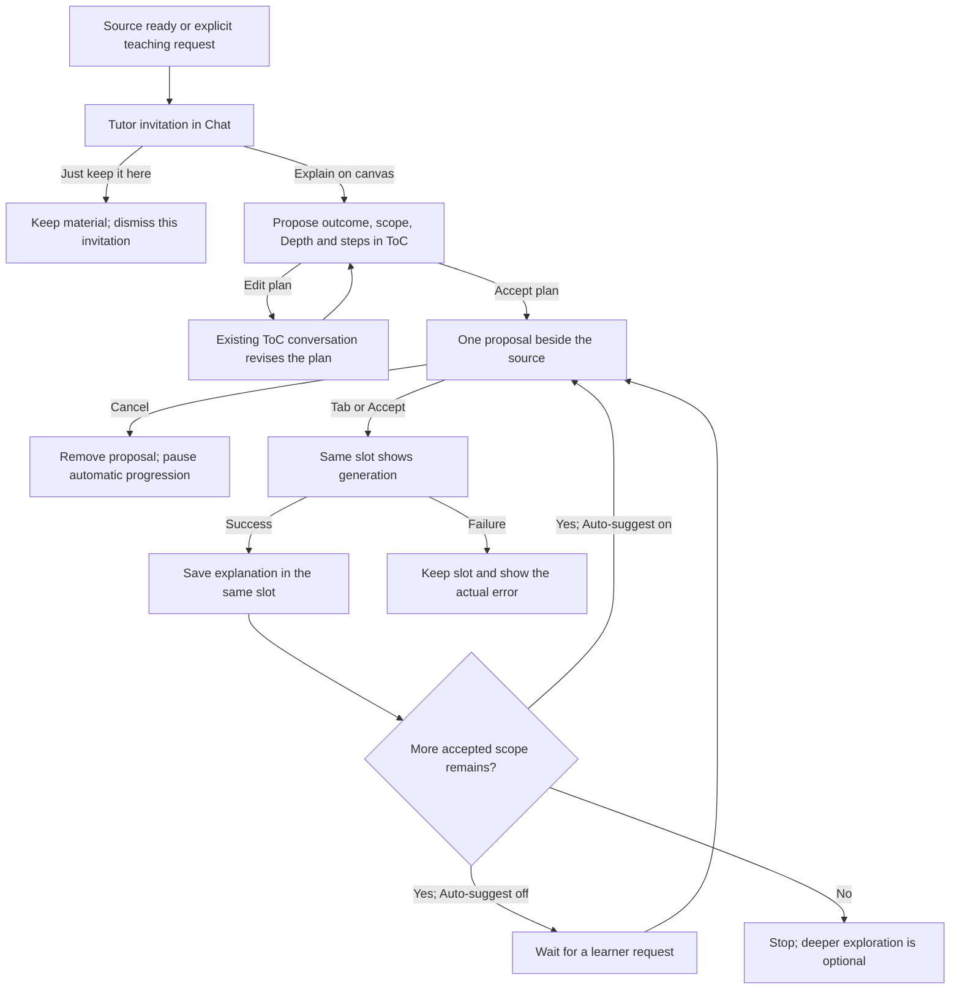

# Explain on Canvas — Tutor product roadmap

**Rabbit Hole · Version 1.4 · 6 November 2026 · WHAT we are building**

**Companion:** [Tutor implementation checklist v1.1](tutor-implementation-checklist.md) describes HOW: current files and functions, changes, interfaces, owners, local commands, test assertions and delivery evidence. Read both before implementing. This roadmap defines the learner experience and release boundaries; the checklist must implement that experience without inventing another UI or approval flow.

**Code baseline:** `Rabbit-Hole-App/Rabbit-Hole` main at `72d6536657af269bb894511220975fd2254246ed`, including the ordinary-author changes through `fe2bf0f` and the new canvas-slot commits. Code presence, configured activation, deployment and functional acceptance are different facts. This document records them separately. It does not claim the new requirements below are already implemented.

**This revision supersedes v1.3 for active work.** Its key corrections are full-document context for ordinary Markdown explanations, one content-authoring call, removal of the per-card citation-review publication gate for that path, one unified ToC, and a persistent canvas slot from proposal through delivery. Preserve the remaining R1–R16 scope. The historical cleanup v0.1 file is not the current cleanup execution plan.

**Delivery scope:** Markdown specifications only. HTML mockups will be produced later in a separate UI folder. No new mockup, demo route, UI framework, application implementation or production deployment is commissioned by this document update.

## Contents

- [1 Product outcome and operating boundaries](#1-product-outcome-and-operating-boundaries)
- [2 Current implementation and the immediate correction](#2-current-implementation-and-the-immediate-correction)
- [3 The complete learner flow](#3-the-complete-learner-flow)
- [4 Chat, Table of Contents and Progress](#4-chat-table-of-contents-and-progress)
- [5 Context, scope and source references](#5-context-scope-and-source-references)
- [6 Proposal, generation and delivery lifecycle](#6-proposal-generation-and-delivery-lifecycle)
- [7 Canvas placement and source navigation](#7-canvas-placement-and-source-navigation)
- [8 Pacing, feedback and practice](#8-pacing-feedback-and-practice)
- [9 Formats and Tutor capabilities](#9-formats-and-tutor-capabilities)
- [10 Uncertainty, research, safety and privacy](#10-uncertainty-research-safety-and-privacy)
- [11 Credits, persistence and failure recovery](#11-credits-persistence-and-failure-recovery)
- [12 Release ladder and cleanup dependencies](#12-release-ladder-and-cleanup-dependencies)
- [13 Verification and production delivery](#13-verification-and-production-delivery)
- [14 Decisions, superseded rules and traceability](#14-decisions-superseded-rules-and-traceability)
- [15 Actions and expected results](#15-actions-and-expected-results)

## 1 Product outcome and operating boundaries

### 1.1 What the learner receives

The learner drops a document onto a canvas. Rabbit Hole understands the supported source, offers to explain it, agrees a finite learning outcome and roadmap, and adds useful explanations progressively to that canvas. The learner accepts one proposed teaching step at a time. Main explanations live on the canvas; clarifications and changes happen in the existing right-side conversations.

The experience must feel continuous: a visible proposal becomes a generating skeleton and then the explanation in the same location. The learner must not watch a placeholder vanish, search for its result elsewhere, or repeatedly tell the Tutor to continue when Auto-suggest is on.

The initial reliable slice is an owned desktop canvas, one readable Markdown source, a chosen scope, and ordinary explanation/table cards. The complete slice includes the first **and second** accepted cards, persistence, navigation, one next proposal, stopping, cancellation and correct charging. A working first card alone is not complete acceptance.

### 1.2 What a roadmap is

A roadmap is the agreed learning outcome, scope, ordered steps and stopping point for the current canvas. It is server-owned state presented through the existing Table of Contents. It is not a new course, journey, syllabus, separate lesson screen or second contents panel.

A step is one coherent teaching addition. A skill is a concept or ability tracked by evidence; it is not a compulsory additional UI or a personal goal the learner must create. The outcome names something the learner should be able to do. Delivered steps show coverage; understanding requires a separate self-report or assessment.

### 1.3 Sprint boundaries

- Prioritize the ordinary Markdown core and its actual learner flow before optional formats or cleanup database removal.
- Reuse the current app, components, state, command handlers and placement helpers. Do not reintroduce the retired browser Tutor planner.
- Record nonblocking defects in `docs/features/explain-on-canvas/OWNER-INBOX.md` with the affected action and next task. Do not turn them into extra release gates.
- Use the owner's direct-to-main/production MVP delivery direction, focused checks, production smoke and recovery. Do not require an isolated clone, dev clone, stable preview or broad-CI wait for this sprint. Any incompatible release-tool precondition must be addressed explicitly as described in the checklist; never fabricate a preview receipt or mark a bypassed check passed.
- Existing production authorization and approved budgets remain in force within their scope. An unknown or exhausted budget is not new spending authority; production database deletion and new infrastructure retain their specific approvals.
- Desktop first. Phone layout, a new reward system, cross-user reuse, arbitrary code execution and Animation-engine changes are not part of the core correction.

## 2 Current implementation and the immediate correction

### 2.1 Evidence at the pinned main

| Area | What is present or observed | What must not be inferred |
|---|---|---|
| R1 feedback, R2 settings, R3 source references | Implementations and focused tests are on main; earlier releases were reported deployed. | This review did not re-run every authenticated UI flow. |
| R4 core and R6 Auto-suggest | Roadmap modules are on main; the production app config sets `ROADMAP_ENABLED` and `ROADMAP_AUTO_ENABLED` to true. The earlier reviewed production workflow succeeded; this audit has not established the served status of the newest source commits. | Config and workflow success do not establish complete learner acceptance. |
| Owner's real Markdown attempt | The owner reports the first card generated, but the second was withheld with a source-matching message. | No passing two-card end-to-end verdict exists from that report. The exact failed claim requires the private stored result. |
| Current author context | `a1e4094` now sends the full fitting document plus title/goal/claims/outcome, using `roadmap-card-3` and trusted `repairs:0`. | Narrow-scope planning still slices its input; accepted-plan binding, original instruction and actual request/allowance reconciliation still need targeted verification. The writer never inherits planner memory implicitly. |
| Current publication | The ordinary path now disables the per-card support checker and records grounding `not_run`, while retaining schema, source revision and safety checks. | This is already implemented source, not proof of complete production acceptance. Remaining automatic author retry policy needs reconciliation. Current safety coverage must be reported accurately; expanded source screening is a separately evaluated follow-up, not a new gate for this fix. |
| Current two-card test | `roadmap-document-context.test.js` now generates, saves and acknowledges first and second cards through real server seams with external doubles. | This audit did not run it. Its model/budget fixture differs from production, and it does not prove the real canvas skeleton/ToC UI. |
| Current proposal/ToC UI | Main now has world-positioned Tutor SlotCards, same-slot insertion wiring, a16px spinner, a28px/4px action group and focused tests. The separate roadmap region above ToC remains. | Pending geometry is still memory-only; exact final saved position/reload, slot-based navigation and visual details need completion/proof. The unified ToC is not implemented. |
| R5 proposal editing/reuse | Draft, edit and link backend code and migration 0041 exist. The production edit flag is absent. Some UI/drag/Add-to-Chat work remains. | The full R5 experience is not enabled or accepted merely because the branch was merged. |
| R7a long Markdown | Index/summary/retrieval code, migration 0042 and a bounded whole-document planning loop exist. The production long-source flag is absent. | Long Markdown is not automatically qualified or live. PDF whole-document planning is a separate R7b capability. |
| Cleanup | P1–P5 changes/receipts are present. Archive-sensitive joins remain; P6 backfill/join removal/drop and P7 closeout are not established complete. | Do not reuse cleanup v0.1's old migration number or wait for table deletion before fixing the Tutor core. |
| R8–R16 | The ladder retains these capabilities; some branch work was reported earlier. | Treat branch work as material to reconcile, not proof of integration, activation or acceptance. |

### 2.2 The next production outcome

The next core correction must deliver the following as one usable flow:

1. Plan and author against the same supported, authorized source revision; a small highlight anchor does not cut down the author's knowledge.
2. Generate an ordinary explanation/table with one authoring call. No per-card LLM citation review, escalation or automatic content-repair loop blocks this flow.
3. Retain schema/renderability, source-access/revision, safety, acceptance, billing and delivery checks. An omitted grounding review is recorded as not run under this policy, never falsely as a passed review.
4. Display roadmap steps in the existing ToC heading hierarchy, with descriptions and navigation; remove the competing half-height roadmap list.
5. Complete the newly landed private canvas slot so it stays visible through proposed, accepting, generating, saving, delivered and failed states, including reload and exact saved placement.
6. Generate and save two consecutive accepted cards, reload them, and show exactly one next proposal after delivery when Auto-suggest permits it.

These are corrections to R3/R4/R6 and their integration, not a new ladder rung that postpones them. The checklist's `CORE.*` and `UI.*` tasks make these changes concrete. Later optional tools must not block this acceptance.

## 3 The complete learner flow

### 3.1 Flow overview

The diagram describes learner-visible transitions. It does not authorize all cards when the plan is accepted, imply that a generated card is already saved, or treat reaching the end as proof of understanding.

### 3.2 Source import and the invitation

- Import the Markdown as the ordinary source card. Do not automatically expand Full Content, reposition the source, or replace it with generated content.
- Once a supported source is readable and Chat is idle, the Tutor initiates a message in the existing right-side Chat. Summarize the source's subject using what was actually read.
- Offer exactly **Explain on canvas** and **Just keep it here**. Free typing remains available. Do not reintroduce Guide me step by step or Help with a specific part as extra invitation choices.
- The invitation belongs to a Tutor-initiated conversation entry. Do not overlay a conversation box in the middle of the canvas or create an unrelated floating chat surface.
- Do not interrupt typing, an active answer, a modal or a current proposal. Coalesce sources that become ready together; never fire an invitation for every import-processing update.
- Just keep it here dismisses that invitation only. It does not delete the source or globally disable future suggestions.
- Ask mode does not initiate an invitation. Auto and Tutor can, subject to Auto-suggest and current interaction state. Explicit learner requests remain available when Auto-suggest is off.

### 3.3 Scope and the proposed outcome

Before ordinary card authoring, propose what the learner should be able to do, the chosen scope, Depth, a finite step sequence and a stopping point. The learner may accept or revise it through the existing ToC conversation.

For a long visible source card, distinguish **whole document** from **the selected/visible section**. This chooses what to explain. It does not choose which pixels the server can read, and it does not make the source card's collapsed preview the entire document. Capture a selected/visible section as a stable source range/version at selection time; later scrolling does not silently change it.

The learner may choose Full Content for viewing. That is a presentation choice, independent of the Tutor's authorized document context. Full Content is not a prerequisite for authoring or for placing a proposal.

Use the learner's explicit instruction over a guessed topic. “I know decision trees; explain random forests” must produce a forest-focused plan and skip redundant introductory material. Use the same principle for every subject, not a decision-tree-specific prompt or hard-coded lesson.

### 3.4 Plan acceptance and the first proposal

- Show the proposed plan in the ToC, including each step's title, short description, type and state.
- Accept plan commits this plan version and presents the first pending proposal. It does not charge for or generate every future step.
- When acceptance is initiated from a button and keyboard ownership is available, activate the first proposal so the next plain Tab can accept it. Do not steal focus from a learner who starts typing while the plan response is arriving.
- Edit plan focuses the existing ToC composer; the learner describes the change, a revised draft appears, and acceptance is required again for the revised plan.
- End roadmap preserves source material, delivered cards and evidence. It stops new unsolicited work.

### 3.5 Step acceptance, generation and saving

The learner sees one pending proposal next to the source, with title, description and format. Its Accept [Tab] | Cancel pill sits outside and below the frame. Click and Tab use one acceptance action with the same version and idempotency rules.

After acceptance, that visual slot becomes the committed skeleton. Keep its frame, position, width and useful title while the content generates. Show a spinner; show a percentage only if the backend supplies real progress. Do not remove the skeleton while waiting for a response, checking applicable safety, saving the board or acknowledging delivery.

When the result is ready, replace the placeholder content in the same slot with the real explanation. Preserve the top-left canvas anchor and width. Grow downward when final content needs more height. Do not place a second result at the current camera center or pan to it automatically.

Persist the actual board content before acknowledging delivery. A reload or lost acknowledgement restores the same result and slot without another author call or charge. A generation/transport/safety failure remains visible in the same slot with the actual failure class and the applicable billing outcome; it is not an invisible disappearance.

### 3.6 The next step and the stopping point

After the current accepted step is delivered and saved, reveal at most one next proposal when Auto-suggest is on and the roadmap has remaining scope. Prepare proposal metadata early where useful, but do not expose it while the current card is unfinished.

While a roadmap is active, suppress independent Next Steps hooks; restore ordinary hooks when no roadmap is active. This prevents two suggestion systems from competing for the next addition.

Keep the next proposal quiet: no repeated Chat prompt, automatic camera movement or stack of multiple offers. If it is outside the viewport, show the compact Next step ready control; clicking it navigates to the existing proposal and does not accept it.

When Auto-suggest is off, the learner can request the next step in Chat or use the existing ToC Propose next step action. Cancelling a proposal pauses automatic progression and marks that step cancelled; a later manual next request moves to the next independent step, not an automatic recreation of the cancelled offer. Resolve a real prerequisite dependency explicitly.

At the accepted stopping point or ceiling, stop. Deeper exploration requires an explicit request and, when scope changes materially, an accepted revision. Do not turn the finite explanation into an automatic hour-long course.

## 4 Chat, Table of Contents and Progress

### 4.1 Responsibilities of each surface

| Surface | Its job | It must not become |
|---|---|---|
| Canvas | Source material, pending proposals, generating skeletons, explanations, practice and their spatial/source relationships. | A second chat window or a collection of invisible generating jobs. |
| Main Chat | Tutor invitation, learner questions, clarification, explicit next requests, explanations of genuine failures and ordinary Chat/slash use. | A replacement for the canvas explanation or a stream of repeated step prompts. |
| Table of Contents | One navigable heading/step hierarchy, learning settings, delivery/coverage states and the existing ToC conversation. | A roadmap list plus a second empty contents region, or a mastery scoreboard. |
| Progress | Private self-reported and assessed learning evidence, including canvas-scoped evidence without a personal goal. | A second roadmap editor or a count that equates acceptance/delivery with understanding. |

### 4.2 One unified ToC

Use the existing H1/H2/H3 heading presentation, hierarchy, numbering, indentation, expand/collapse behavior and navigation. Roadmap steps appear as entries in this same tree, each with a description. Preserve ordinary manually authored headings. Typed roadmap identity and status are metadata on the corresponding entries, not an excuse to create another list.

There is one scrolling content area for learning parameters, steps and stopping-point actions, beneath the current panel header. The existing ToC conversation/composer remains at its established bottom location. Do not split the panel in half, impose a second 50vh roadmap scroller, or leave an empty second ToC below it.

Group outcome/scope, Depth and explanation/practice mode into the learning-parameters area with a separator before entries. Depth in the ToC is a direct three-position slider; it is not a button opening another slider. Edit plan opens/focuses the existing ToC composer rather than editing a second outcome textbox.

Selecting a step navigates to its pending slot or delivered content. A planned step with no content remains selected in the ToC without pretending an artifact exists. A removed card keeps a delivered-history entry with a removed marker. A delivered step does not set an understanding checkmark.

### 4.3 Existing panel and composer controls

- Preserve the right-panel tabs, including Chat, Find, Table of Contents, Comments and Progress and any applicable Project companion tabs. Progress remains a tab in the same right panel for now; do not add a companion column.
- Preserve the existing upload/context `+`, mode selector, slash slot, microphone and Send controls.
- Keep **Auto**, **Ask** and **Tutor**. Rebuild Tutor behavior; do not remove the three modes as part of cleanup.
- Add/use the existing Depth control and the small **Auto-suggest** toggle in the composer. Do not rename the toggle Suggest next. Reuse the current control/component and icon system rather than selecting unrelated new icon designs.
- Depth is per learner/canvas and governs supported ordinary answers and generated formats. Auto-suggest is remembered per learner. Composer and ToC read the same values; do not create separate settings that drift.
- Hide unsolicited-Tutor controls in Ask; explicit ordinary answers keep working. Switching to Ask pauses unsolicited proposals and speculative work. Already accepted generation may complete and persist.

Ask answers in Chat and does not start a roadmap, even for a teaching request. Switching to Ask pauses new Tutor initiative; it does not erase the plan or cancel an already accepted entitlement.

### 4.4 Depth, size and learning assumptions

Overview, Standard and Deep change explanatory detail and suitable step count. Current default ceilings are 5, 10 and 15 steps respectively. These are maximums, not target counts or an assertion that every source needs that many steps. Use fewer when the learner's outcome needs fewer; avoid repeated introductions to known material.

A teaching step must remain a coherent addition, not a whole textbook hidden inside one accepted item. The current ordinary path produces one explanation/table. The future maximum of three independent elements per step remains a ceiling when combined formats ship. Adapt amount to context and learner evidence; never make a fixed two-explanations/one-practice pattern the lesson structure.

Initial learner assumptions belong in the proposed plan. If the source, title or learner instruction does not establish a necessary starting point, ask one focused question. Do not infer mastery from a job title, a cancelled card or a Tab press.

## 5 Context, scope and source references

### 5.1 Three independent concepts

| Concept | Meaning | What controls it |
|---|---|---|
| Teaching scope | The topic/sections the learner wants this roadmap or step to explain. | Accepted plan and explicit learner revisions. |
| Authoring context | Authorized source material and accepted brief available to the content-authoring call. | Pinned source revision, supported context budget and task context. |
| Source anchor | The paragraph, code range, figure or page to highlight and navigate to. | Source reference metadata. |

An anchor is not the entire knowledge available to the writer. A visible/selected-section teaching scope may still use definitions elsewhere in the same authorized document. A viewport crop is not a backend extraction boundary. Position on the canvas is independent of all three.

### 5.2 Ordinary bounded Markdown contract

For a readable Markdown document within the supported whole-source limit, planning and each ordinary card's authoring request receive the same full pinned document. The current baseline limit is 40,000 characters; implementation must also respect the actual model request/token budget. Reuse the authenticated source reader; never trust a browser-provided full document as proof of access.

Language follows the learner's explicit request, then the language of their question, then the source language for source-only entry. Ask one focused clarification if mixed-language ambiguity materially changes the intended explanation.

The author also receives the accepted outcome, selected teaching scope, current step title/description/goal, planned points to cover, Depth, language and learner instruction. Relevant delivered-step coverage can prevent repetition. These are separate fields; do not concatenate only a title and goal and assume the model remembers earlier planning calls.

The generator explains the current step, not every section merely because the full source is available. It may paraphrase, connect definitions and use clearly identified illustrative examples. It must not fabricate source quotations, external citations or claims that code was executed. When the source is incomplete or contradictory, use the uncertainty behavior in section 10.

### 5.3 One authoring call, with truthful publication checks

For fresh generation on this ordinary Markdown explanation/table path, acceptance permits one content-authoring call. Accepting a valid prepared result or linking an existing card starts zero new author calls; R11's prepared-result billing remains separate. Do not add an LLM citation judge, escalation, repair-author loop or automatic content regeneration between that call and publication. The planner and existing safety classifier are separate operations; “one authoring call” does not falsely claim that the whole Tutor uses only one model request.

Keep authorization, source-version binding, output schema/renderability, existing safety policy, payment and persistence checks. An invalid output or genuine unavailable/safety/access condition still needs a truthful failure path. This contract is not a promise that every provider call succeeds or every model assertion is infallible.

Ordinary paraphrasing, an illustrative question or a source anchor that covers less text than the full document must not be rejected by the removed exact-quotation gate. Grounding-review metadata for this path says **not run under the ordinary Markdown policy**. Do not relabel an unperformed review as passed or restore it later through proposal editing, linked content or speculative preparation.

Other capabilities keep their applicable rules: quiz-key/assessment validity, fetched-source provenance, calculator execution evidence, code/rendering validity and rich-media safety. This narrow change does not disable existing standalone command validators or safety across Rabbit Hole.

### 5.4 Sources that exceed the supported context

Do not promise that every document fits a single prompt. R7a provides a versioned whole-document outline, bounded summaries and retrieval of original sections for long Markdown. Summaries guide selection; the author receives a sufficient supporting context bundle, separate from the highlight anchor, with explicit coverage and omissions. R7b adds PDF pages; R13 code snapshots; R15 notes, images and OCR.

The first bounded-source correction does not require rebuilding R7 or a vector database. If the source is beyond the enabled capability, report the actual limit and ask for a supported teaching scope. Do not silently use the beginning of a long file, infer that an unread section is absent, or activate an unqualified adapter just to hide a limitation.

### 5.5 Version changes, missing sources and competing material

Bind a plan and its accepted card to an immutable source revision. A changed source does not silently alter an in-flight purchase or reuse a stale prepared result. Preserve previously delivered cards with their historical references; mark changed/missing anchors honestly.

The arrival of another source does not automatically start a competing roadmap. Keep one unfinished roadmap per learner/canvas. Invite or clarify when appropriate, and include additional material through a revised plan accepted by the learner. When sources compete, disagree materially or are incomplete, ask a focused clarification rather than inventing a synthesis.

## 6 Proposal, generation and delivery lifecycle

### 6.1 Logical state and visual continuity

A pending **proposal** is an offer. Acceptance creates a committed generation **skeleton**. The records may have different IDs, but the learner sees one continuous private canvas slot with a stable mapping to the proposal version and eventual server-minted card ID. Reuse existing skeleton visuals and card renderers.

| State | What stays visible | Controls and transition |
|---|---|---|
| Proposed | Frame, title, description, format and source relationship at a stored canvas position. | Attached Accept [Tab] / Cancel; existing Quick Edit/Add to Chat affordances where supported. |
| Accepting | Same slot and useful text; immediate acknowledgement. | Disable duplicate purchase actions while the server decides. |
| Generating | Same frame/anchor/width with a spinner in the content area. | Decision controls become a noninteractive Generating status; no disappearance. |
| Saving/acknowledging | The actual rendered content replaces the placeholder when ready; retain the same slot while persistence finishes. | Do not show the next offer until saved delivery is acknowledged. |
| Delivered | The real card at the same top-left/width, with ordinary card controls, source navigation and feedback. | Pending action pill is gone; generation is not restarted on reload. |
| Failed/held for an applicable check | Same frame with an actionable, accurate error and known billing outcome. | Existing application toast and authorized recovery; never an endless spinner or silent deletion. |
| Cancelled before acceptance | Remove that unaccepted visual offer; keep its private cancellation/history. | No author call or learner debit; automatic progression pauses. |

The promise that the skeleton does not disappear applies through acceptance, generation and delivery. Explicit pre-acceptance Cancel removes an offer. Deliberate learner deletion follows ordinary canvas behavior. Neither exception authorizes a network transition to remove the slot.

### 6.2 Keyboard and concurrent actions

Plain Tab accepts exactly the active pending proposal when the canvas/proposal owns keyboard input. Shift+Tab, text fields, contenteditable areas, code editors, inline Quick Edit, open modals and IME composition keep their normal handling. A hover over a card alone must not authorize spending.

Click and Tab share the same server action key/version. Double click, key repeat, two tabs and stale responses cannot create a second purchase or card. The first valid Accept/Cancel/Apply action on a proposal version wins. A conflicting action receives current state; it does not overwrite a delivered result.

Ctrl/Cmd+K edits a proposal through the existing inline editor. Apply changes the proposal version; it is not acceptance or generation. Esc discards only the edit draft. Do not introduce a separate always-visible Edit button beside the proposal's attached pill.

### 6.3 Progress and errors

Use a spinner for unknown-duration generation. A progress bar or percentage requires real backend progress; no simulated countdown. Show current operational state with short copy, keeping the title and frame stable.

A source-loading/access failure, insufficient credits, invalid output, provider failure, safety uncertainty and a save failure are distinct conditions. Surface the actual condition. Do not call a citation mismatch a safety refusal, and do not show the old source-matching message for ordinary cards whose citation gate is no longer run.

Generation succeeded but save acknowledgement was lost is a delivery-reconciliation case. Load or insert the same authorized card ID and complete saving. It is not a new authoring attempt. A refunded failure cannot later be silently charged or delivered as if its old authorization remained settled.

## 7 Canvas placement and source navigation

### 7.1 Adjacent, stable and collision-aware placement

Place the proposal beside the dropped source using the source card's canvas bounds and existing free-space logic. The first ordinary proposal prefers adjacent free space; later additions may extend outward on any side when that avoids overlap. Do not force every explanation to one side or lay the whole roadmap across the canvas before acceptance.

For a collapsed/truncated Markdown card, use the visible card's canvas bounds. Do not require a precise on-screen paragraph location or Full Content expansion. For a full-content source, a resolved passage can help choose the initial vertical alignment, but initial placement must not fail when the passage is offscreen.

Once shown, retain the slot's world coordinates. The immediate implementation must preserve pending/accepted geometry across same-browser reload using private state; cross-device pending geometry synchronization may follow separately. Server work/entitlement and saved delivered-card geometry remain canonical across devices, and a second client must never create a duplicate card or purchase. Scrolling inside the Markdown does not move it. Canvas pan/zoom moves source and proposal together normally; the proposal is not pinned to screen coordinates. Preserve a learner's deliberate drag and use that position for delivery. Do not recompute at the camera center when a response arrives.

The checklist specifies the exact spacing, widths, pill position, colors, states and renderer reuse. Those values must be implemented consistently; agents do not choose a new style while wiring the feature.

### 7.2 Highlights and two-way navigation

Keep the stable source anchor even when its text is not currently visible. Card-to-source navigation scrolls the source's own viewer to the correct passage and highlights it. As the learner manually scrolls the source, the anchored passage and its subtle View explanation affordance can become visible.

Use the existing neutral source-reference presentation and hover affordances. Highlighting is temporary/interaction-driven, not a permanent rainbow over every section. A selected explanation may show its associated passage. A changed or ambiguous source reference reports that state; it never jumps to a guessed match.

Connectors/arrows are optional and selective: use them when the relationship is otherwise unclear, not on every source/explanation pair. Placement, highlight visibility and connector visibility cannot block backend generation.

### 7.3 Multiple elements and navigation controls

A future combined step may deliver a few independent cards linked by a private step identity. Do not automatically turn them into a new canvas group or insert a large labelled step frame. Each element has its own stable slot/card ID and per-card feedback. Keep the shared relationship available to ToC navigation.

The Next step ready indicator appears only when a current pending proposal is outside the viewport. It reveals that proposal; it never purchases it. Keep the existing manual Propose next step action for when no offer exists, without adding another set of repeated suggestion buttons.

## 8 Pacing, feedback and practice

### 8.1 Signals have different meanings

| Learner action or evidence | Meaning | It does not establish |
|---|---|---|
| Accept / Tab | Wants this addition and authorizes its applicable charge. | Understanding or successful practice. |
| Cancel | Declines this proposal at this time. | A prerequisite gap, dislike of a format, mastery or failure. |
| Thumbs up/down | Private per-card self-report of understanding/helpfulness in the agreed learning sense. | An objective assessment score. |
| Answered practice | Evidence about the shown, version-bound task under its assessor. | General mastery of every related topic. |
| Unanswered practice | Accepted content the learner may answer later. | Failure or refusal to learn. |
| Delivered card | Content is saved and available. | The learner read or understood it. |

Show one thumbs pair under each generated card. Both selected states are blue. Keep the agreed hover-only visual treatment and existing keyboard access; selection alone must not pin the controls onscreen. Imported source cards and pending offers do not receive understanding feedback. Feedback is private and must survive reload without entering shared board JSON.

### 8.2 Explanations only or explanations with practice

The plan settings offer Explanations only now, and Explanations plus practice when R9 is implemented and enabled. Do not show a selectable mode that cannot produce and assess its supported practice.

Use practice where it helps the current learning outcome: a short retrieval check, application, explain-back or optional flashcard can reinforce a difficult idea. Timing considers the source, complexity, recent formats, learner instruction, thumbs and actual assessment evidence. There is no hard-coded two-to-one cadence, compulsory homework sequence or repeated quiz after every card.

If the learner answers immediately, use that evidence to choose or revise the next unaccepted step. If the learner answers later, continue with context and the existing plan where dependencies permit it. Do not freeze all explanations while a quiz is unanswered or replace an accepted/generating card because a delayed answer arrived.

### 8.3 Assessment and private Progress

Reuse the retained Explain-back rubric assessor for open responses. Multiple-choice grading uses the exact question/options/key snapshot shown, with an immutable activity identity and integer revision. A stale answer is graded against its valid snapshot or rejected with the changed question; never silently rebound to a new key. Assessment remains free to the learner.

Track learning without requiring a personal goal. Use an internal evidence container compatible with the existing stores; the learner should not have to understand hidden goals, claims or database sections. Progress separates self-reports from assessed evidence, with source/card navigation where available. Preserve deliberate personal goals alongside canvas evidence.

If evidence suggests a prerequisite gap, adapt an unaccepted step on the same canvas or ask one focused question. Do not infer the gap from Cancel alone. A Rabbit Hole opens only when the learner chooses it; preserve ordinary manual Rabbit Hole behavior and a return point.

### 8.4 Revision and nonredundancy

The full revision capability in R10 makes scope, Depth, outcome or explanation/practice-mode changes after plan acceptance produce a revised plan for acceptance. Until that capability is implemented, keep accepted-roadmap parameters read-only, preserve frozen accepted inputs and offer only supported draft-plan edits; do not silently mutate the active roadmap or show a control that cannot complete its action. Ordinary Chat preferences may change for Chat/future plans without rewriting that accepted roadmap. Switching the Chat selector between Auto, Ask and Tutor changes initiative eligibility, not the accepted learning outcome by itself. Keep delivered content and history. Preserve the original learner instruction and later explicit revisions; the latest relevant instruction wins without erasing what was already taught.

Learner-created slash-command or Quick Edit cards remain outside the roadmap unless explicitly linked. They can still contribute private feedback/evidence. Linking a suitable existing card as the next step is a zero-generation-charge action, not a claim that new content was authored.

Different version affects unaccepted work and requires new acceptance for a new purchase. It does not destroy earlier delivered cards/assets. All added prerequisites and continued steps respect the accepted ceiling and stopping point until the learner accepts an expanded scope.

## 9. Formats and Tutor capabilities

### 9.1 The Tutor chooses a format for the learning need

Choose from capabilities actually enabled for this source, account and environment. Consider the accepted outcome, source, learner instruction, Depth, relevant evidence, previous formats and what already exists on the canvas. Do not map a topic mechanically to a modality: video can explain an idea, not only change over time; text can explain a process. Avoid repetition without alternating formats for its own sake.

One step may combine a few complementary elements when that explains one coherent idea. Start with one. The provisional ceiling is three independent cards per step, not three cards required. Before accepting, the learner sees the proposed title, description and format combination. Plan acceptance does not authorize those cards; the specific step acceptance does. Expand formats incrementally; unavailable tools never become promises in the plan.

### 9.2 Complete retained command catalogue

This is the intended Tutor catalogue, checked against the application's command registry. It is **not** a claim that all commands are wired into the roadmap. The current ordinary roadmap adapter supports explanation text and tables; later rungs add the rest. `/goal` remains learner-operated and is excluded from Tutor generation.

| Command | Category | Format/action and constraint | First Tutor integration |
| --- | --- | --- | --- |
| `/explain` | Explanation | Text or comparison table; interactive explanation uses its existing engine later. | R4; interactive R12.09 |
| `/practice` | Practice | Explain-back and supported multiple-choice practice; grade with the retained assessment path. | R9 |
| `/quiz` | Practice | A question, choices and feedback bound to the immutable question actually shown. | R9 |
| `/flashcards` | Practice | Question/answer recall cards. Reveal or self-rating alone is not assessed mastery. | R9 |
| `/code` | Either | Python example or learner exercise as a snippet. Do not claim execution without an execution receipt. | R12.02 |
| `/graph` | Explanation | Interactive function graph or data plot using the actual supported primitive. | R12.03 |
| `/diagram` | Explanation | Node/arrow or Mermaid diagram, with renderability validation. | R12.04 |
| `/notebook` | Either | Empty notebook initially. Prepared code or exercises are a later extension; no automatic code execution. | R12.05 |
| `/image` | Explanation | Generated image. Acceptance precedes expensive generation. | R12.06 |
| `/motion` | Explanation | Animated explainer video using the existing Motion engine. | R12.07 |
| `/whiteboard` | Explanation | Narrated whiteboard video, internal `whiteboard-video`; this is the returned capability, not the earlier removed drawing tool. | R12.08 |
| `/cad` | Explanation | Dimensioned CAD model using the existing engine and checks. | R12.10 |
| `/animation` | Explanation | Live interactive 3D scene, through its existing engine. Animation internals are outside this Tutor sprint. | R12.11 |
| `/3d` | Explanation | Technical 3D scene built through Blender. | R12.12 |
| `/browser` | Explanation | Saved webpage card with authorized fetched content and provenance. | R12.13 |
| `/photos` | Explanation | Photo search and a credited photo, not generated-image authorization. | R12.14 |
| `/youtube` | Explanation | Find and add an existing YouTube video; do not claim an unwatched video supports a statement. | R12.15 |
| `/arxiv` | Explanation | Find and add a research paper, distinguishing metadata from inspected content. | R12.16 |
| `/wikipedia` | Explanation | Find and add a Wikipedia article with source identity. | R12.17 |

The catalogue governs planning eligibility as well as rendering. A future adapter is not enabled merely because its standalone slash command works. Typed commands and Tutor-selected steps can reuse the same engine while keeping their distinct authorization and lifecycle.

### 9.3 Tools are capabilities, not a new visible toolbar

Tutor tools read authorized source content, inspect current canvas coverage, read relevant private learning evidence, search/fetch when needed, calculate, and later inspect images or execute in a sandbox. They do not add a new learner-facing tools panel.

| Capability | Why the Tutor needs it | Delivery boundary |
| --- | --- | --- |
| Authorized canvas/source reader | Understand the document and existing content without making the learner paste it again. | Core; larger sources in R7. |
| Outline, section retrieval and coverage | Work honestly with documents beyond the bounded full-context path. | R7a/R7b. |
| Private evidence reader | Adapt from relevant practice and self-reports without requiring a personal goal. | R9/R10. |
| Exa discovery plus guarded evidence fetch | Research a real knowledge gap or a requested current fact. | R8a; use existing Exa/fetch infrastructure. |
| Restricted calculator | Produce reproducible numerical results from a bounded expression. | R8b; before arbitrary execution. |
| Source navigation/highlight | Show which portion a card relates to and navigate in either direction. | R3/core correction; no context clipping. |
| Figure/image/OCR reader | Understand a diagram, screenshot or scan with uncertainty/coverage reported. | R15. |
| Sandboxed execution | Run authorized examples or exercises and report actual output. | R16; no invented execution before it. |
| Existing command adapters | Create the accepted format through its existing lifecycle. | R12, one adapter or small coherent batch at a time. |

## 10. Uncertainty, research, safety and privacy

### 10.1 Unfamiliar or incomplete source material

Lack of model prior knowledge is not a reason to fabricate. Read the supplied material as evidence, preserve its terminology, and distinguish what it states from an illustrative explanation or inference. A clear document can be explained even if its subject is unfamiliar to the model. Conflicting sources, missing premises, unreadable content or ambiguous intent require one focused clarification when they materially change the answer.

If an external fact is needed, use an enabled research tool within its scope and budget. If research is disabled, inconclusive or inappropriate, say what is missing or unknown. Never silently fill gaps, claim the whole document was read when only selected evidence was available, or treat an index summary as the original evidence. Do not impose a per-card quotation examiner on ordinary bounded Markdown explanations to implement this honesty requirement.

### 10.2 Research and calculation

Research queries contain the minimum authorized information. Do not send private source text, secrets, learner evidence or private repository contents to search by default. Reuse guarded URL fetching: reject forbidden destinations, recheck redirects, apply byte/time limits, and treat fetched text as untrusted data. A search hit is discovery, not proof that its page was inspected. Record source identity, fetched coverage, time and supporting passage where available.

Research should answer the identified gap, not start an unlimited browsing loop or rewrite the agreed outcome. Distinguish sourced facts, model explanation, inference, uncertainty and computed results. Preserve citations on the final relevant content; do not manufacture quotations or references.

The restricted calculator accepts a validated expression and bounded inputs. It does not evaluate arbitrary JavaScript, Python, shell, network or filesystem operations. A computed result includes expression/inputs, method/version and output so it can be reproduced. Arbitrary execution is a separate later capability with separate isolation and authorization.

### 10.3 Contextual safety with deterministic enforcement

Retain the existing safety boundary before publication and before expensive preparation where applicable. Classifiers supply evidence; code enforces the allowed actions. A classifier timeout or `unknown` outcome is not permission and is not proof that the learner asked for prohibited content. Preserve bounded resolution, a truthful message and the applicable refund behavior without infinite checking or hidden generation retries.

The policy must consider purpose and context, not just keywords:

| Source/request | Expected handling |
| --- | --- |
| Ordinary education, including medical/anatomical, historical or literary material | Permit appropriate educational explanation; do not refuse solely because sensitive words appear. |
| Medical, legal, financial or other high-stakes interpretation | State uncertainty and source limits, avoid unsupported personalized conclusions, and use appropriate authoritative evidence when available. |
| Sexual content | Distinguish educational context from disallowed sexual generation. Do not sexualize minors or facilitate exploitation. |
| Violence, hate or wrongdoing in a document | Permit necessary analysis; do not transform the material into instructions for harm or endorsement of abuse. |
| Personal distress or self-harm signals | Use the existing supportive safety response and appropriate pause/escalation behavior; do not continue a harmful lesson mechanically. |
| Source text instructing the system to ignore rules, expose secrets or call tools | Treat it as source data, never authority. |
| Private or identifying information | Minimize unnecessary repetition, preserve access controls and do not expose it through research, analytics, sharing or reuse. |
| Classification failure or ambiguous case | Hold the unsafe/unknown publication path, explain the limitation, retain honest operational state and resolve/refund within the existing bound. |

These are capability requirements and the retained policy direction, not a claim that every future modality has been evaluated. The checklist names the current JEV/safety implementation and per-capability tests. The Markdown correction removes a citation gate; it does not remove safety or widen other engines' policies.

### 10.4 Private state and publication

Proposals, drafts, accepted authorizations, evidence, feedback, internal source indices, generation results awaiting checks and learning metadata are private to the acting learner. Delivered authorized cards can follow ordinary canvas sharing. A share/fork must not expose hidden proposals, raw evidence, model logs, unapproved assets or private step relationships. Failed or pending generated assets cannot be retrieved through a guessed GET/asset URL or copied through a fork.

Initially execute the roadmap as the canvas owner. R14 adds editors deliberately: distinguish source/canvas owner, acting learner and payer; revalidate access before source reads, work, delivery and result reads; stop on revoked access. Readers do not receive private Tutor controls or Progress. A fork starts without the original learner's roadmap; retain only source references the new learner can legally access.

### 10.5 Evidence and operational limits

Store enough provenance to explain a failure without logging raw private documents or exposing model reasoning. Record identifiers, versions, coverage, actual checks, typed failure reasons, dispatch counts, cost and timing. Do not request or store hidden chain-of-thought. A concise decision reason and evidence identifiers are sufficient.

Bounds on source size, tool work, steps, output and paid calls must be explicit and measured. A limit should produce an honest supported alternative or clear limitation, not silent truncation. The sprint does not require building every future tool before shipping the corrected core.

## 11. Credits, persistence and failure recovery

### 11.1 What the learner authorizes and pays for

- Invitations, source identification/indexing, roadmap drafts/revisions, proposal metadata and Quick Edit, scoped research, applicable checks and assessment are platform-funded. The ToC planning conversation belongs to this planning work, not an extra hidden ordinary Chat bill.
- An explicit Accept click or eligible Tab authorizes the specific accepted step once. The desktop Tutor UI does not show prices, including Tutor-mode paid command flow. Standalone Auto/Ask behavior retains its existing price policy.
- A plan acceptance, scroll, source highlight, preview, thumbs feedback, navigation or Auto-suggest toggle never purchases a card.
- Check allowance for the whole accepted step atomically. If insufficient, leave the whole proposal pending and use existing credits recovery; do not partially purchase a multi-element step.
- Settle delivered elements and release unused holds. A failed element's learner charge is refunded/released under the existing contract while actual provider expense remains recorded. A refund does not imply the provider call was free.
- Repeat clicks, Tab, reload, concurrent devices, lost responses and job replay cannot create another charge or accepted operation.
- A newly requested different version or explicit retry after a completed failed attempt is a new bounded action under existing recovery semantics. It is not an automatic author retry.

Server identity, not a client amount or model output, determines payer, authorized request, capability and allowance. The actual full-context author request must fit its reserved bound. A price-free UI does not permit an unbounded or mismatched internal purchase.

### 11.2 Preparing one step ahead

R6 makes the next **proposal** ready automatically; it does not imply that a paid card has already been authored. R11 adds speculative preparation separately.

When enabled for an eligible inexpensive format, prepare at most one future step in the background while the learner considers/works through the current step. Do not display its next proposal until the current accepted card is fully generated, validated as required, saved and acknowledged. Maintain only one active offer. The goal is a quick next suggestion, not a chain of unattended paid cards.

The platform pays for preparation the learner has not accepted. If accepted and still matching the plan/source/format/Depth/policy identity, deliver the prepared result and charge the learner once under the accepted-result contract, without recording its provider expense twice. If rejected or made stale, retain the result/metadata as appropriate; reuse eligibility is a later decision. Do not launch expensive media or its paid planning speculatively.

Store result ID, owner/namespace, format, source/version/coverage, plan/step/proposal version, prompt/model/policy identity, creation time, validation and asset references, provider expense and lifecycle. This preserves future reuse options; **cross-user reuse is not enabled**. Retention applies only to unaccepted preparation. Pausing is not expiration, and delivered/accepted assets never enter speculative cleanup.

### 11.3 State and recovery

The server remembers the roadmap and work lifecycle. Client reloads render canonical state; they do not reconstruct authority from sessionStorage. A lost client does not prevent a completed accepted job from being reconciled. Stage alarms, progress on reads and a bounded daily sweep recover unfinished work with idempotent effects.

Generation, validation, board saving and delivery acknowledgement are distinct states. Save the actual card at the existing slot before acknowledging delivery. If the save or acknowledgement fails, retain/recover the same result/card identity without another model call. Do not mark a ToC entry delivered because a provider replied.

Errors use the existing application toast, with its supported Retry action when applicable. Do not add a new global banner, recovery panel or status chip. The existing slot retains its title/position and a short truthful failure state; it does not disappear. Replacement/omission can be requested through the existing Chat/ToC conversation and authorized server actions rather than a new row of suggestions. Do not automatically regenerate to hide a failure.

Pause/Ask/Auto-suggest off stops new initiative and eligible speculative work, not already accepted entitlement. End roadmap stops new proposals and retains delivered cards/history. Deleting a delivered card leaves the ToC delivery record with a removed-content indication; it does not claim the learner forgot or automatically refund a valid generation.

## 12. Release ladder and cleanup dependencies

### 12.1 Ship the corrected core first

Keep the existing R1–R16 identifiers. They describe capability releases, not sixteen equally sized tasks or a requirement to wait for all of them. Split a large rung into useful smaller releases. Keep local preparation of independent later work moving while the lead integrates the next ready candidate.

The immediate sprint deliverable is: **drop Markdown → invitation → accepted plan in the unified ToC → visible proposal beside the source → click/Tab → same-slot real first card → saved reload → exactly one next proposal → same-slot real second card**. Correct that loop before expanding tools. Do not spend the sprint polishing a citation reviewer that this ordinary path no longer uses.

| Release | Learner outcome | Dependency and next boundary |
| --- | --- | --- |
| R1 Feedback | Per-card thumbs feed private self-reported Progress. | Existing. Preserve behavior while fixing slot/card integration. |
| R2 Depth/Auto-suggest | Shared composer/ToC Depth and remembered Auto-suggest. | Existing. Actual author request must consume accepted settings. |
| R3 Source references | Cards and source passages can navigate to each other. | Existing. Separate reference identity from author context and world placement. |
| R4 Core roadmap | Source → invitation → bounded accepted plan → accepted generated card, durable state and billing. | Existing and enabled, with correction/acceptance work. Ordinary full-context authoring is in main; reconcile the exact latest commit before editing. Retain a separately enabled empty/meaningful-title entry follow-up with clarification for generic titles; it does not block Markdown. |
| R6 Automatic proposals | One next offer after saved delivery, without camera movement or repeated Chat prompts. | Existing and enabled; prove first and second delivery before claiming completion. R6 does not require R5 editing or R11 speculation. |
| R5 Edit/reuse | Ctrl/Cmd+K edits a proposal; explicit linking reuses a suitable existing card free of generation charge. | Implemented portions disabled; finish the selected edit/reuse path after the core. Keep its draft/apply/version semantics. |
| R7a Long Markdown | Whole-document coverage beyond the bounded full-context source path. | Existing index/plan portions disabled; qualify coverage/context/limits and enable separately. Important for the original long-document use case. |
| R7b PDF text | Page/section context and accurate references; unreadable scans identified. | Reuse PDF extraction; add the roadmap adapter. Does not require OCR. |
| R8b Calculator | Verified bounded computations within the explanation. | Small independent tool; can precede web research. No sandbox dependency. |
| R8a Research | Scoped Exa search and guarded fetched evidence for genuine gaps. | Independent tool slice with privacy/quota/provenance checks. Does not block source-supported explanations. |
| R9 Practice/Progress | Optional adaptive practice and private assessed evidence without a personal goal. | Existing assessment stores retained; integrate immutable quiz snapshots and assessment outbox. |
| R10 Adaptation | Future steps respond to evidence, settings and changed context without losing delivered work. | Uses R9 evidence when available; no rigid explanation/practice ratio. |
| R11 One-ahead preparation | Fast eligible additions with platform-funded unused work and exactly-once accepted billing. | Requires stable lifecycle and money binding. No expensive speculative media or cross-user reuse. |
| R12 Command adapters | Tutor can choose the remaining registered formats. | Ship per adapter/small useful batch; common lifecycle first. No all-media megarelease. |
| R13 Projects | Explain on canvas from authorized codebase context/files. | Same flow and source honesty; no revival of old journeys or fixed codebase goals. |
| R14 Editors | Authorized editors run their own private Tutor state/evidence on a shared canvas. | Actor/owner/payer access matrix is required; no unrelated full gate. |
| R15 Images/notes/OCR | Interpret scans, figures and notes with extraction uncertainty/coverage. | Dedicated visual source adapter; not a claim existing image assessment already does OCR. |
| R16 Sandbox | Execute authorized bounded code and report actual results. | Separate isolated execution service; not needed for snippets or the earlier calculator. |

R5, R7, R8 and R9 can be prepared independently where their files/contracts do not collide. Integration order follows the next complete learner outcome, not historical numbering. Feature-off code still needs correct boundaries; “flag off” is not proof of harmlessness or completion.

### 12.2 Cleanup stays separate from new feature acceptance

P1–P5 were reported live in the earlier release chain. Current source still contains journey-dependent reads; P6/P7 are not complete merely because the visible old Tutor was removed. The copied `cleanup-v0.1.md` is historical and is **not** an executable current migration plan. Its old migration numbers and join-removal timing must not be reused.

Preserve the verified order: retire journey writers/routes first; finish and verify the archived-goal backfill per environment; deploy P6a code removing joins while old tables still exist; then execute the separately authorized P6b schema-source/drop window; finally P7 verifies the cleanup receipt and documentation. Keep retained reusable SQL builders in the retained store before deleting their old module. This avoids reopening archived goals or running join SQL against dropped tables.

Tutor integration depends on the cleanup phase that changes the same interfaces/files. It does **not** wait for a blanket P7 receipt or unrelated database drop. Do not put P6b on the core repair's critical path. Database writes/drops remain explicit environment-specific operations under their existing authorization, not implicit in a documentation edit.

### 12.3 Small parallel lanes, one integration owner

For the current correction, use three implementation lanes when independent work is ready: (1) source/author/check policy and money, (2) canvas slot/keyboard/delivery, (3) ToC/settings/source navigation. A lead owns shared wiring and release integration. A verifier starts on a committed candidate. Combine lanes when changes overlap; more agents are not automatically faster.

Keep the next useful source/practice/tool work prepared behind its own capability boundary without repeatedly rebasing the current release. Name exact file writers, route/model/migration ownership and dependency patches. No two lanes independently change the same integration file or push competing production candidates. Report tested behavior and blockers, not only files edited.

## 13. Verification and production delivery

### 13.1 Test locally without waiting for the owner

The checklist specifies runnable test commands, prerequisites, current versus new tests and expected assertions for every rung. Use local deterministic provider doubles to exercise the **real** pipeline and inspect the actual outgoing model request. A double that returns a finished card before source loading or generation does not prove full-context authoring.

For the immediate release, cover full source beyond the former 8k passage, narrow teaching scope, first and second accepted cards, one author call per card, zero ordinary citation calls, applicable safety, allowance/idempotency/refunds, same-slot rendering, Tab focus exclusions, save-before-acknowledge and reload. Include real D1/workerd behavior where the changed database/query/runtime behavior requires it; a permissive fake cannot prove D1-specific limits.

Use keyless local browser fixtures for geometry, focus, intermediate loading states, scrolling and navigation. This is not a deployed clone. Unit tests establish semantics; browser evidence establishes actual DOM/canvas behavior; a build establishes compilation. None substitutes for the others or for live model quality.

Do not repeatedly ask the owner to reproduce a failure that can be replayed from a stored private job/result or local fixture. Inspect authorized records, reconstruct the exact source/plan/proposal/model policy inputs and run the narrow reproduction. If the authenticated production session is unavailable, state that limitation precisely and keep independent fixes/tests moving.

### 13.2 Direct production sprint path

The owner has instructed direct main/production delivery for this sprint, without a dev clone or stable-preview deployment cycle. Broad CI/release gates remain nonblocking for authorized MVP work. Retain a successful build, relevant local tests, focused production smoke, exact commit/build identity, required schema/secrets checks and available recovery. Record omitted checks as bypassed/not run, never passed.

If current release tooling still requires a preview receipt, make the smallest explicit compatibility change using the existing MVP path and test its consumers offline. Do not fabricate a preview record or run an unsupported flag, and do not silently reinstate the rejected clone process. This is a release-tool implementation task, not a new general approval round.

After deployment report the served SHA/build, flags/migrations actually checked, smoke result and authenticated functional result separately. Test on production under the existing authorized account/spend limits. The docs update does not itself deploy application changes, apply migrations or increase a paid-test cap.

### 13.3 What blocks the sprint and what goes to the inbox

A reproducible failure of the supported core flow, wrong/duplicate charging, data loss, access leak, missing required migration, nonrenderable accepted output or unbounded work is a release blocker for that affected capability. Fix the smallest cause and rerun the relevant checks.

Cosmetic refinement, unused later formats, broad unrelated CI flakes, additional convenience controls, speculative optimizations and nonblocking edge cases go to `OWNER-INBOX.md` with symptom, evidence, impact, affected release and next action. Keep shipping independent ready work. Do not label a first-card success as complete while the second-card path is still broken.

### 13.4 Completion evidence is explicit

Use separate labels: **implemented**, **locally verified**, **deployed**, **enabled**, **functionally accepted**. A test added to main is not a test result; a passing mocked test is not a real-model result; a release job is not an authenticated learner flow. Receipts identify candidate SHA, commands/case counts, actual provider/model when exercised, call/charge counts, source/context coverage and remaining limitations.

## 14. Decisions, superseded rules and traceability

### 14.1 Latest decisions that replace older prose

| Earlier instruction/assumption | Current requirement |
| --- | --- |
| A step's 8k passage is all the author may know. | Full authorized bounded document plus accepted roadmap/step intent; passage is navigation metadata. |
| Every ordinary text/table card needs a quotation/support verdict and escalation before publication. | No per-card LLM citation gate for this ordinary path; record not run. Safety/schema/source access/billing remain. |
| Repair or retry ordinary generated content automatically. | One author call; explicit recovery for failure. Provider-unknown outcomes are reconciled, not blindly redispatched. |
| Floating proposal disappears after acceptance; final card is inserted at current view. | Persistent private world slot beside source, same frame through work and saved content replacement. |
| Separate Roadmap above a second ToC, or split the panel in half. | One existing H1/H2/H3 tree with descriptions, status and navigation; one content scroller. |
| Progress companion column. | Existing right-panel Progress tab. |
| Green/red tall or capsule-shaped accept/cancel. | Latest approved neutral/pale-blue attached pill geometry in checklist; 28px high, 4px radius, 8px below slot. |
| New global progress chip or repeated recovery panels. | Existing slot state and application toast; no new global UI. |
| All later rungs wait for cleanup P7/schema drop. | Only actual shared-interface dependencies block integration. |
| Deploy a dev clone/stable preview before every sprint candidate. | Owner-authorized direct-production path with honest focused evidence and recovery. |
| Every R1–R16 task is still new work. | Reconcile current main; preserve existing implementation and repair only missing contracts. |

### 14.2 Decision identifiers remain stable

| IDs | Retained meaning / updated location |
| --- | --- |
| D1, D4, D20, D28, D35 | One initiative, End roadmap, readiness timing, dismissal/Auto-suggest, capability flags: §§3, 4, 8, 11. |
| D2 | Trusted ordinary adapter with one full-context author call; standalone `/explain` and later interactive engine remain scoped: §§5, 9. |
| D3, D26, D32 | Hidden learning evidence container, honest Progress, immutable practice grading: §8. |
| D5, D13, D17, D40–D42 | Source/language/project/research/calculator/OCR staging: §§5, 9, 10, 12. |
| D6, D7, D14–D16, D24–D25, D31, D38–D39 | Atomic acceptance, deletion, quotas, retention, hidden prices, speculation and accounting: §11. No new testing budget is implied. |
| D8–D9, D18–D19, D33, D37 | Private proposal/world slot, independent cards, Tab ownership, placement, Quick Edit and private step relationship: §§6–7; implementation measurements in checklist. |
| D10, D29–D30 | Existing configured models, bounded routing/safety, server state: §§10–11 and checklist registry. No model substitution inferred from a generic role name. |
| D11–D12, D22–D23 | Remembered settings and all three modes: §4. |
| D21 | Minimal allowlisted telemetry, no raw private source or hidden reasoning: §10.5. |
| D27, D44 | Eventual editors with actor/owner/payer matrix on the MVP path: §§10.4, 12. |
| D34 | Keep cleanup Home/Next Steps as ordinary Chat entry, not retired Tutor routes: §12.2 and checklist cleanup tasks. |
| D36 | Authorized recovery actions preserved; present errors through existing toast and conversation, not the removed recovery block: §11.3. |
| D43 | Contextual safety, deterministic enforcement and honest unknown handling: §10.3, expanded/tested per capability. |
| D45 | As few elements as sufficient, provisional maximum three, one ordinary card first: §9.1. |

Legacy M0–M15 identifiers are historical traceability, not a second release dependency graph. The companion checklist preserves R task identifiers and maps the immediate corrections to concrete current files. Where later choices remain provisional, they do not become blockers for the ordinary Markdown sprint.

## 15. Actions and expected results

| Learner/system action | Expected visible result | Expected state / money behavior |
| --- | --- | --- |
| Drop readable supported Markdown in Auto/Tutor with Auto-suggest on | Saved source, then one invitation in existing Chat after typing/import settles. | No card purchase; full authorized source available independently of its rendered height. |
| Drop it in Ask or with Auto-suggest off | Source remains; no unsolicited invitation. | Explicit Chat request can still request supported work under mode rules. |
| Choose Just keep it here | That invitation is dismissed; source stays. | No global mute, generation or learner charge. |
| Choose Explain on canvas | Outcome/scope/Depth/roadmap in the single existing ToC. | Platform-funded plan; no accepted card yet. |
| Choose Visible section | Plan focuses on the captured section. | Full bounded document remains context; scope does not follow subsequent scrolling. |
| Edit a draft plan or change draft Depth | Existing ToC composer/slider updates a supported draft for acceptance. | Delivered content preserved; no automatic purchase. Full active-plan revision is staged in R10; accepted parameters are not silently mutated. |
| Accept plan | One proposed slot with title/description/format beside source and Accept [Tab] / Cancel below. | No generated card charge from plan acceptance. |
| Scroll inside collapsed or Full Content source | Source text scrolls; proposal/accepted slot stays at its world coordinates. | No generation, plan change, re-placement or camera movement. |
| Click Accept or eligible Tab | Same slot enters Accepting, then generation with spinner. | One server acceptance, one bounded ordinary author dispatch, one charge identity. |
| Press Tab in a text editor/menu/ToC composer | Normal focus/editor behavior. | No proposal acceptance. |
| Accept with insufficient allowance | Proposal remains pending; existing credits flow explains limitation. | No consumed acceptance or partial step purchase. |
| Generate ordinary first or second explanation | Full pinned document and accepted step brief produce the real card in the same slot. | Citation gate recorded not run; applicable safety/schema/access checks pass before delivery. |
| Generation fails | Same slot retains title/position and truthful failure; existing toast offers allowed recovery. | No automatic content retry; refund/reconciliation is accurate. |
| Board save fails or acknowledgement is lost | Existing slot/result can resume; no duplicate card appears. | Do not acknowledge before save or call the author again for a saved result. |
| Reload after successful delivery | Exactly one saved card in the same position, with ToC navigation intact. | No new generation or debit. |
| Current step finishes with Auto-suggest on | Exactly one next offer, quietly; offscreen readiness uses existing indicator. | Next metadata is platform work; no implicit acceptance. |
| Cancel a pending proposal | That proposal intentionally disappears; ToC records cancellation. | No learner charge; no assumption about understanding. Manual next can request the next independent step; it does not silently recreate the cancelled proposal. Resolve prerequisite dependencies explicitly. |
| Click thumbs up/down on a delivered card | Selected thumb is blue; pair hides when hover/focus leaves. | Private self-report only, not assessed mastery. |
| Accept practice and answer now/later | Feedback can shape the next unaccepted step; unrelated explanation need not wait. | Immutable question binding; assessment separate from self-report. |
| Reach stopping point | ToC shows the accepted scope complete and no further automatic additions. | Deeper continuation needs explicit learner intent/accepted revision. |
| End roadmap or delete a delivered card | Delivered work/history remains as applicable; removed-content state is honest. | No erasure of evidence or automatic refund of valid past work. |

**Document completion:** this roadmap specifies the intended product and current reconciliation. The checklist specifies implementation and proof. Neither document edit is a claim that the requested fixes are deployed or that the user's two-card flow has passed.
