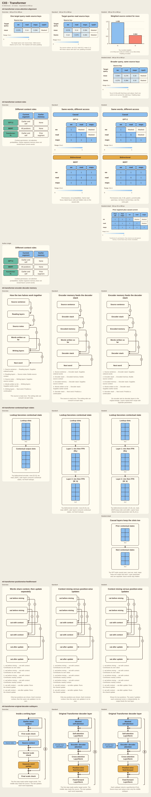

# C03 · Transformer at release 164

Branch `explain/composition-c03-r2` at `5e5381dff2bb03193cb205f994049dbaa711137b`. The prerequisite C01/C02 carryover is `4da7d85dc3356700923dc9a6cab676a132f2009a` on main `a88949c27`.
The tranche adds three references and three existing-reference overlays. The context-rules panels comparison has an authored matrix single.

## Compact token counts

Measured on compact `{id, spec}` with `cl100k_base`. Cells with different authored and parser-completed counts show both.

| Reference | Overview | Standard | Detailed | Detailed companion | Author single |
| --- | ---: | ---: | ---: | ---: | ---: |
| `ml-transformer-cross-attention-alignment` | 114 | 149 | 109 / 108 | 145 | — |
| `ml-transformer-context-rules` | 104 | 236 | 245 | 127 | 105 |
| `ml-transformer-encoder-decoder-memory` | 194 | 194 | 197 | — | — |
| `ml-transformer-contextual-layer-states` | 132 | 185 | 191 | 138 | — |
| `ml-transformer-positionwise-feedforward` | 231 | 230 | 237 | — | — |
| `ml-transformer-original-decoder-sublayers` | 213 | 224 | 230 | — | — |

## Verification

- The production replay moved zero first picks and zero planner kinds across 3,057 existing catalogue cases and 474 saved cases. At all three depths, 22 prompts selected a new reference and seven new prompts selected the intended existing reference. [Replay](planner-replay.json) · [New prompts](new-prompts.md)
- All 1,543 affected tests passed, including arithmetic, actual author requests, the content contract, snapshots, and the lazy library accessor. The reference and overlay linters returned zero findings. The web build passed. [Linter](lint.json) · [Spec verification](tokens.json)
- The three new references add nine snapshot entries at the repository snapshot widths.
- The sheet contains 22 views at a requested width of 408 px. Five have native widths of 444–524 px and fit to the column. The reused decoder repeat bracket crosses the readable ×6 marker. [Preview dimensions](preview-layout.json)

