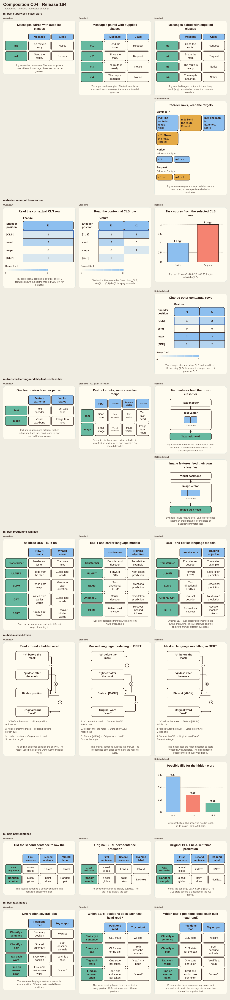

# C04 · Release 164

Branch `explain/composition-c04-r2` at `c967dc54c0f00f5c50a61c609c2e30efce52f9ab`, stacked on `4dd3fe85f27231134b5fe28fb2c2315f13a156ac`. [Source commit](https://github.com/Rabbit-Hole-App/Rabbit-Hole/commit/c967dc54c0f00f5c50a61c609c2e30efce52f9ab) · [Previous tranche](https://github.com/Rabbit-Hole-App/Rabbit-Hole/commit/4dd3fe85f27231134b5fe28fb2c2315f13a156ac)

This tranche adds 3 references and updates 4 existing references.

## Compact token counts

Counts use compact `{id, spec}` and `cl100k_base`. Maximum 176 authored and 175 parsed. A cell with two counts shows authored / parsed.

| Reference | Brief | Balanced | Detailed | Companions | Author single |
| --- | ---: | ---: | ---: | --- | ---: |
| `ml-bert-supervised-class-pairs` | 92 | 121 | 125 | Detailed 160 | — |
| `ml-bert-summary-token-readout` | 140 / 139 | 176 / 175 | 101 | Detailed 161 / 160 | — |
| `ml-transfer-learning-modality-feature-classifier` | 95 | 110 | 115 | Detailed 115 | — |
| `ml-bert-pretraining-families` | 147 | 139 | 146 | — | — |
| `ml-bert-masked-token` | 152 | 157 | 159 | Detailed 101 / 100 | — |
| `ml-bert-next-sentence` | 104 | 103 | 116 | — | — |
| `ml-bert-task-heads` | 136 | 146 | 154 | — | — |

## Relationship edge labels

Counts include nonempty labels in each depth’s main diagram and any companion. [Relationship inventory](relationships.json)

| Reference | Scope | Overview | Standard | Deep | Author single |
| --- | --- | ---: | ---: | ---: | --- |
| `ml-bert-masked-token` | reused | 3 | 3 | 3 | — |

## Verification

- Replay moved zero existing first picks or planner kinds across 3,144 catalogue and 474 archive cases. All 93 tranche prompt-depth cases selected their intended reference. [Replay](planner-replay.json) · [New prompts](new-prompts.md)
- 146 affected tests passed, including both lazy library cases. The web build passed. The compiler found zero errors and the linter reported 0 errors and 0 warnings. [Spec verification](tokens.json) · [Linter](lint.json)
- Snapshots added 9, changed 9, and removed 0. [Snapshot keys](snapshots.json)
- The sheet shows 25 views at a requested 408 px. One wide view was scaled to fit. Native widths are 408 px × 24, 412 px × 1. The PNG uses the renderer’s native text fallback for 9 math lines. [Preview layout](preview-layout.json)

## Visual review

Reviewed 25 of 25 views at 408 px. [Review record](visual-review.json)

The following views need an owner decision on the three-line note limit.

- `ml-bert-masked-token` · Brief main · 9 lines. The current relationship renderer puts the arrow labels into 6 numbered-list text lines below the diagram. The caption takes 3.
- `ml-bert-masked-token` · Balanced main · 9 lines. The current relationship renderer puts the arrow labels into 6 numbered-list text lines below the diagram. The caption takes 3.
- `ml-bert-masked-token` · Detailed main · 9 lines. The current relationship renderer puts the arrow labels into 6 numbered-list text lines below the diagram. The caption takes 3.

- The relationship graph renderer leaves node boxes unfilled and numbers its arrow labels in these references: `ml-bert-masked-token`. These views are listed for the renderer review.
- `ml-bert-summary-token-readout` Detailed keeps the logits and operands in a shorter caption. The PNG uses plain subscript notation for some formulas.
- `ml-transfer-learning-modality-feature-classifier` shows labelled feature groups of widths two and three. The cells show the differing widths of the text and image feature vectors.

