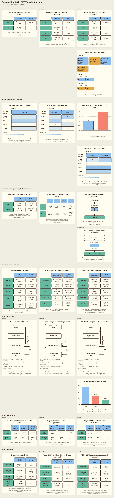

# C04 BERT readout follow-up

This follow-up appends to accepted C04 (`c967dc54c0f00f5c50a61c609c2e30efce52f9ab`). The verified source tree is `e543927e5b4e47eda85f4053718b6839d77370d4`.

The readout heatmaps label their columns **Feature 1** and **Feature 2**. Overview shows Feature 1. Standard and the Detailed companion show both. The Detailed bars show Notice at **1** and Request at **2**. The caption identifies those scores as logits and shows the linear head calculation.

## Visual review

The 408 px sheet contains all 25 C04 views. The four readout views changed and were reviewed on the refreshed sheet. The other 21 SVGs match the accepted sheet. The reference highlights the same CLS row, illustrates its projection into task scores, and shows that changing the other rows after encoding leaves those scores fixed. I recomputed Notice as 1 × 1 + 2 × 0 + 0 = 1 and Request as 1 × (−1) + 2 × 1 + 1 = 2 from the data module. The four captions take at most three lines at 408 px. [View differences](preview-delta.json) · [Preview layout](preview-layout.json)

- `ml-bert-supervised-class-pairs`, Detailed companion. The sample-set renderer prints “2 draws · 2 unique” for both class groups and “× 1” on each sample.
- `ml-transfer-learning-modality-feature-classifier` and `ml-bert-next-sentence`. The matrix renderer uses different font sizes for headers in the same row.
- `ml-bert-masked-token`. Each main view carries three relationship edge labels. At all three depths, the renderer uses six numbered text lines below the diagram and the caption adds three. [Relationship inventory](../relationships.json)

## Compact tokens

Counts use `cl100k_base` over compact `{id, spec}`. A pair of counts gives authored / parsed. [Token report](tokens.json)

| Reference | Overview | Standard | Detailed | Detailed companion |
| --- | ---: | ---: | ---: | ---: |
| `ml-bert-supervised-class-pairs` | 92 | 121 | 125 | 160 |
| `ml-bert-summary-token-readout` | 141 / 140 | 178 / 177 | 96 | 163 / 162 |
| `ml-transfer-learning-modality-feature-classifier` | 95 | 110 | 115 | 115 |
| `ml-bert-pretraining-families` | 147 | 139 | 146 | — |
| `ml-bert-masked-token` | 152 | 157 | 159 | 101 / 100 |
| `ml-bert-next-sentence` | 104 | 103 | 116 | — |
| `ml-bert-task-heads` | 136 | 146 | 154 | — |

## Verification

- Replay against accepted C04 moved zero first picks and zero planner kinds across 3,213 catalogue and 474 saved planner cases. [Replay](planner-replay.json)
- 93 affected tests passed, including independent recomputation of the logits, the label checks, the lazy library, the content contract, and snapshot fingerprints. The reference linter reported zero errors and zero warnings. [Linter](lint.json)
- Three existing standard readout snapshot keys changed at 320, 408 and 720 px. [Snapshot keys](snapshots.json)
