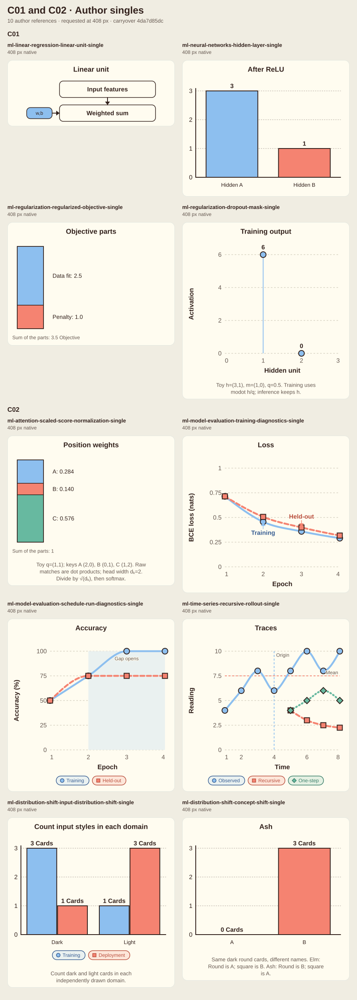

# C01 and C02 · Author singles

The sheet uses the ten accepted authored references from carryover `4da7d85dc`. The checkout tree matches the accepted commit. The production request builder selected each single for its first documented learner prompt at Balanced depth. Each rendering uses the exact `spec` serialized into the author’s examples.

All ten diagrams rendered at native 408 px. The sheet is 870 × 2431 px. All ten author-request tests passed.

The PNG uses the renderer’s native text for five math lines. The dropout caption displays `modot` for the source’s TeX dot operator in that fallback. The serialized payload retains the TeX expression.

| Author reference | Kind | Compact tokens |
| --- | --- | ---: |
| `ml-linear-regression-linear-unit-single` | `block-stack` | 63 |
| `ml-neural-networks-hidden-layer-single` | `bar-chart` | 53 |
| `ml-regularization-regularized-objective-single` | `bar-chart` | 66 |
| `ml-regularization-dropout-mask-single` | `coordinate-plot` | 133 |
| `ml-attention-scaled-score-normalization-single` | `bar-chart` | 131 |
| `ml-model-evaluation-training-diagnostics-single` | `coordinate-plot` | 155 |
| `ml-model-evaluation-schedule-run-diagnostics-single` | `coordinate-plot` | 161 |
| `ml-time-series-recursive-rollout-single` | `coordinate-plot` | 209 |
| `ml-distribution-shift-input-distribution-shift-single` | `bar-chart` | 89 |
| `ml-distribution-shift-concept-shift-single` | `bar-chart` | 83 |

Compact counts use `cl100k_base` on `{id,spec}`.

[Exact author payloads](author-singles.json) · [Preview layout](preview-layout.json)

