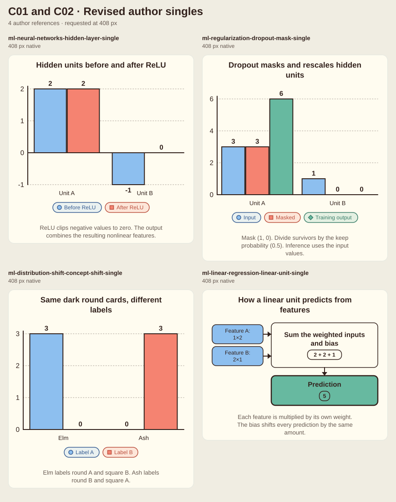

# Four revised learner singles

These are the Balanced author examples captured from the production author request. The four IDs are unchanged. They are published on `explain/composition-c03-r2` at `c51cf997c7144ec3d01e64493e5397fba3a8f76e`. The evidence was generated from the matching tree at `474dd74ffb9c499056a0ba06f4e5ec5208e18886`.

| Reference | What the diagram shows | Compact tokens | Note lines at 408 px |
| --- | --- | ---: | ---: |
| `ml-neural-networks-hidden-layer-single` | ReLU leaves Unit A at 2 and clips Unit B from −1 to 0. The output combines the resulting features. | 95 | 2 |
| `ml-regularization-dropout-mask-single` | The original values are (3, 1). The mask leaves (3, 0). Dividing by the keep probability of 0.5 yields the training output (6, 0). | 116 | 3 |
| `ml-distribution-shift-concept-shift-single` | Elm labels all three dark round cards A. Ash labels the same three cards B. | 94 | 2 |
| `ml-linear-regression-linear-unit-single` | Two named features enter one weighted sum. The terms 2 and 2 plus bias 1 produce prediction 5. | 127 | 3 |

Each diagram rendered at 408 px with readable text and named parts. The grouped bars distinguish the series by colour. The linear unit shows two separate feature arrows and highlights the prediction. The PNG uses the renderer's SVG text fallback for four formulas. [Typeset sheet](contact-sheet.html) · [Author payloads](author-singles.json) · [Preview layout](preview-layout.json)

All 76 focused tests passed, including independent recomputation from the existing data inputs, author tool schema, content contract, lazy library and SVG fingerprints. The single-variant receipts were recounted for these four IDs. The other variants and every full library reference matched the base. The scoped linter reported zero findings for rules that apply to authored single variants. [Test log](tests.log) · [Lint log](lint.log)

The planner-kind replay moved zero first picks and zero planner kinds across 3,144 catalogue and 474 saved requests. All 72 exact prompt and depth combinations for these four references still selected their original single ID in the production author request. [Planner replay](planner-replay.json)

