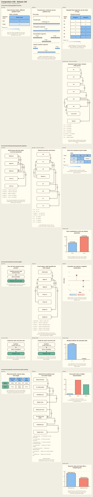

# C05 · Release 164

Branch `explain/composition-c05-r2` at `3f868d330e5dac469454f8e6feb2147992e24844`, stacked on `c967dc54c0f00f5c50a61c609c2e30efce52f9ab`. [Source commit](https://github.com/Rabbit-Hole-App/Rabbit-Hole/commit/3f868d330e5dac469454f8e6feb2147992e24844) · [Previous tranche](https://github.com/Rabbit-Hole-App/Rabbit-Hole/commit/c967dc54c0f00f5c50a61c609c2e30efce52f9ab)

This tranche adds 4 references and updates 0 existing references.

## Compact token counts

Counts use compact `{id, spec}` and `cl100k_base`. Maximum 299 authored and 299 parsed. A cell with two counts shows authored / parsed.

| Reference | Brief | Balanced | Detailed | Companions | Author single |
| --- | ---: | ---: | ---: | --- | ---: |
| `ml-recurrent-training-gradient-horizons` | 107 | 279 | 178 | Detailed 262 | — |
| `ml-recurrent-training-shared-parameter-gradients` | 199 | 299 | 138 | Detailed 113 / 112 | — |
| `ml-recurrent-networks-recurrent-update` | 116 | 275 | 187 | Brief 123, Balanced 123, Detailed 94 / 93 | — |
| `ml-recurrent-networks-recurrent-next-token-training` | 113 | 295 | 135 / 134 | Detailed 114 / 113 | — |

## Relationship edge labels

Counts include nonempty labels in each depth’s main diagram and any companion. [Relationship inventory](relationships.json)

| Reference | Scope | Overview | Standard | Deep | Author single |
| --- | --- | ---: | ---: | ---: | --- |
| `ml-recurrent-training-gradient-horizons` | added | 0 | 0 | 8 | — |
| `ml-recurrent-training-shared-parameter-gradients` | added | 5 | 8 | 0 | — |
| `ml-recurrent-networks-recurrent-update` | added | 0 | 6 | 0 | — |
| `ml-recurrent-networks-recurrent-next-token-training` | added | 0 | 7 | 0 | — |

## Verification

- Replay moved zero existing first picks or planner kinds across 3,213 catalogue and 474 archive cases. All 75 tranche prompt-depth cases selected their intended reference. [Replay](planner-replay.json) · [New prompts](new-prompts.md)
- 154 affected tests passed, including both lazy library cases. The web build passed. The compiler found zero errors and the linter reported 0 errors and 0 warnings. [Spec verification](tokens.json) · [Linter](lint.json)
- Snapshots added 12, changed 0, and removed 0. [Snapshot keys](snapshots.json)
- The sheet shows 18 views at a requested 408 px. 2 wide views were scaled to fit. Native widths are 408 px × 16, 416 px × 2. The PNG uses the renderer’s native text fallback for 23 math lines. [Preview layout](preview-layout.json)

## Visual review

Reviewed 18 of 18 views at 408 px. [Review record](visual-review.json)

The following views need an owner decision on the three-line note limit.

- `ml-recurrent-training-gradient-horizons` · Detailed detail · 11 lines. The current relationship renderer puts the arrow labels into 8 numbered-list text lines below the diagram. The caption takes 3.
- `ml-recurrent-training-shared-parameter-gradients` · Brief main · 8 lines. The current relationship renderer puts the arrow labels into 5 numbered-list text lines below the diagram. The caption takes 3.
- `ml-recurrent-training-shared-parameter-gradients` · Balanced main · 10 lines. The current relationship renderer puts the arrow labels into 8 numbered-list text lines below the diagram. The caption takes 2.
- `ml-recurrent-networks-recurrent-update` · Balanced main · 9 lines. The current relationship renderer puts the arrow labels into 6 numbered-list text lines below the diagram. The caption takes 3.
- `ml-recurrent-networks-recurrent-next-token-training` · Balanced main · 17 lines. The current relationship renderer puts the arrow labels into 14 numbered-list text lines below the diagram. The caption takes 3.

- The relationship graph renderer leaves node boxes unfilled and numbers its arrow labels in these references: `ml-recurrent-training-gradient-horizons`, `ml-recurrent-training-shared-parameter-gradients`, `ml-recurrent-networks-recurrent-update`, `ml-recurrent-networks-recurrent-next-token-training`. These views are listed for the renderer review.
- `ml-recurrent-networks-recurrent-next-token-training` Standard uses a three-line authored caption. Its Detailed distribution shows the three bars and labelled categories, and the compact renderer suppresses the numeric labels above those bars at this width.
- In `ml-recurrent-networks-recurrent-update` Detailed the two markers coincide at the first step because the positive input is unchanged by ReLU. The second step separates the negative value and zero.

