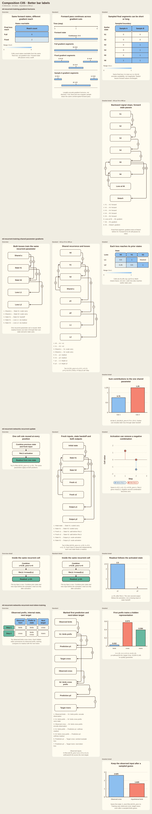

# C05 learner-card review

Reviewed the example cards from `explain/composition-c05-r2` at a requested width of 408 px.

The correction is based on `3f868d330e5dac469454f8e6feb2147992e24844`. Verified source tree `8082aa959c4a78921a3f4961366f7a600ca46c04`.
Reviewed 18 views. The refresh changed 4 views. The other 14 have the same SVG fingerprints. [View comparison](sheet-diff.json)

- The Detailed companion for `ml-recurrent-training-shared-parameter-gradients` shows 0.75 and 1.25 with the shared derivative in its caption. The Detailed companion for `ml-recurrent-networks-recurrent-update` shows 2.5 and 0. Its Detailed main has coincident first-step markers because ReLU preserves the positive first input, and the second step separates the negative input from zero.
- The Detailed main for `ml-recurrent-networks-recurrent-next-token-training` now prints 0.032, 0.573 and 0.394. Its Detailed companion prints 2.625 and 1.625. The Standard authored caption takes three lines.
- The tranche has no raw feature labels or registered author-single panel slices.

## Compact token counts

Maximum 299 tokens for compact `{id, spec}`. Two numbers give authored and parsed counts.

| Reference | Overview | Standard | Detailed | Companions |
| --- | ---: | ---: | ---: | --- |
| `ml-recurrent-training-gradient-horizons` | 107 | 279 | 178 | Detailed 262 |
| `ml-recurrent-training-shared-parameter-gradients` | 199 | 299 | 138 | Detailed 106 / 105 |
| `ml-recurrent-networks-recurrent-update` | 116 | 275 | 187 | Overview 123, Standard 123, Detailed 90 / 89 |
| `ml-recurrent-networks-recurrent-next-token-training` | 113 | 295 | 131 / 130 | Detailed 108 / 107 |

## Relationship labels and notes

- `ml-recurrent-training-gradient-horizons` · Detailed detail 8.
- `ml-recurrent-training-shared-parameter-gradients` · Overview main 5, Standard main 8.
- `ml-recurrent-networks-recurrent-update` · Standard main 6.
- `ml-recurrent-networks-recurrent-next-token-training` · Standard main 7.

5 views exceed three visible note lines. The relationship renderer moves arrow labels into a numbered list.

- `ml-recurrent-training-gradient-horizons` · Detailed detail · 11 lines. The current relationship renderer puts the arrow labels into 8 numbered-list text lines below the diagram. The caption takes 3.
- `ml-recurrent-training-shared-parameter-gradients` · Overview main · 8 lines. The current relationship renderer puts the arrow labels into 5 numbered-list text lines below the diagram. The caption takes 3.
- `ml-recurrent-training-shared-parameter-gradients` · Standard main · 10 lines. The current relationship renderer puts the arrow labels into 8 numbered-list text lines below the diagram. The caption takes 2.
- `ml-recurrent-networks-recurrent-update` · Standard main · 9 lines. The current relationship renderer puts the arrow labels into 6 numbered-list text lines below the diagram. The caption takes 3.
- `ml-recurrent-networks-recurrent-next-token-training` · Standard main · 17 lines. The current relationship renderer puts the arrow labels into 14 numbered-list text lines below the diagram. The caption takes 3.

## Verification

- Production replay moved zero first picks or planner kinds over 3,288 catalogue and 474 archive cases. All 75 tranche prompt-depth cases still selected their reference. The correction adds no routing prompts. [Replay](planner-replay.json) · [Original tranche prompts](../new-prompts.md)
- 77 focused tests passed, including the data-module, content contract, SVG snapshot, author single and lazy library tests. The compiler and linter reported zero errors. [Tests](tests.log) · [Linter](lint.json)
- The central SVG snapshot registry was regenerated and is byte-identical. It has no entries for the corrected depths and companions. [Registry check](snapshots.json) · [Preview layout](preview-layout.json)

