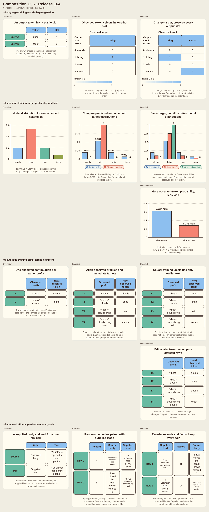

# C06 · Release 164

Branch `explain/composition-c06-r2` at `d3f202ff5fe3e416d5865000b10a9859f4697987`, stacked on `3f868d330e5dac469454f8e6feb2147992e24844`. [Source commit](https://github.com/Rabbit-Hole-App/Rabbit-Hole/commit/d3f202ff5fe3e416d5865000b10a9859f4697987) · [Previous tranche](https://github.com/Rabbit-Hole-App/Rabbit-Hole/commit/3f868d330e5dac469454f8e6feb2147992e24844)

This tranche adds 4 references and updates 0 existing references.

## Compact token counts

Counts use compact `{id, spec}` and `cl100k_base`. Maximum 178 authored and 178 parsed. A cell with two counts shows authored / parsed.

| Reference | Brief | Balanced | Detailed | Companions | Author single |
| --- | ---: | ---: | ---: | --- | ---: |
| `ml-language-training-vocabulary-target-slots` | 112 | 146 | 160 | — | — |
| `ml-language-training-target-probability-and-loss` | 121 / 120 | 143 | 153 | Detailed 110 / 109 | — |
| `ml-language-training-prefix-target-alignment` | 118 | 169 | 178 | Detailed 178 | — |
| `ml-summarization-supervised-summary-pair` | 119 | 144 | 152 | — | — |

## Relationship edge labels

This tranche adds or reuses no relationship references. [Relationship inventory](relationships.json)

## Verification

- Replay moved zero existing first picks or planner kinds across 3,288 catalogue and 474 archive cases. All 84 tranche prompt-depth cases selected their intended reference. [Replay](planner-replay.json) · [New prompts](new-prompts.md)
- 151 affected tests passed, including both lazy library cases. The web build passed. The compiler found zero errors and the linter reported 0 errors and 0 warnings. [Spec verification](tokens.json) · [Linter](lint.json)
- Snapshots added 12, changed 0, and removed 0. [Snapshot keys](snapshots.json)
- The sheet shows 14 views at a requested 408 px. 0 wide views were scaled to fit. Native widths are 408 px × 14. The PNG uses the renderer’s native text fallback for 9 math lines. [Preview layout](preview-layout.json)

## Visual review

Reviewed 14 of 14 views at 408 px. [Review record](visual-review.json)

All views met the three-line note limit.

- `ml-language-training-prefix-target-alignment` Detailed uses a title that can read as if the label is produced from the prefix. The table and caption show the observed next token as the target. The wording is called out for review.
- `ml-language-training-target-probability-and-loss` omits some numeric bar labels at 408 px. The axis and groups support the comparison, and the Detailed companion prints both computed losses.

