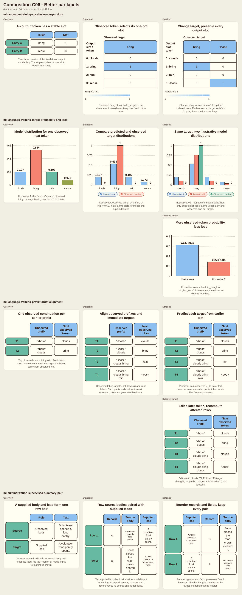

# C06 learner-card review

Reviewed the example cards from `explain/composition-c06-r2` at a requested width of 408 px.

The correction is based on `d3f202ff5fe3e416d5865000b10a9859f4697987`. Verified source tree `c8986264343475b4b1455f83423a853f3a5ae1e5`.
Reviewed 14 views. The refresh changed 2 views. The other 12 have the same SVG fingerprints. [View comparison](sheet-diff.json)

- The Overview for `ml-language-training-target-probability-and-loss` prints 0.197, 0.534, 0.197 and 0.072. The Detailed loss companion retains nats, the unit for natural-log loss.
- The Detailed heading for `ml-language-training-prefix-target-alignment` reads “Predict each target from earlier text.” Its table separately names the observed prefix and next observed token.
- The tranche has no raw feature labels or registered author-single panel slices.

## Compact token counts

Maximum 178 tokens for compact `{id, spec}`. Two numbers give authored and parsed counts.

| Reference | Overview | Standard | Detailed | Companions |
| --- | ---: | ---: | ---: | --- |
| `ml-language-training-vocabulary-target-slots` | 112 | 146 | 160 | — |
| `ml-language-training-target-probability-and-loss` | 117 / 116 | 143 | 153 | Detailed 110 / 109 |
| `ml-language-training-prefix-target-alignment` | 118 | 169 | 176 | Detailed 178 |
| `ml-summarization-supervised-summary-pair` | 119 | 144 | 152 | — |

## Relationship labels and notes

This tranche has no relationship references.

All views met the three-line note limit.

## Verification

- Production replay moved zero first picks or planner kinds over 3,372 catalogue and 474 archive cases. All 84 tranche prompt-depth cases still selected their reference. The correction adds no routing prompts. [Replay](planner-replay.json) · [Original tranche prompts](../new-prompts.md)
- 74 focused tests passed, including the data-module, content contract, SVG snapshot, author single and lazy library tests. The compiler and linter reported zero errors. [Tests](tests.log) · [Linter](lint.json)
- The central SVG snapshot registry was regenerated and is byte-identical. It has no entries for the corrected depths and companions. [Registry check](snapshots.json) · [Preview layout](preview-layout.json)

