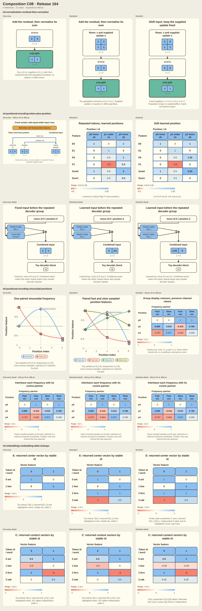

# C08 · Release 164

Branch `explain/composition-c08-r2` at `02e8c9ce56f0de7e1fc29722010c976e3c0fbbd5`, stacked on `8c3235710019f258e5cdf196dbf8f4169f341d0e`. [Source commit](https://github.com/Rabbit-Hole-App/Rabbit-Hole/commit/02e8c9ce56f0de7e1fc29722010c976e3c0fbbd5) · [Previous tranche](https://github.com/Rabbit-Hole-App/Rabbit-Hole/commit/8c3235710019f258e5cdf196dbf8f4169f341d0e)

This tranche adds 4 references and updates 0 existing references.

## Compact token counts

Counts use compact `{id, spec}` and `cl100k_base`. Maximum 300 authored and 299 parsed. A cell with two counts shows authored / parsed.

| Reference | Brief | Balanced | Detailed | Companions | Author single |
| --- | ---: | ---: | ---: | --- | ---: |
| `ml-normalization-residual-then-normalize` | 177 / 176 | 222 / 221 | 231 / 230 | — | — |
| `ml-positional-encoding-token-plus-position` | 220 | 297 / 296 | 300 / 299 | Brief 170 / 169, Balanced 176 / 175, Detailed 176 / 175 | — |
| `ml-positional-encoding-sinusoidal-positions` | 209 / 208 | 292 / 291 | 210 / 209 | Brief 204 / 203, Balanced 204 / 203, Detailed 204 / 203 | — |
| `ml-embeddings-embedding-table-lookups` | 145 / 144 | 171 / 170 | 172 / 171 | Brief 197 / 196, Balanced 197 / 196, Detailed 200 / 199 | — |

## Relationship edge labels

This tranche adds or reuses no relationship references. [Relationship inventory](relationships.json)

## Verification

- Replay moved zero existing first picks or planner kinds across 3,603 catalogue and 474 archive cases. All 93 tranche prompt-depth cases selected their intended reference. [Replay](planner-replay.json) · [New prompts](new-prompts.md)
- 155 affected tests passed, including both lazy library cases. The web build passed. The compiler found zero errors and the linter reported 0 errors and 0 warnings. [Spec verification](tokens.json) · [Linter](lint.json)
- Snapshots added 12, changed 0, and removed 0. [Snapshot keys](snapshots.json)
- The sheet shows 21 views at a requested 408 px. 5 wide views were scaled to fit. Native widths are 408 px × 16, 444 px × 4, 535 px × 1. The PNG uses the renderer’s native text fallback for 43 math lines. [Preview layout](preview-layout.json)

## Visual review

Reviewed 21 of 21 views at 408 px. [Review record](visual-review.json)

All views met the three-line note limit.

- The positional-encoding comparisons keep the edited position and the unedited positions identifiable at 408 px. The renderer uses a native text fallback for formulas in the PNG.

