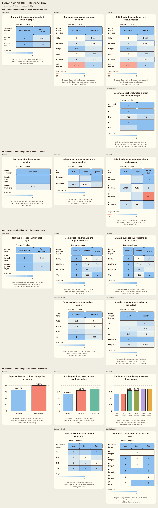

# C09 · Release 164

Branch `explain/composition-c09-r2` at `a8785bbed34dcc32ffad3bba1e18f20f2e49d2c3`, stacked on `02e8c9ce56f0de7e1fc29722010c976e3c0fbbd5`. [Source commit](https://github.com/Rabbit-Hole-App/Rabbit-Hole/commit/a8785bbed34dcc32ffad3bba1e18f20f2e49d2c3) · [Previous tranche](https://github.com/Rabbit-Hole-App/Rabbit-Hole/commit/02e8c9ce56f0de7e1fc29722010c976e3c0fbbd5)

This tranche adds 4 references and updates 0 existing references.

## Compact token counts

Counts use compact `{id, spec}` and `cl100k_base`. Maximum 238 authored and 237 parsed. A cell with two counts shows authored / parsed.

| Reference | Brief | Balanced | Detailed | Companions | Author single |
| --- | ---: | ---: | ---: | --- | ---: |
| `ml-contextual-embeddings-contextual-word-vectors` | 133 | 224 / 223 | 237 / 236 | Detailed 160 | — |
| `ml-contextual-embeddings-two-directional-states` | 118 | 189 / 188 | 238 / 237 | — | — |
| `ml-contextual-embeddings-weighted-layer-states` | 128 | 237 | 216 | Balanced 199, Detailed 196 | — |
| `ml-contextual-embeddings-layer-pooling-evaluation` | 98 / 97 | 123 / 122 | 152 / 151 | Balanced 159, Detailed 196 | — |

## Relationship edge labels

This tranche adds or reuses no relationship references. [Relationship inventory](relationships.json)

## Verification

- Replay moved zero existing first picks or planner kinds across 3,696 catalogue and 474 archive cases. All 75 tranche prompt-depth cases selected their intended reference. [Replay](planner-replay.json) · [New prompts](new-prompts.md)
- 149 affected tests passed, including both lazy library cases. The web build passed. The compiler found zero errors and the linter reported 0 errors and 0 warnings. [Spec verification](tokens.json) · [Linter](lint.json)
- Snapshots added 12, changed 0, and removed 0. [Snapshot keys](snapshots.json)
- The sheet shows 17 views at a requested 408 px. 0 wide views were scaled to fit. Native widths are 408 px × 17. The PNG uses the renderer’s native text fallback for 26 math lines. [Preview layout](preview-layout.json)

## Visual review

Reviewed 17 of 17 views at 408 px. [Review record](visual-review.json)

All views met the three-line note limit.

- The contextual-state captions now separate feature indices and numeric values with spaces. The weighted-layer-state data and chart values are unchanged.
- `ml-contextual-embeddings-layer-pooling-evaluation` Detailed uses six labelled bars. At 408 px the chart renderer suppresses four above-bar numeric labels to avoid collisions. The companion retains the predictions by ID.

