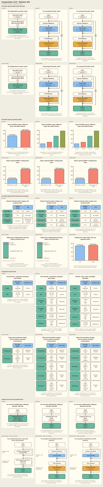

# C10 · Release 164

Branch `explain/composition-c10-r2` at `144c094d16a59fb56241d68bb0cb6bcf81c3271f`, stacked on `a8785bbed34dcc32ffad3bba1e18f20f2e49d2c3`. [Source commit](https://github.com/Rabbit-Hole-App/Rabbit-Hole/commit/144c094d16a59fb56241d68bb0cb6bcf81c3271f) · [Previous tranche](https://github.com/Rabbit-Hole-App/Rabbit-Hole/commit/a8785bbed34dcc32ffad3bba1e18f20f2e49d2c3)

This tranche adds 5 references and updates 0 existing references.

## Compact token counts

Counts use compact `{id, spec}` and `cl100k_base`. Maximum 280 authored and 280 parsed. A cell with two counts shows authored / parsed.

| Reference | Brief | Balanced | Detailed | Companions | Author single |
| --- | ---: | ---: | ---: | --- | ---: |
| `ml-model-capacity-depth-width-allocation` | 142 | 244 | 248 | Brief 150, Balanced 244, Detailed 248 | — |
| `ml-model-capacity-capacity-profiles` | 108 / 107 | 132 / 131 | 133 / 132 | Brief 98 / 97, Balanced 98 / 97, Detailed 98 / 97 | — |
| `ml-model-capacity-block-parameter-accounting` | 169 | 179 | 180 | Brief 125, Balanced 125, Detailed 101 / 100 | — |
| `ml-gpt2-task-input-format` | 146 | 280 | 275 | Brief 170, Balanced 278, Detailed 278 | — |
| `ml-gpt2-overview-and-expanded-block` | 130 / 129 | 137 | 128 | Brief 238, Balanced 271, Detailed 271 | — |

## Relationship edge labels

This tranche adds or reuses no relationship references. [Relationship inventory](relationships.json)

## Verification

- Replay moved zero existing first picks or planner kinds across 3,771 catalogue and 474 archive cases. All 114 tranche prompt-depth cases selected their intended reference. [Replay](planner-replay.json) · [New prompts](new-prompts.md)
- 156 affected tests passed, including both lazy library cases. The web build passed. The compiler found zero errors and the linter reported 0 errors and 0 warnings. [Spec verification](tokens.json) · [Linter](lint.json)
- Snapshots added 15, changed 0, and removed 0. [Snapshot keys](snapshots.json)
- The sheet shows 30 views at a requested 408 px. 3 wide views were scaled to fit. Native widths are 408 px × 27, 455 px × 3. The PNG uses the renderer’s native text fallback for 153 math lines. [Preview layout](preview-layout.json)

## Visual review

Reviewed 30 of 30 views at 408 px. [Review record](visual-review.json)

All views met the three-line note limit.

- C10 now uses semantic roles on attention, feedforward, and output stages. The current palette keeps the authored normalization roles visually neutral.
- `ml-gpt2-task-input-format` puts spaces between displayed structural markers and words. The original token sequences and order are unchanged.
- `ml-model-capacity-depth-width-allocation` still shows the repeat bracket crossing the ×2 and ×3 badges in the grouped decoder stacks. The badges remain readable and the view needs the renderer fix.
- `ml-model-capacity-capacity-profiles` Standard and Detailed use axis ticks and labelled bars. The 408 px renderer leaves off their exact above-bar number labels.

