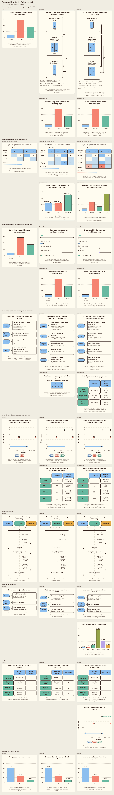

# C11 · Release 164

Branch `explain/composition-c11-r2` at `54cb9c136d6912234745bc6a67e55d951e971690`, stacked on `144c094d16a59fb56241d68bb0cb6bcf81c3271f`. [Source commit](https://github.com/Rabbit-Hole-App/Rabbit-Hole/commit/54cb9c136d6912234745bc6a67e55d951e971690) · [Previous tranche](https://github.com/Rabbit-Hole-App/Rabbit-Hole/commit/144c094d16a59fb56241d68bb0cb6bcf81c3271f)

This tranche adds 5 references and updates 4 existing references.

The review branch contains the references, data modules, regenerated receipts, and tests. The original design documents remain on the historical C11 branch pending publication approval.

## Compact token counts

Counts use compact `{id, spec}` and `cl100k_base`. Maximum 299 authored and 299 parsed. A cell with two counts shows authored / parsed.

| Reference | Brief | Balanced | Detailed | Companions | Author single |
| --- | ---: | ---: | ---: | --- | ---: |
| `ml-language-generation-vocabulary-score-probabilities` | 125 / 124 | 244 | 262 | Balanced 125 / 124, Detailed 125 / 124 | — |
| `ml-language-generation-key-value-cache` | 136 | 186 | 203 | Balanced 117 / 116, Detailed 129 / 128 | — |
| `ml-language-generation-greedy-versus-sampling` | 115 / 114 | 179 | 179 | Balanced 115 / 114, Detailed 115 / 114 | — |
| `ml-language-generation-autoregressive-feedback` | 205 | 234 | 227 | Balanced 128 / 129, Detailed 190 | — |
| `ml-music-tokenization-music-events-and-time` | 164 | 195 | 201 | Balanced 182, Detailed 180 | — |
| `ml-kv-cache-decode` | 299 | 299 | 299 | — | — |
| `ml-gpt2-continue-prefix` | 112 | 116 | 124 | Detailed 124 / 123 | — |
| `ml-gpt2-music-event-tokens` | 133 | 132 | 135 | Detailed 179 | — |
| `ml-word2vec-prefix-guesses` | 94 | 95 | 106 | — | — |

## Relationship edge labels

Counts include nonempty labels in each depth’s main diagram and any companion. [Relationship inventory](relationships.json)

| Reference | Scope | Overview | Standard | Deep | Author single |
| --- | --- | ---: | ---: | ---: | --- |
| `ml-language-generation-vocabulary-score-probabilities` | added | 0 | 2 | 2 | — |

## Verification

- Replay moved zero existing first picks or planner kinds across 3,885 catalogue and 474 archive cases. All 201 tranche prompt-depth cases selected their intended reference. [Replay](planner-replay.json) · [New prompts](new-prompts.md)
- 156 affected tests passed, including both lazy library cases. The web build passed. The compiler found zero errors and the linter reported 0 errors and 0 warnings. [Spec verification](tokens.json) · [Linter](lint.json)
- Snapshots added 15, changed 6, and removed 0. [Snapshot keys](snapshots.json)
- The sheet shows 39 views at a requested 408 px. 3 wide views were scaled to fit. Native widths are 408 px × 36, 444 px × 3. The PNG uses the renderer’s native text fallback for 84 math lines. [Preview layout](preview-layout.json)

## Visual review

Reviewed 39 of 39 views at 408 px. [Review record](visual-review.json)

The following views need an owner decision on the three-line note limit.

- `ml-language-generation-vocabulary-score-probabilities` · Balanced main · 7 lines. The current relationship renderer puts the arrow labels into 4 numbered-list text lines below the diagram. The caption takes 3.
- `ml-language-generation-vocabulary-score-probabilities` · Detailed main · 8 lines. The current relationship renderer puts the arrow labels into 5 numbered-list text lines below the diagram. The caption takes 3.

- The relationship graph renderer leaves node boxes unfilled and numbers its arrow labels in these references: `ml-language-generation-vocabulary-score-probabilities`. These views are listed for the renderer review.
- The stop cases now distinguish “after 3” and “limit 2” in prose. Compact names in the event ledger, such as `Start60`, are literal token identifiers.
- The vocabulary and greedy-versus-sampling charts omit some above-bar numeric labels at 408 px. The score grid and sampling partition preserve the relevant numbers and identities.

