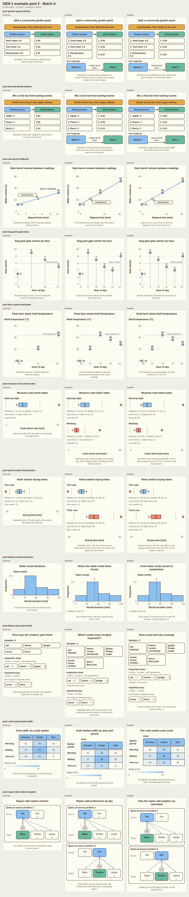

# GEN-1 example pool 2 · Batch A

Source commit `8ebb70e353a4b9e16204db99afba584625991e21` on `explain/gen-1-pool-2`, based on release 164 (`a88949c27`).
The sheet has 33 diagrams at native 408 px.

The source exercises all seven derived rows. The transformation lists and plot annotations leave their computed results to the parser. Both box-plot references retain raw observations in their data file and leave the fences to code. The proportion histogram and token-links provide counts, the sample set provides a replacement draw, and the heatmap provides cells without a fixed scale.

The bakery example computes the out-of-bag group. Release 164 renders the word “draws” beside every group tally, including the unpicked group.

## Compact tokens

Each cell is authored / parser-completed `{id, spec}`, measured with `cl100k_base`.

| Reference | Overview | Standard | Detailed |
| --- | ---: | ---: | ---: |
| `pool-garden-grant-softmax` | 109 / 124 | 136 / 151 | 132 / 147 |
| `pool-fruit-tea-blend-softmax` | 109 / 124 | 136 / 151 | 133 / 148 |
| `pool-rain-barrel-midpoint` | 152 / 155 | 165 / 168 | 172 / 175 |
| `pool-dog-park-gate-mean` | 170 / 173 | 183 / 186 | 187 / 190 |
| `pool-farm-stand-shelf-peak` | 162 / 165 | 179 / 182 | 187 / 190 |
| `pool-museum-coat-check-waits` | 122 / 133 | 177 / 200 | 185 / 208 |
| `pool-paint-swatch-drying-times` | 124 / 135 | 182 / 205 | 189 / 212 |
| `pool-skate-rental-proportions` | 97 / 105 | 109 / 117 | 124 / 132 |
| `pool-bakery-tray-spot-check` | 136 / 142 | 177 / 184 | 175 / 182 |
| `pool-craft-market-aisle-traffic` | 103 / 113 | 125 / 135 | 142 / 152 |
| `pool-repair-cafe-station-weights` | 85 / 91 | 108 / 120 | 109 / 121 |

## Verification

- The planner and selector replay moved zero first picks and zero planner kinds across 3,057 existing catalogue cases and 474 saved cases. All 33 new prompt-depth cases picked their intended reference.
- All 18 new data and reference tests passed. The focused suites passed 538 tests, including the lazy loader and SVG snapshot tests.
- Added 33 new snapshot entries. Existing hashes match release 164 and preceding commits.

[Per-depth token and schema checks](tokens.json) · [Planner replay](replay.json) · [Preview dimensions](preview-layout.json)

