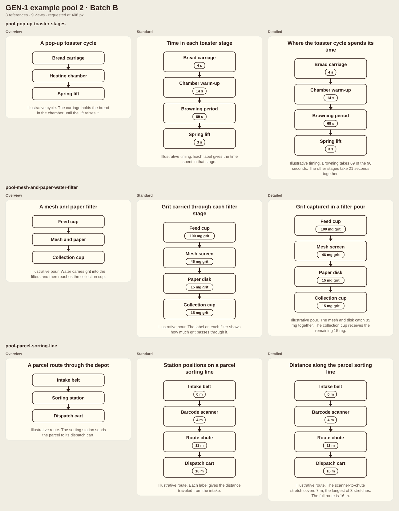

# GEN-1 example pool 2 · Batch B

Source commit `8af35e35742fbee0e198dd8f18eaebe5054ab7ed` on `explain/gen-1-pool-2`, based on release 164 (`a88949c27`).
The sheet has 9 diagrams at native 408 px.

The three new stacks have only ordered stages. The tensor schema supports one uniformly styled grid with up to eight cells, an overall name, and dimensions. Row names, column names and region highlights need additional fields. The validator rejects a nine-cell grid. [Tensor schema checks](tensor-schema.json)

## Block-stack baseline

At release 164, there were 29 eligible stacks per depth. The following counts come from the actual 408 px markup. Each skip edge in this pool draws an add join.

| Reference | Overview skip / add | Standard skip / add | Detailed skip / add |
| --- | ---: | ---: | ---: |
| `figure-gallery-convolution-relative-bias` | 2 / 2 | 2 / 2 | 2 / 2 |
| `figure-gallery-layer-specific-token-lookup` | 0 / 2 | 0 / 2 | 0 / 2 |
| `ml-gemma-decoder-stack` | 0 / 0 | 2 / 2 | 2 / 2 |
| `ml-llama-decoder-block` | 2 / 2 | 2 / 2 | 2 / 2 |
| `ml-transformer-encoder-stack` | 2 / 2 | 2 / 2 | 2 / 2 |
| `ml-transformer-original-decoder-sublayers` | 3 / 3 | 3 / 3 | 3 / 3 |
| `raschka-residual-gain-and-soft-logit-cap` | 1 / 1 | 1 / 1 | 1 / 1 |

The new stacks raise the count with neither a skip nor an add from 23 to 26 at Overview and from 22 to 25 at Standard and Detailed, out of 32 at each depth. [Full pool inventory](block-stack-inventory.json)

## Compact tokens

Each cell is authored / parser-completed `{id, spec}`, measured with `cl100k_base`.

| Reference | Overview | Standard | Detailed |
| --- | ---: | ---: | ---: |
| `pool-pop-up-toaster-stages` | 88 / 88 | 116 / 116 | 128 / 128 |
| `pool-mesh-and-paper-water-filter` | 84 / 84 | 118 / 118 | 125 / 125 |
| `pool-parcel-sorting-line` | 83 / 83 | 113 / 113 | 128 / 128 |

## Verification

- The planner and selector replay moved zero first picks and zero planner kinds across 3,090 existing catalogue cases and 474 saved cases. All 9 new prompt-depth cases picked their intended reference.
- All 4 new data and reference tests passed. The focused suites passed 545 tests, including the lazy loader and SVG snapshot tests.
- Added 9 new snapshot entries. Existing hashes match release 164 and preceding commits.

[Per-depth token and schema checks](tokens.json) · [Planner replay](replay.json) · [Preview dimensions](preview-layout.json)

