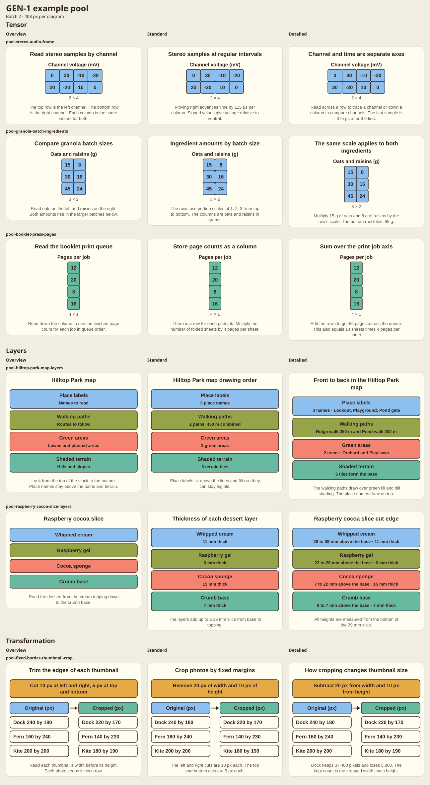

# GEN-1 example pool · Batch 2

Six new references on `explain/gen-1-pool`, each with a single diagram at all three depths. Each commit was pushed when its kind passed verification.

| Kind | Commit | Eligible Overview / Standard / Detailed | Data and reference tests | Review |
| --- | --- | --- | ---: | --- |
| Tensor | `f83becfc6` | 3 / 3 / 3 | 6 | [Tensor counts and checks](tensor/) |
| Layers | `d327924c2` | 3 / 3 / 3 | 3 | [Layers counts and checks](layers/) |
| Transformation | `41376bca8` | 11 / 4 / 3 | 2 | [Transformation counts and checks](transformation/) |

Each diagram on the sheet is rendered at a native width of 408 px. The snapshot changes add 18 IDs for these new reference variants. The compact `{ id, spec }` entries use 77–144 tokens.

The full R2 replay at `293511c1b` found zero changed picks across 3,102 existing catalogue cases and 474 saved planner cases. All 36 new prompt-depth cases selected the intended reference and kind. The web build passed. The web unit suite reported 7,393 passed, 37 skipped, and 1 todo, with zero failures.

