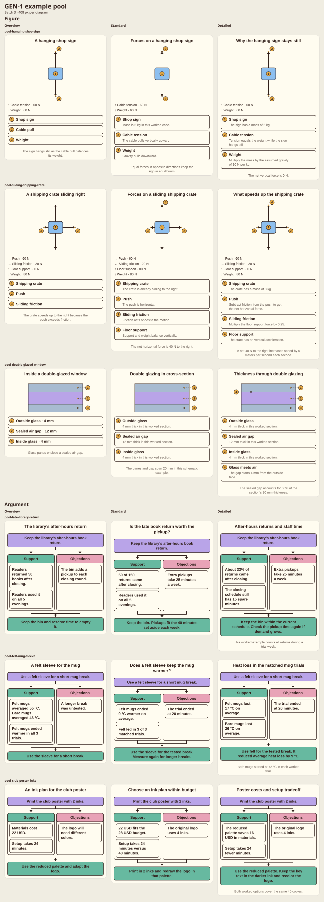

# GEN-1 example pool · Batch 3

Six new references on `explain/gen-1-pool`, each with a single diagram at all three depths. Each commit was pushed when its kind passed verification.

| Kind | Commit | Eligible Overview / Standard / Detailed | Data and reference tests | Review |
| --- | --- | --- | ---: | --- |
| Figure | `83d17a7af` | 3 / 3 / 3 | 6 | [Figure counts and checks](figure/) |
| Argument | `293511c1b` | 3 / 3 / 3 | 4 | [Argument counts and checks](argument/) |

Each diagram on the sheet is rendered at a native width of 408 px. The snapshot changes add 18 IDs for these new reference variants. The compact `{ id, spec }` entries use 94–212 tokens.

At `293511c1b`, all 24 library kinds have at least three eligible references per depth. The full R2 replay found zero changed picks across 3,102 existing catalogue cases and 474 saved planner cases. All 36 new prompt-depth cases selected the intended reference and kind. The web build passed. The web unit suite reported 7,393 passed, 37 skipped, and 1 todo, with zero failures.

