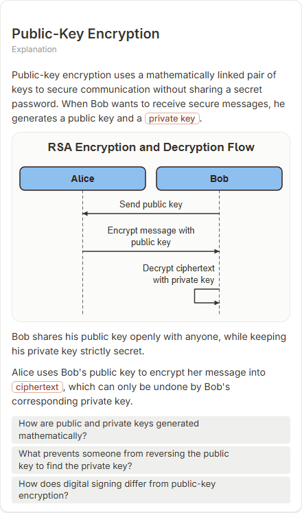

# Public-Key Encryption

- Prompt: how does public-key encryption work?
- Depth: balanced (balanced)
- Expected shape (owner): sequence: two parties, public and private keys, encrypt / decrypt messages
- Authored by: google / gemini-3.5-flash-lite
- Card as saved: 440 x 746 px at 100% zoom, KaTeX nodes 0 (errors 0)

## Body (as saved, visual markers in place)

Public-key encryption uses a mathematically linked pair of keys to secure communication without sharing a secret password. When Bob wants to receive secure messages, he generates a public key and a private key.

[[visual:1]]

Bob shares his public key openly with anyone, while keeping his private key strictly secret.

Alice uses Bob's public key to encrypt her message into ciphertext, which can only be undone by Bob's corresponding private key.

## Visuals

- [[visual:1]] diagram, kind **sequence**, title "RSA Encryption and Decryption Flow", caption "" ([spec](visual-1.json), [svg](visual-1.svg), [png](visual-1.png))

## Follow-up questions

1. How are public and private keys generated mathematically?
2. What prevents someone from reversing the public key to find the private key?
3. How does digital signing differ from public-key encryption?

## Pipeline

- Planner (jev): visualType/plan visuals [{"type":"diagram","kind":"sequence"}], depthTreatment **mechanism**, kind **sequence** (fixed), confidence {"kind":0.86,"visualType":1}, flags {"needsPlot":0.06,"isPhysical":0.08,"needsWorkedExample":0.78}; per-kind probabilities are not in the server log (only the confidence of the chosen kind). secondVisual: not in this build.
- Visuals decided by: [{"winner":"plan","kinds":["sequence"],"wordHeuristics":"off"}]
- References selected: attempt 0: shape-sequence
- Model: profile google-low v1 (hash 7a65d850970c6aad); steps [{"provider":"google","model":"gemini-3.5-flash-lite","outcome":"artifact"}]; google/gemini-3.5-flash-lite reasoning effort low, author temperature = provider default (none sent), repair temperature 0.3, fallback fireworks gpt-oss-120b (used: no)
- Timing: planner 265 ms; model call(s) 2186 ms (sum 2186 ms); whole card 2483 ms
- Tokens (author + repair calls): input 3512, output 493; cost US$0.002287
- Repaired: no; attempts 1
- Server corrections: {"block.diagramCorrections":null,"explanation_diagram_corrected events":[],"visualFallback":null,"diagramsSimplified":null,"diagram smells logged":[]}
- Page errors while rendering: none
