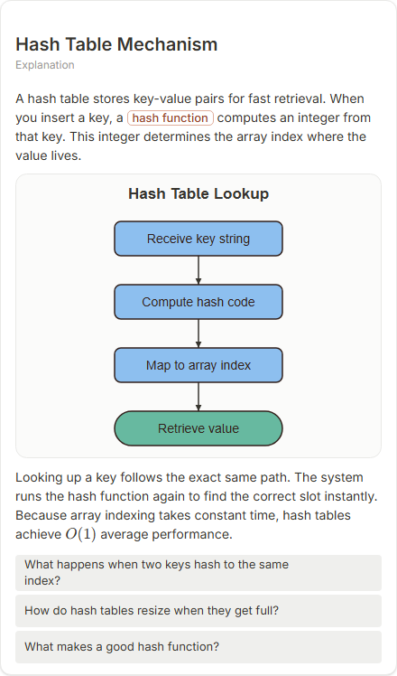

# Hash Table Mechanism

- Prompt: how does a hash table work?
- Depth: balanced (balanced)
- Expected shape (owner): transformation or flow: key -> hash function -> bucket, with a collision
- Authored by: google / gemini-3.5-flash-lite
- Card as saved: 440 x 747 px at 100% zoom, KaTeX nodes 1 (errors 0)

## Body (as saved, visual markers in place)

A hash table stores key-value pairs for fast retrieval. When you insert a key, a hash function computes an integer from that key. This integer determines the array index where the value lives.

[[visual:1]]

Looking up a key follows the exact same path. The system runs the hash function again to find the correct slot instantly. Because array indexing takes constant time, hash tables achieve $O(1)$ average performance.

## Visuals

- [[visual:1]] diagram, kind **flow**, title "Hash Table Lookup", caption "" ([spec](visual-1.json), [svg](visual-1.svg), [png](visual-1.png))

## Follow-up questions

1. What happens when two keys hash to the same index?
2. How do hash tables resize when they get full?
3. What makes a good hash function?

## Pipeline

- Planner (jev): visualType/plan visuals [{"type":"diagram","kind":"flow"}], depthTreatment **mechanism**, kind **flow** (fixed), confidence {"kind":0.8,"visualType":1}, flags {"needsPlot":0.06,"isPhysical":0.11,"needsWorkedExample":0.84}; per-kind probabilities are not in the server log (only the confidence of the chosen kind). secondVisual: not in this build.
- Visuals decided by: [{"winner":"plan","kinds":["flow"],"wordHeuristics":"off"}]
- References selected: attempt 0: shape-flow
- Model: profile google-low v1 (hash 7a65d850970c6aad); steps [{"provider":"google","model":"gemini-3.5-flash-lite","outcome":"artifact"}]; google/gemini-3.5-flash-lite reasoning effort low, author temperature = provider default (none sent), repair temperature 0.3, fallback fireworks gpt-oss-120b (used: no)
- Timing: planner 59 ms; model call(s) 2447 ms (sum 2447 ms); whole card 2553 ms
- Tokens (author + repair calls): input 3523, output 489; cost US$0.00228
- Repaired: no; attempts 1
- Server corrections: {"block.diagramCorrections":null,"explanation_diagram_corrected events":[],"visualFallback":null,"diagramsSimplified":null,"diagram smells logged":[]}
- Page errors while rendering: none
