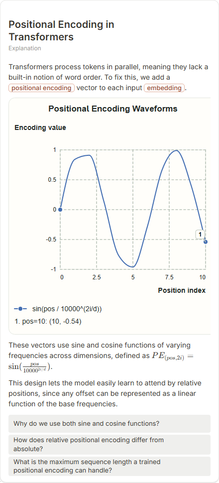

# Positional Encoding in Transformers

- Prompt: how does positional encoding work in a transformer?
- Depth: balanced (balanced)
- Expected shape (owner): coordinate-plot: two or three sinusoids over position; tensor strip optional
- Authored by: google / gemini-3.5-flash-lite
- Card as saved: 440 x 969 px at 100% zoom, KaTeX nodes 1 (errors 0)

## Body (as saved, visual markers in place)

Transformers process tokens in parallel, meaning they lack a built-in notion of word order. To fix this, we add a positional encoding vector to each input embedding.

[[visual:1]]

These vectors use sine and cosine functions of varying frequencies across dimensions, defined as $PE_{(pos, 2i)} = \sin(\frac{pos}{10000^{2i/d}})$.

This design lets the model easily learn to attend by relative positions, since any offset can be represented as a linear function of the base frequencies.

## Visuals

- [[visual:1]] diagram, kind **coordinate-plot**, title "Positional Encoding Waveforms", caption "" ([spec](visual-1.json), [svg](visual-1.svg), [png](visual-1.png))

## Follow-up questions

1. Why do we use both sine and cosine functions?
2. How does relative positional encoding differ from absolute?
3. What is the maximum sequence length a trained positional encoding can handle?

## Pipeline

- Planner (jev): visualType/plan visuals [{"type":"diagram","kind":"coordinate-plot"}], depthTreatment **mechanism**, kind **coordinate-plot** (fixed), confidence {"kind":0.71,"visualType":1}, flags {"needsPlot":0.41,"isPhysical":0.09,"needsWorkedExample":0.8}; per-kind probabilities are not in the server log (only the confidence of the chosen kind). secondVisual: not in this build.
- Visuals decided by: [{"winner":"plan","kinds":["coordinate-plot"],"wordHeuristics":"off"}]
- References selected: attempt 0: shape-coordinate-plot
- Model: profile google-low v1 (hash 7a65d850970c6aad); steps [{"provider":"google","model":"gemini-3.5-flash-lite","outcome":"artifact"}]; google/gemini-3.5-flash-lite reasoning effort low, author temperature = provider default (none sent), repair temperature 0.3, fallback fireworks gpt-oss-120b (used: no)
- Timing: planner 67 ms; model call(s) 3050 ms (sum 3050 ms); whole card 3156 ms
- Tokens (author + repair calls): input 3603, output 667; cost US$0.002749
- Repaired: no; attempts 1
- Server corrections: {"block.diagramCorrections":null,"explanation_diagram_corrected events":[],"visualFallback":null,"diagramsSimplified":null,"diagram smells logged":["bare_maths"]}
- Page errors while rendering: none
