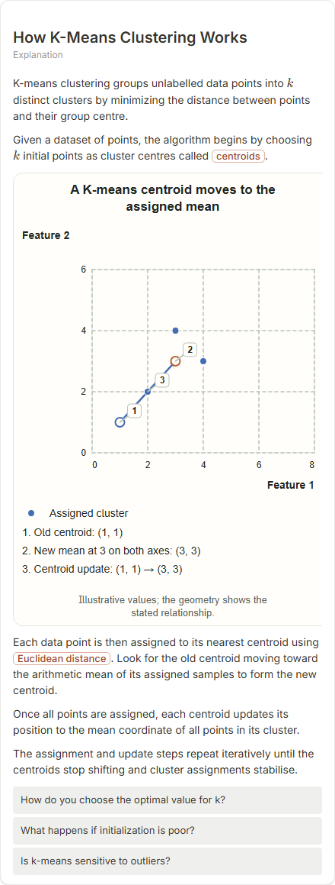

# How K-Means Clustering Works

- Prompt: how does k-means clustering work?
- Depth: balanced (balanced)
- Expected shape (owner): coordinate-plot scatter: points, centroids, one re-assignment step
- Authored by: google / gemini-3.5-flash-lite
- Card as saved: 440 x 1159 px at 100% zoom, KaTeX nodes 2 (errors 0)

## Body (as saved, visual markers in place)

K-means clustering groups unlabelled data points into $k$ distinct clusters by minimizing the distance between points and their group centre.

Given a dataset of points, the algorithm begins by choosing $k$ initial points as cluster centres called centroids.

[[visual:1]]

Each data point is then assigned to its nearest centroid using Euclidean distance. Look for the old centroid moving toward the arithmetic mean of its assigned samples to form the new centroid.

Once all points are assigned, each centroid updates its position to the mean coordinate of all points in its cluster.

The assignment and update steps repeat iteratively until the centroids stop shifting and cluster assignments stabilise.

## Visuals

- [[visual:1]] diagram, kind **coordinate-plot**, title "A K-means centroid moves to the assigned mean", caption "Illustrative values; the geometry shows the stated relationship." ([spec](visual-1.json), [svg](visual-1.svg), [png](visual-1.png))

## Follow-up questions

1. How do you choose the optimal value for k?
2. What happens if initialization is poor?
3. Is k-means sensitive to outliers?

## Pipeline

- Planner (jev): visualType/plan visuals [{"type":"diagram","kind":"coordinate-plot"}], depthTreatment **mechanism**, kind **coordinate-plot** (fixed), confidence {"kind":0.83,"visualType":1}, flags {"needsPlot":0.15,"isPhysical":0.09,"needsWorkedExample":0.84}; per-kind probabilities are not in the server log (only the confidence of the chosen kind). secondVisual: not in this build.
- Visuals decided by: [{"winner":"plan","kinds":["coordinate-plot"],"wordHeuristics":"off"}]
- References selected: attempt 0: shape-coordinate-plot, kmeans-centroid-update, clustering-elbow-silhouette
- Model: profile google-low v1 (hash 7a65d850970c6aad); steps [{"provider":"google","model":"gemini-3.5-flash-lite","outcome":"artifact"}]; google/gemini-3.5-flash-lite reasoning effort low, author temperature = provider default (none sent), repair temperature 0.3, fallback fireworks gpt-oss-120b (used: no)
- Timing: planner 249 ms; model call(s) 3080 ms (sum 3080 ms); whole card 3427 ms
- Tokens (author + repair calls): input 4013, output 738; cost US$0.003049
- Repaired: no; attempts 1
- Server corrections: {"block.diagramCorrections":null,"explanation_diagram_corrected events":[],"visualFallback":null,"diagramsSimplified":null,"diagram smells logged":[]}
- Page errors while rendering: none
