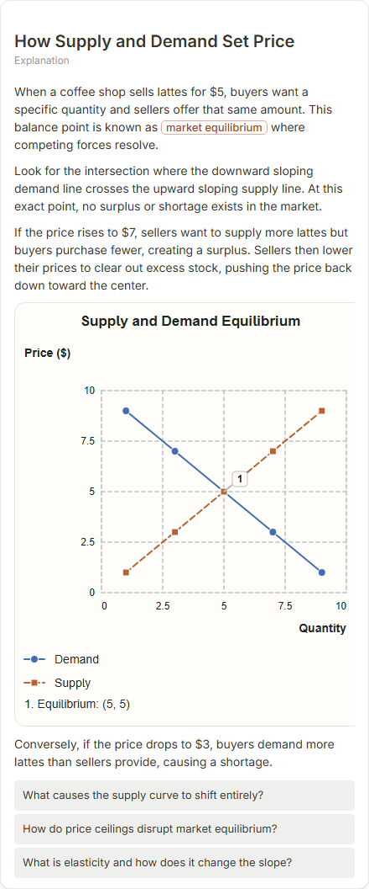

# How Supply and Demand Set Price

- Prompt: how do supply and demand set a price?
- Depth: balanced (balanced)
- Expected shape (owner): coordinate-plot: supply and demand lines crossing at the equilibrium, annotated point
- Authored by: google / gemini-3.5-flash-lite
- Card as saved: 440 x 1056 px at 100% zoom, KaTeX nodes 0 (errors 0)

## Body (as saved, visual markers in place)

When a coffee shop sells lattes for $5, buyers want a specific quantity and sellers offer that same amount. This balance point is known as market equilibrium where competing forces resolve.

Look for the intersection where the downward sloping demand line crosses the upward sloping supply line. At this exact point, no surplus or shortage exists in the market.

If the price rises to $7, sellers want to supply more lattes but buyers purchase fewer, creating a surplus. Sellers then lower their prices to clear out excess stock, pushing the price back down toward the center.

[[visual:1]]

Conversely, if the price drops to $3, buyers demand more lattes than sellers provide, causing a shortage.

## Visuals

- [[visual:1]] diagram, kind **coordinate-plot**, title "Supply and Demand Equilibrium", caption "" ([spec](visual-1.json), [svg](visual-1.svg), [png](visual-1.png))

## Follow-up questions

1. What causes the supply curve to shift entirely?
2. How do price ceilings disrupt market equilibrium?
3. What is elasticity and how does it change the slope?

## Pipeline

- Planner (jev): visualType/plan visuals [{"type":"diagram","kind":"coordinate-plot"}], depthTreatment **mechanism**, kind **coordinate-plot** (fixed), confidence {"kind":0.98,"visualType":1}, flags {"needsPlot":0.75,"isPhysical":0.09,"needsWorkedExample":0.79}; per-kind probabilities are not in the server log (only the confidence of the chosen kind). secondVisual: not in this build.
- Visuals decided by: [{"winner":"plan","kinds":["coordinate-plot"],"wordHeuristics":"off"}]
- References selected: attempt 0: shape-coordinate-plot
- Model: profile google-low v1 (hash 7a65d850970c6aad); steps [{"provider":"google","model":"gemini-3.5-flash-lite","outcome":"artifact"}]; google/gemini-3.5-flash-lite reasoning effort low, author temperature = provider default (none sent), repair temperature 0.3, fallback fireworks gpt-oss-120b (used: no)
- Timing: planner 184 ms; model call(s) 3187 ms (sum 3187 ms); whole card 3425 ms
- Tokens (author + repair calls): input 3603, output 633; cost US$0.002664
- Repaired: no; attempts 1
- Server corrections: {"block.diagramCorrections":null,"explanation_diagram_corrected events":[],"visualFallback":null,"diagramsSimplified":null,"diagram smells logged":[]}
- Page errors while rendering: none
