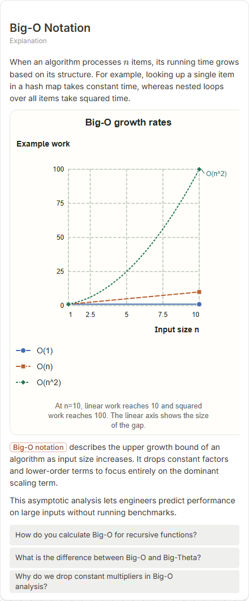

# Big-O Notation

- Prompt: what is Big-O notation?
- Depth: balanced (balanced)
- Expected shape (owner): coordinate-plot: growth curves O(1), O(log n), O(n), O(n^2); or comparison
- Authored by: google / gemini-3.5-flash-lite
- Card as saved: 440 x 1057 px at 100% zoom, KaTeX nodes 1 (errors 0)

## Body (as saved, visual markers in place)

When an algorithm processes $n$ items, its running time grows based on its structure. For example, looking up a single item in a hash map takes constant time, whereas nested loops over all items take squared time.

[[visual:1]]

Big-O notation describes the upper growth bound of an algorithm as input size increases. It drops constant factors and lower-order terms to focus entirely on the dominant scaling term.

This asymptotic analysis lets engineers predict performance on large inputs without running benchmarks.

## Visuals

- [[visual:1]] diagram, kind **coordinate-plot**, title "Big-O growth rates", caption "At n=10, linear work reaches 10 and squared work reaches 100. The linear axis shows the size of the gap." ([spec](visual-1.json), [svg](visual-1.svg), [png](visual-1.png))

## Follow-up questions

1. How do you calculate Big-O for recursive functions?
2. What is the difference between Big-O and Big-Theta?
3. Why do we drop constant multipliers in Big-O analysis?

## Pipeline

- Planner (jev): visualType/plan visuals [{"type":"diagram","kind":"coordinate-plot"}], depthTreatment **mechanism**, kind **coordinate-plot** (fixed), confidence {"kind":0.99,"visualType":1}, flags {"needsPlot":0.77,"isPhysical":0.09,"needsWorkedExample":0.7}; per-kind probabilities are not in the server log (only the confidence of the chosen kind). secondVisual: not in this build.
- Visuals decided by: [{"winner":"plan","kinds":["coordinate-plot"],"wordHeuristics":"off"}]
- References selected: attempt 0: shape-coordinate-plot, big-o-growth-rates
- Model: profile google-low v1 (hash 7a65d850970c6aad); steps [{"provider":"google","model":"gemini-3.5-flash-lite","outcome":"artifact"}]; google/gemini-3.5-flash-lite reasoning effort low, author temperature = provider default (none sent), repair temperature 0.3, fallback fireworks gpt-oss-120b (used: no)
- Timing: planner 108 ms; model call(s) 3511 ms (sum 3511 ms); whole card 3666 ms
- Tokens (author + repair calls): input 4179, output 972; cost US$0.003684
- Repaired: no; attempts 1
- Server corrections: {"block.diagramCorrections":null,"explanation_diagram_corrected events":[],"visualFallback":null,"diagramsSimplified":null,"diagram smells logged":["bare_maths"]}
- Page errors while rendering: none
