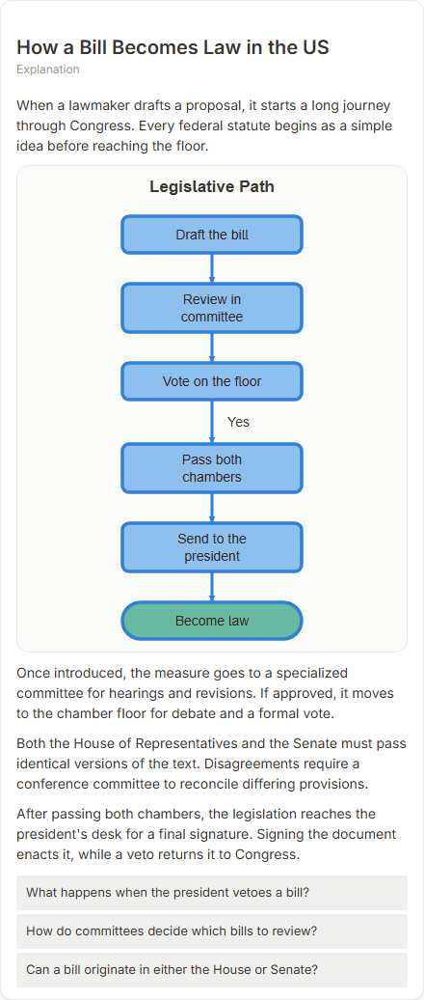

# How a Bill Becomes Law in the US

- Prompt: how does a bill become law in the United States?
- Depth: balanced (balanced)
- Expected shape (owner): flow with decisions: committee, both chambers, veto, override
- Authored by: google / gemini-3.5-flash-lite
- Card as saved: 440 x 1036 px at 100% zoom, KaTeX nodes 0 (errors 0)

## Body (as saved, visual markers in place)

When a lawmaker drafts a proposal, it starts a long journey through Congress. Every federal statute begins as a simple idea before reaching the floor.

[[visual:1]]

Once introduced, the measure goes to a specialized committee for hearings and revisions. If approved, it moves to the chamber floor for debate and a formal vote.

Both the House of Representatives and the Senate must pass identical versions of the text. Disagreements require a conference committee to reconcile differing provisions.

After passing both chambers, the legislation reaches the president's desk for a final signature. Signing the document enacts it, while a veto returns it to Congress.

## Visuals

- [[visual:1]] diagram, kind **flow**, title "Legislative Path", caption "" ([spec](visual-1.json), [raw as the model wrote it](visual-1.raw.json), [svg](visual-1.svg), [png](visual-1.png))

## Follow-up questions

1. What happens when the president vetoes a bill?
2. How do committees decide which bills to review?
3. Can a bill originate in either the House or Senate?

## Pipeline

- Planner (jev): visualType/plan visuals [{"type":"diagram","kind":"flow"}], depthTreatment **mechanism**, kind **flow** (fixed), confidence {"kind":0.99,"visualType":1}, flags {"needsPlot":0.03,"isPhysical":0.08,"needsWorkedExample":0.16}; per-kind probabilities are not in the server log (only the confidence of the chosen kind). secondVisual: not in this build.
- Visuals decided by: [{"winner":"plan","kinds":["flow"],"wordHeuristics":"off"}]
- References selected: attempt 0: shape-flow
- Model: profile google-low v1 (hash 7a65d850970c6aad); steps [{"provider":"google","model":"gemini-3.5-flash-lite","outcome":"artifact"}]; google/gemini-3.5-flash-lite reasoning effort low, author temperature = provider default (none sent), repair temperature 0.3, fallback fireworks gpt-oss-120b (used: no)
- Timing: planner 353 ms; model call(s) 2504 ms (sum 2504 ms); whole card 2904 ms
- Tokens (author + repair calls): input 3531, output 648; cost US$0.00268
- Repaired: no; attempts 1
- Server corrections: {"block.diagramCorrections":{"one_branch_decision":1},"explanation_diagram_corrected events":["one_branch_decision"],"visualFallback":null,"diagramsSimplified":null,"diagram smells logged":[]}
- Page errors while rendering: none
