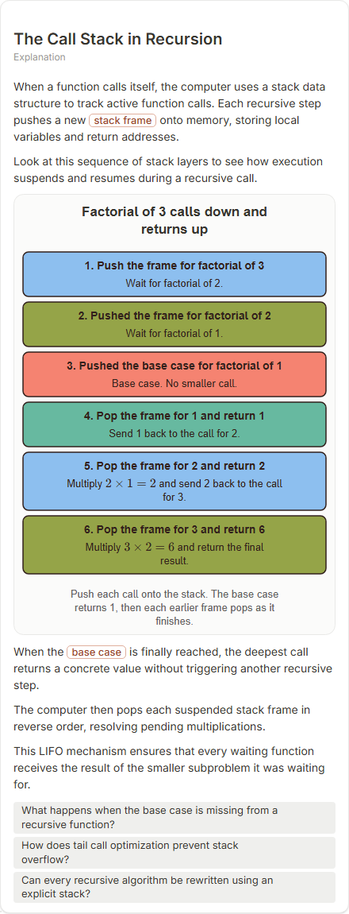

# The Call Stack in Recursion

- Prompt: how does the call stack work during recursion?
- Depth: balanced (balanced)
- Expected shape (owner): layers or block-stack: frames pushed and popped, base case
- Authored by: google / gemini-3.5-flash-lite
- Card as saved: 440 x 1149 px at 100% zoom, KaTeX nodes 2 (errors 0)

## Body (as saved, visual markers in place)

When a function calls itself, the computer uses a stack data structure to track active function calls. Each recursive step pushes a new stack frame onto memory, storing local variables and return addresses.

Look at this sequence of stack layers to see how execution suspends and resumes during a recursive call.

[[visual:1]]

When the base case is finally reached, the deepest call returns a concrete value without triggering another recursive step.

The computer then pops each suspended stack frame in reverse order, resolving pending multiplications.

This LIFO mechanism ensures that every waiting function receives the result of the smaller subproblem it was waiting for.

## Visuals

- [[visual:1]] diagram, kind **layers**, title "Factorial of 3 calls down and returns up", caption "Push each call onto the stack. The base case returns 1, then each earlier frame pops as it finishes." ([spec](visual-1.json), [svg](visual-1.svg), [png](visual-1.png))

## Follow-up questions

1. What happens when the base case is missing from a recursive function?
2. How does tail call optimization prevent stack overflow?
3. Can every recursive algorithm be rewritten using an explicit stack?

## Pipeline

- Planner (jev): visualType/plan visuals [{"type":"diagram","kind":"layers"}], depthTreatment **mechanism**, kind **layers** (fixed), confidence {"kind":0.96,"visualType":1}, flags {"needsPlot":0.11,"isPhysical":0.09,"needsWorkedExample":0.81}; per-kind probabilities are not in the server log (only the confidence of the chosen kind). secondVisual: not in this build.
- Visuals decided by: [{"winner":"plan","kinds":["layers"],"wordHeuristics":"off"}]
- References selected: attempt 0: shape-layers, recursion-factorial-unwind
- Model: profile google-low v1 (hash 7a65d850970c6aad); steps [{"provider":"google","model":"gemini-3.5-flash-lite","outcome":"artifact"}]; google/gemini-3.5-flash-lite reasoning effort low, author temperature = provider default (none sent), repair temperature 0.3, fallback fireworks gpt-oss-120b (used: no)
- Timing: planner 79 ms; model call(s) 3194 ms (sum 3194 ms); whole card 3320 ms
- Tokens (author + repair calls): input 3757, output 770; cost US$0.003053
- Repaired: no; attempts 1
- Server corrections: {"block.diagramCorrections":null,"explanation_diagram_corrected events":[],"visualFallback":null,"diagramsSimplified":null,"diagram smells logged":[]}
- Page errors while rendering: none
