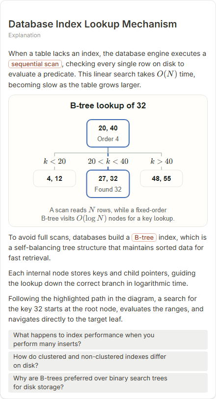

# Database Index Lookup Mechanism

- Prompt: how does a database index speed up a query?
- Depth: balanced (balanced)
- Expected shape (owner): tree (B-tree) or comparison: scan vs index lookup
- Authored by: google / gemini-3.5-flash-lite
- Card as saved: 440 x 814 px at 100% zoom, KaTeX nodes 6 (errors 0)

## Body (as saved, visual markers in place)

When a table lacks an index, the database engine executes a sequential scan, checking every single row on disk to evaluate a predicate. This linear search takes $O(N)$ time, becoming slow as the table grows larger.

[[visual:1]]

To avoid full scans, databases build a B-tree index, which is a self-balancing tree structure that maintains sorted data for fast retrieval.

Each internal node stores keys and child pointers, guiding the lookup down the correct branch in logarithmic time.

Following the highlighted path in the diagram, a search for the key 32 starts at the root node, evaluates the ranges, and navigates directly to the target leaf.

## Visuals

- [[visual:1]] diagram, kind **tree**, title "B-tree lookup of 32", caption "A scan reads $N$ rows, while a fixed-order B-tree visits $O(\log N)$ nodes for a key lookup." ([spec](visual-1.json), [svg](visual-1.svg), [png](visual-1.png))

## Follow-up questions

1. What happens to index performance when you perform many inserts?
2. How do clustered and non-clustered indexes differ on disk?
3. Why are B-trees preferred over binary search trees for disk storage?

## Pipeline

- Planner (jev): visualType/plan visuals [{"type":"diagram","kind":"tree"}], depthTreatment **mechanism**, kind **tree** (fixed), confidence {"kind":0.81,"visualType":1}, flags {"needsPlot":0.11,"isPhysical":0.09,"needsWorkedExample":0.63}; per-kind probabilities are not in the server log (only the confidence of the chosen kind). secondVisual: not in this build.
- Visuals decided by: [{"winner":"plan","kinds":["tree"],"wordHeuristics":"off"}]
- References selected: attempt 0: shape-tree, tree-btree-lookup
- Model: profile google-low v1 (hash 7a65d850970c6aad); steps [{"provider":"google","model":"gemini-3.5-flash-lite","outcome":"artifact"}]; google/gemini-3.5-flash-lite reasoning effort low, author temperature = provider default (none sent), repair temperature 0.3, fallback fireworks gpt-oss-120b (used: no)
- Timing: planner 112 ms; model call(s) 2744 ms (sum 2744 ms); whole card 2893 ms
- Tokens (author + repair calls): input 3734, output 679; cost US$0.002818
- Repaired: no; attempts 1
- Server corrections: {"block.diagramCorrections":null,"explanation_diagram_corrected events":[],"visualFallback":null,"diagramsSimplified":null,"diagram smells logged":[]}
- Page errors while rendering: none
