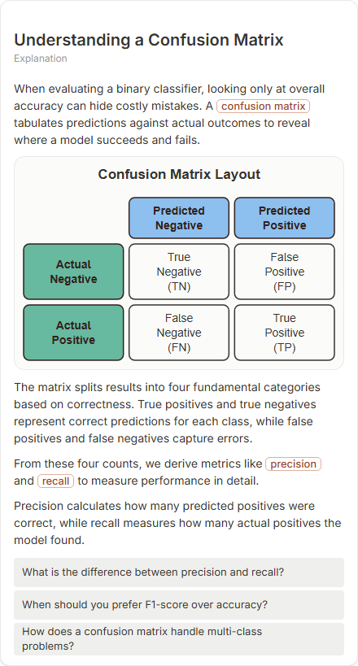

# Understanding a Confusion Matrix

- Prompt: how does a confusion matrix work?
- Depth: balanced (balanced)
- Expected shape (owner): matrix: actual vs predicted, TP/FP/FN/TN, with precision and recall derived
- Authored by: google / gemini-3.5-flash-lite
- Card as saved: 440 x 819 px at 100% zoom, KaTeX nodes 0 (errors 0)

## Body (as saved, visual markers in place)

When evaluating a binary classifier, looking only at overall accuracy can hide costly mistakes. A confusion matrix tabulates predictions against actual outcomes to reveal where a model succeeds and fails.

[[visual:1]]

The matrix splits results into four fundamental categories based on correctness. True positives and true negatives represent correct predictions for each class, while false positives and false negatives capture errors.

From these four counts, we derive metrics like precision and recall to measure performance in detail.

Precision calculates how many predicted positives were correct, while recall measures how many actual positives the model found.

## Visuals

- [[visual:1]] diagram, kind **matrix**, title "Confusion Matrix Layout", caption "" ([spec](visual-1.json), [svg](visual-1.svg), [png](visual-1.png))

## Follow-up questions

1. What is the difference between precision and recall?
2. When should you prefer F1-score over accuracy?
3. How does a confusion matrix handle multi-class problems?

## Pipeline

- Planner (jev): visualType/plan visuals [{"type":"diagram","kind":"matrix"}], depthTreatment **mechanism**, kind **matrix** (fixed), confidence {"kind":1,"visualType":1}, flags {"needsPlot":0.61,"isPhysical":0.09,"needsWorkedExample":0.86}; per-kind probabilities are not in the server log (only the confidence of the chosen kind). secondVisual: not in this build.
- Visuals decided by: [{"winner":"plan","kinds":["matrix"],"wordHeuristics":"off"}]
- References selected: attempt 0: shape-matrix
- Model: profile google-low v1 (hash 7a65d850970c6aad); steps [{"provider":"google","model":"gemini-3.5-flash-lite","outcome":"artifact"}]; google/gemini-3.5-flash-lite reasoning effort low, author temperature = provider default (none sent), repair temperature 0.3, fallback fireworks gpt-oss-120b (used: no)
- Timing: planner 93 ms; model call(s) 2752 ms (sum 2752 ms); whole card 2882 ms
- Tokens (author + repair calls): input 3489, output 479; cost US$0.002245
- Repaired: no; attempts 1
- Server corrections: {"block.diagramCorrections":null,"explanation_diagram_corrected events":[],"visualFallback":null,"diagramsSimplified":null,"diagram smells logged":[]}
- Page errors while rendering: none
