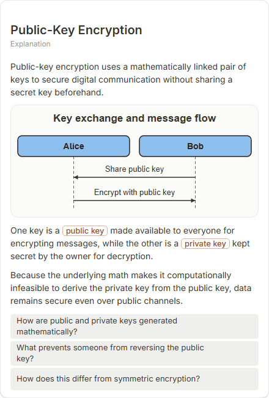

# Public-Key Encryption

- Prompt: how does public-key encryption work?
- Depth: balanced (balanced)
- Expected shape (owner): sequence: two parties, public and private keys, encrypt / decrypt messages
- Authored by: google / gemini-3.5-flash-lite
- Card as saved: 440 x 651 px at 100% zoom, KaTeX nodes 0 (errors 0)

## Body (as saved, visual markers in place)

Public-key encryption uses a mathematically linked pair of keys to secure digital communication without sharing a secret key beforehand.

[[visual:1]]

One key is a public key made available to everyone for encrypting messages, while the other is a private key kept secret by the owner for decryption.

Because the underlying math makes it computationally infeasible to derive the private key from the public key, data remains secure even over public channels.

## Visuals

- [[visual:1]] diagram, kind **sequence**, title "Key exchange and message flow", caption "" ([spec](visual-1.json), [raw as the model wrote it](visual-1.raw.json), [svg](visual-1.svg), [png](visual-1.png))

## Follow-up questions

1. How are public and private keys generated mathematically?
2. What prevents someone from reversing the public key?
3. How does this differ from symmetric encryption?

## Pipeline

- Planner (jev): visualType/plan visuals [{"type":"diagram","kind":"sequence"}], depthTreatment **mechanism**, kind **sequence** (fixed), confidence {"kind":0.84,"visualType":1}, flags {"needsPlot":0.06,"isPhysical":0.07,"needsWorkedExample":0.76}; per-kind probabilities are not in the server log (only the confidence of the chosen kind). secondVisual: not in this build.
- Visuals decided by: [{"winner":"plan","kinds":["sequence"],"wordHeuristics":"off"}]
- References selected: attempt 0: shape-sequence; attempt 1: shape-sequence
- Model: profile google-low v1 (hash 7a65d850970c6aad); steps [{"provider":"google","model":"gemini-3.5-flash-lite","outcome":"artifact"}]; google/gemini-3.5-flash-lite reasoning effort low, author temperature = provider default (none sent), repair temperature 0.3, fallback fireworks gpt-oss-120b (used: no)
- Timing: planner 671 ms; model call(s) 2718 + 1922 ms (sum 4640 ms); whole card 5533 ms
- Tokens (author + repair calls): input 6351, output 724 (3001/437 + 3350/287); cost US$0.003716
- Repaired: yes; attempts 1
- Repair causes (first attempt invalid):
  - attempt 0: explanation_bad_diagram: the rh-diagram spec is not valid (diagram.messages.2: An actor cannot send a message to itself)
- Server corrections: {"block.diagramCorrections":{"simplified_sequence":1},"explanation_diagram_corrected events":["simplified_sequence"],"visualFallback":"simplified","diagramsSimplified":1,"diagram smells logged":[]}
- Page errors while rendering: none
