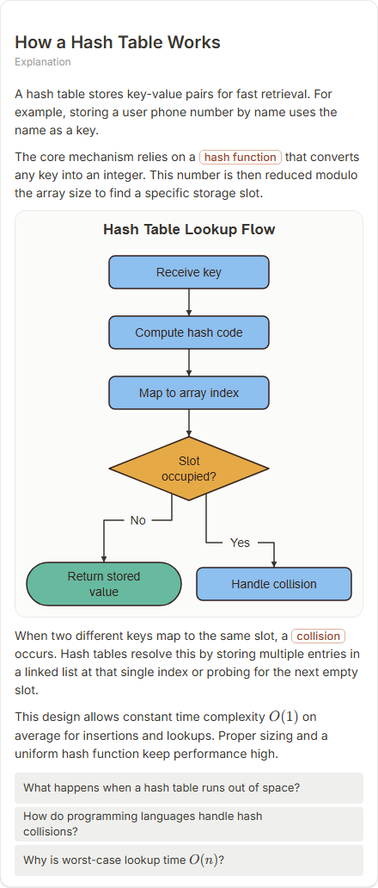

# How a Hash Table Works

- Prompt: how does a hash table work?
- Depth: balanced (balanced)
- Expected shape (owner): transformation or flow: key -> hash function -> bucket, with a collision
- Authored by: google / gemini-3.5-flash-lite
- Card as saved: 440 x 1030 px at 100% zoom, KaTeX nodes 2 (errors 0)

## Body (as saved, visual markers in place)

A hash table stores key-value pairs for fast retrieval. For example, storing a user phone number by name uses the name as a key.

The core mechanism relies on a hash function that converts any key into an integer. This number is then reduced modulo the array size to find a specific storage slot.

[[visual:1]]

When two different keys map to the same slot, a collision occurs. Hash tables resolve this by storing multiple entries in a linked list at that single index or probing for the next empty slot.

This design allows constant time complexity $O(1)$ on average for insertions and lookups. Proper sizing and a uniform hash function keep performance high.

## Visuals

- [[visual:1]] diagram, kind **flow**, title "Hash Table Lookup Flow", caption "" ([spec](visual-1.json), [svg](visual-1.svg), [png](visual-1.png))

## Follow-up questions

1. What happens when a hash table runs out of space?
2. How do programming languages handle hash collisions?
3. Why is worst-case lookup time $O(n)$?

## Pipeline

- Planner (jev): visualType/plan visuals [{"type":"diagram","kind":"flow"}], depthTreatment **mechanism**, kind **flow** (fixed), confidence {"kind":0.86,"visualType":1}, flags {"needsPlot":0.07,"isPhysical":0.1,"needsWorkedExample":0.84}; per-kind probabilities are not in the server log (only the confidence of the chosen kind). secondVisual: not in this build.
- Visuals decided by: [{"winner":"plan","kinds":["flow"],"wordHeuristics":"off"}]
- References selected: attempt 0: shape-flow
- Model: profile google-low v1 (hash 7a65d850970c6aad); steps [{"provider":"google","model":"gemini-3.5-flash-lite","outcome":"artifact"}]; google/gemini-3.5-flash-lite reasoning effort low, author temperature = provider default (none sent), repair temperature 0.3, fallback fireworks gpt-oss-120b (used: no)
- Timing: planner 110 ms; model call(s) 2857 ms (sum 2857 ms); whole card 3013 ms
- Tokens (author + repair calls): input 3020, output 710; cost US$0.002681
- Repaired: no; attempts 1
- Server corrections: {"block.diagramCorrections":null,"explanation_diagram_corrected events":[],"visualFallback":null,"diagramsSimplified":null,"diagram smells logged":[]}
- Page errors while rendering: none
