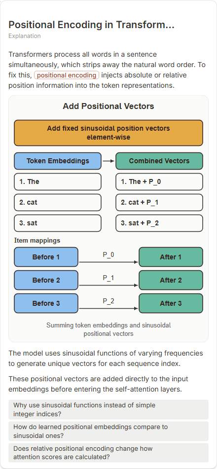

# Positional Encoding in Transformers

- Prompt: how does positional encoding work in a transformer?
- Depth: balanced (balanced)
- Expected shape (owner): coordinate-plot: two or three sinusoids over position; tensor strip optional
- Authored by: google / gemini-3.5-flash-lite
- Card as saved: 440 x 950 px at 100% zoom, KaTeX nodes 0 (errors 0)

## Body (as saved, visual markers in place)

Transformers process all words in a sentence simultaneously, which strips away the natural word order. To fix this, positional encoding injects absolute or relative position information into the token representations.

[[visual:1]]

The model uses sinusoidal functions of varying frequencies to generate unique vectors for each sequence index.

These positional vectors are added directly to the input embeddings before entering the self-attention layers.

## Visuals

- [[visual:1]] diagram, kind **transformation**, title "Add Positional Vectors", caption "Summing token embeddings and sinusoidal positional vectors" ([spec](visual-1.json), [svg](visual-1.svg), [png](visual-1.png))

## Follow-up questions

1. Why use sinusoidal functions instead of simple integer indices?
2. How do learned positional embeddings compare to sinusoidal ones?
3. Does relative positional encoding change how attention scores are calculated?

## Pipeline

- Planner (jev): visualType/plan visuals [{"type":"diagram","kind":"transformation"}], depthTreatment **mechanism**, kind **transformation** (fixed), confidence {"kind":0.66,"visualType":1}, flags {"needsPlot":0.37,"isPhysical":0.09,"needsWorkedExample":0.79}; per-kind probabilities are not in the server log (only the confidence of the chosen kind). secondVisual: not in this build.
- Visuals decided by: [{"winner":"plan","kinds":["transformation"],"wordHeuristics":"off"}]
- References selected: attempt 0: shape-transformation
- Model: profile google-low v1 (hash 7a65d850970c6aad); steps [{"provider":"google","model":"gemini-3.5-flash-lite","outcome":"artifact"}]; google/gemini-3.5-flash-lite reasoning effort low, author temperature = provider default (none sent), repair temperature 0.3, fallback fireworks gpt-oss-120b (used: no)
- Timing: planner 111 ms; model call(s) 2314 ms (sum 2314 ms); whole card 2474 ms
- Tokens (author + repair calls): input 3022, output 455; cost US$0.002045
- Repaired: no; attempts 1
- Server corrections: {"block.diagramCorrections":null,"explanation_diagram_corrected events":[],"visualFallback":null,"diagramsSimplified":null,"diagram smells logged":["bare_maths","bare_maths","bare_maths","bare_maths","bare_maths","bare_maths"]}
- Page errors while rendering: none
