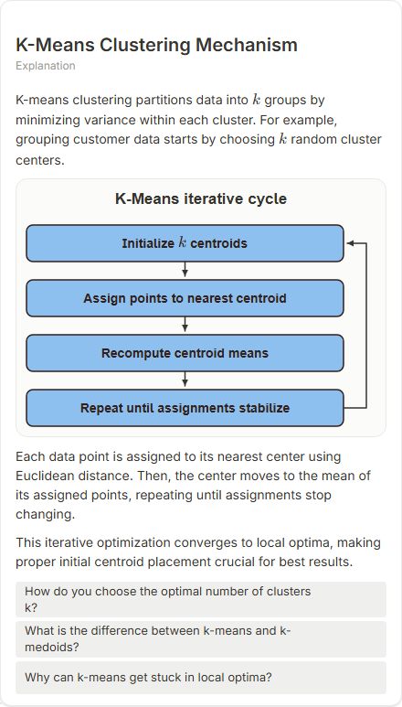

# K-Means Clustering Mechanism

- Prompt: how does k-means clustering work?
- Depth: balanced (balanced)
- Expected shape (owner): coordinate-plot scatter: points, centroids, one re-assignment step
- Authored by: google / gemini-3.5-flash-lite
- Card as saved: 440 x 772 px at 100% zoom, KaTeX nodes 3 (errors 0)

## Body (as saved, visual markers in place)

K-means clustering partitions data into $k$ groups by minimizing variance within each cluster. For example, grouping customer data starts by choosing $k$ random cluster centers.

[[visual:1]]

Each data point is assigned to its nearest center using Euclidean distance. Then, the center moves to the mean of its assigned points, repeating until assignments stop changing.

This iterative optimization converges to local optima, making proper initial centroid placement crucial for best results.

## Visuals

- [[visual:1]] diagram, kind **cycle**, title "K-Means iterative cycle", caption "" ([spec](visual-1.json), [svg](visual-1.svg), [png](visual-1.png))

## Follow-up questions

1. How do you choose the optimal number of clusters k?
2. What is the difference between k-means and k-medoids?
3. Why can k-means get stuck in local optima?

## Pipeline

- Planner (jev): visualType/plan visuals [{"type":"diagram","kind":"cycle"}], depthTreatment **mechanism**, kind **cycle** (fixed), confidence {"kind":0.78,"visualType":1}, flags {"needsPlot":0.17,"isPhysical":0.09,"needsWorkedExample":0.83}; per-kind probabilities are not in the server log (only the confidence of the chosen kind). secondVisual: not in this build.
- Visuals decided by: [{"winner":"plan","kinds":["cycle"],"wordHeuristics":"off"}]
- References selected: attempt 0: shape-cycle
- Model: profile google-low v1 (hash 7a65d850970c6aad); steps [{"provider":"google","model":"gemini-3.5-flash-lite","outcome":"artifact"}]; google/gemini-3.5-flash-lite reasoning effort low, author temperature = provider default (none sent), repair temperature 0.3, fallback fireworks gpt-oss-120b (used: no)
- Timing: planner 92 ms; model call(s) 1968 ms (sum 1968 ms); whole card 2107 ms
- Tokens (author + repair calls): input 2924, output 228; cost US$0.001448
- Repaired: no; attempts 1
- Server corrections: {"block.diagramCorrections":null,"explanation_diagram_corrected events":[],"visualFallback":null,"diagramsSimplified":null,"diagram smells logged":[]}
- Page errors while rendering: none
