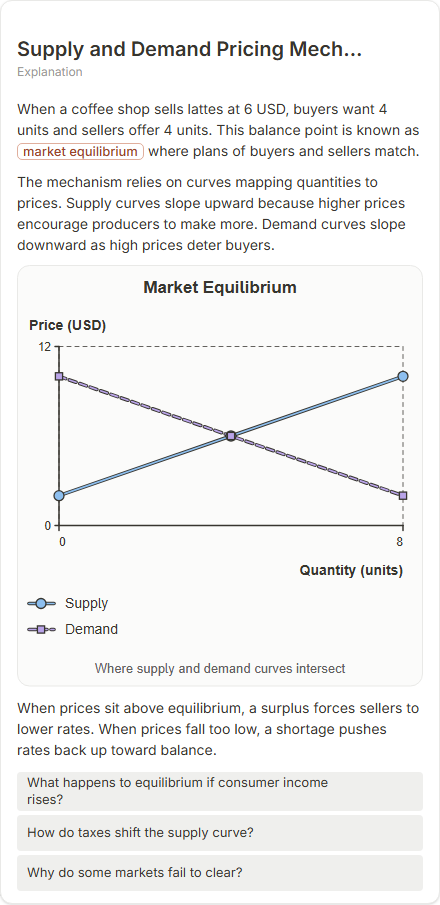

# Supply and Demand Pricing Mechanism

- Prompt: how do supply and demand set a price?
- Depth: balanced (balanced)
- Expected shape (owner): coordinate-plot: supply and demand lines crossing at the equilibrium, annotated point
- Authored by: google / gemini-3.5-flash-lite
- Card as saved: 440 x 904 px at 100% zoom, KaTeX nodes 0 (errors 0)

## Body (as saved, visual markers in place)

When a coffee shop sells lattes at 6 USD, buyers want 4 units and sellers offer 4 units. This balance point is known as market equilibrium where plans of buyers and sellers match.

The mechanism relies on curves mapping quantities to prices. Supply curves slope upward because higher prices encourage producers to make more. Demand curves slope downward as high prices deter buyers.

[[visual:1]]

When prices sit above equilibrium, a surplus forces sellers to lower rates. When prices fall too low, a shortage pushes rates back up toward balance.

## Visuals

- [[visual:1]] diagram, kind **coordinate-plot**, title "Market Equilibrium", caption "Where supply and demand curves intersect" ([spec](visual-1.json), [svg](visual-1.svg), [png](visual-1.png))

## Follow-up questions

1. What happens to equilibrium if consumer income rises?
2. How do taxes shift the supply curve?
3. Why do some markets fail to clear?

## Pipeline

- Planner (jev): visualType/plan visuals [{"type":"diagram","kind":"coordinate-plot"}], depthTreatment **mechanism**, kind **coordinate-plot** (fixed), confidence {"kind":0.99,"visualType":1}, flags {"needsPlot":0.77,"isPhysical":0.1,"needsWorkedExample":0.8}; per-kind probabilities are not in the server log (only the confidence of the chosen kind). secondVisual: not in this build.
- Visuals decided by: [{"winner":"plan","kinds":["coordinate-plot"],"wordHeuristics":"off"}]
- References selected: attempt 0: shape-coordinate-plot
- Model: profile google-low v1 (hash 7a65d850970c6aad); steps [{"provider":"google","model":"gemini-3.5-flash-lite","outcome":"artifact"}]; google/gemini-3.5-flash-lite reasoning effort low, author temperature = provider default (none sent), repair temperature 0.3, fallback fireworks gpt-oss-120b (used: no)
- Timing: planner 80 ms; model call(s) 3051 ms (sum 3051 ms); whole card 3218 ms
- Tokens (author + repair calls): input 3037, output 553; cost US$0.002294
- Repaired: no; attempts 1
- Server corrections: {"block.diagramCorrections":null,"explanation_diagram_corrected events":[],"visualFallback":null,"diagramsSimplified":null,"diagram smells logged":[]}
- Page errors while rendering: none
