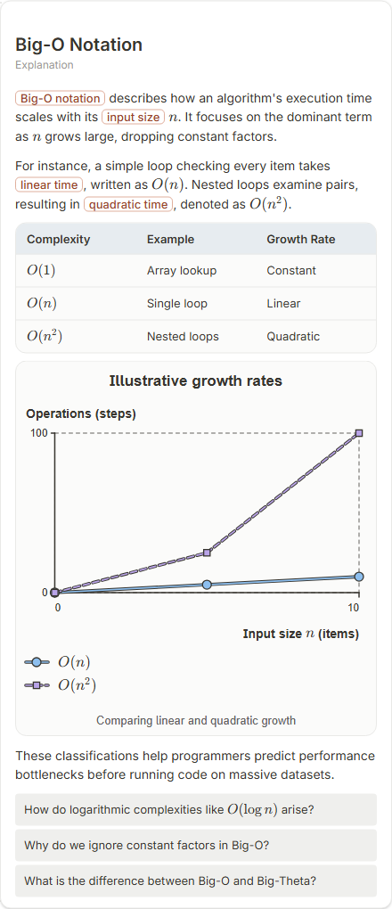

# Big-O Notation

- Prompt: what is Big-O notation?
- Depth: balanced (balanced)
- Expected shape (owner): coordinate-plot: growth curves O(1), O(log n), O(n), O(n^2); or comparison
- Authored by: google / gemini-3.5-flash-lite
- Card as saved: 440 x 1019 px at 100% zoom, KaTeX nodes 11 (errors 0)

## Body (as saved, visual markers in place)

Big-O notation describes how an algorithm's execution time scales with its input size $n$. It focuses on the dominant term as $n$ grows large, dropping constant factors.

For instance, a simple loop checking every item takes linear time, written as $O(n)$. Nested loops examine pairs, resulting in quadratic time, denoted as $O(n^2)$.

| Complexity | Example | Growth Rate |
| :--- | :--- | :--- |
| $O(1)$ | Array lookup | Constant |
| $O(n)$ | Single loop | Linear |
| $O(n^2)$ | Nested loops | Quadratic |

[[visual:1]]

These classifications help programmers predict performance bottlenecks before running code on massive datasets.

## Visuals

- [[visual:1]] diagram, kind **coordinate-plot**, title "Illustrative growth rates", caption "Comparing linear and quadratic growth" ([spec](visual-1.json), [svg](visual-1.svg), [png](visual-1.png))

## Follow-up questions

1. How do logarithmic complexities like $O(\log n)$ arise?
2. Why do we ignore constant factors in Big-O?
3. What is the difference between Big-O and Big-Theta?

## Pipeline

- Planner (jev): visualType/plan visuals [{"type":"diagram","kind":"coordinate-plot"}], depthTreatment **mechanism**, kind **coordinate-plot** (fixed), confidence {"kind":0.99,"visualType":1}, flags {"needsPlot":0.77,"isPhysical":0.09,"needsWorkedExample":0.72}; per-kind probabilities are not in the server log (only the confidence of the chosen kind). secondVisual: not in this build.
- Visuals decided by: [{"winner":"plan","kinds":["coordinate-plot"],"wordHeuristics":"off"}]
- References selected: attempt 0: shape-coordinate-plot
- Model: profile google-low v1 (hash 7a65d850970c6aad); steps [{"provider":"google","model":"gemini-3.5-flash-lite","outcome":"artifact"}]; google/gemini-3.5-flash-lite reasoning effort low, author temperature = provider default (none sent), repair temperature 0.3, fallback fireworks gpt-oss-120b (used: no)
- Timing: planner 353 ms; model call(s) 3308 ms (sum 3308 ms); whole card 3724 ms
- Tokens (author + repair calls): input 3033, output 511; cost US$0.002188
- Repaired: no; attempts 1
- Server corrections: {"block.diagramCorrections":null,"explanation_diagram_corrected events":[],"visualFallback":null,"diagramsSimplified":null,"diagram smells logged":[]}
- Page errors while rendering: none
