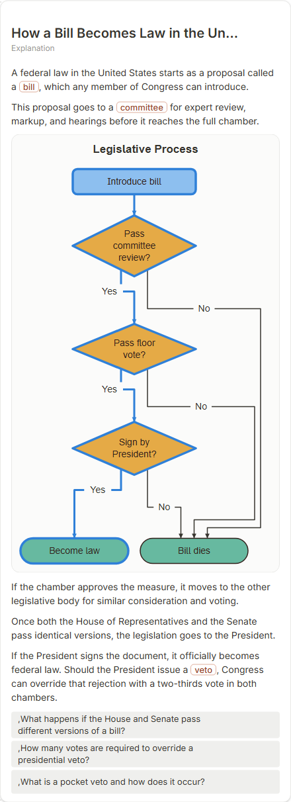

# How a Bill Becomes Law in the United States

- Prompt: how does a bill become law in the United States?
- Depth: balanced (balanced)
- Expected shape (owner): flow with decisions: committee, both chambers, veto, override
- Authored by: google / gemini-3.5-flash-lite
- Card as saved: 440 x 1212 px at 100% zoom, KaTeX nodes 0 (errors 0)

## Body (as saved, visual markers in place)

A federal law in the United States starts as a proposal called a bill, which any member of Congress can introduce.

This proposal goes to a committee for expert review, markup, and hearings before it reaches the full chamber.

[[visual:1]]

If the chamber approves the measure, it moves to the other legislative body for similar consideration and voting.

Once both the House of Representatives and the Senate pass identical versions, the legislation goes to the President.

If the President signs the document, it officially becomes federal law. Should the President issue a veto, Congress can override that rejection with a two-thirds vote in both chambers.

## Visuals

- [[visual:1]] diagram, kind **flow**, title "Legislative Process", caption "" ([spec](visual-1.json), [svg](visual-1.svg), [png](visual-1.png))

## Follow-up questions

1. ,What happens if the House and Senate pass different versions of a bill?
2. ,How many votes are required to override a presidential veto?
3. ,What is a pocket veto and how does it occur?

## Pipeline

- Planner (jev): visualType/plan visuals [{"type":"diagram","kind":"flow"}], depthTreatment **mechanism**, kind **flow** (fixed), confidence {"kind":0.99,"visualType":1}, flags {"needsPlot":0.02,"isPhysical":0.08,"needsWorkedExample":0.16}; per-kind probabilities are not in the server log (only the confidence of the chosen kind). secondVisual: not in this build.
- Visuals decided by: [{"winner":"plan","kinds":["flow"],"wordHeuristics":"off"}]
- References selected: attempt 0: shape-flow
- Model: profile google-low v1 (hash 7a65d850970c6aad); steps [{"provider":"google","model":"gemini-3.5-flash-lite","outcome":"artifact"}]; google/gemini-3.5-flash-lite reasoning effort low, author temperature = provider default (none sent), repair temperature 0.3, fallback fireworks gpt-oss-120b (used: no)
- Timing: planner 190 ms; model call(s) 2988 ms (sum 2988 ms); whole card 3253 ms
- Tokens (author + repair calls): input 3028, output 838; cost US$0.003004
- Repaired: no; attempts 1
- Server corrections: {"block.diagramCorrections":null,"explanation_diagram_corrected events":[],"visualFallback":null,"diagramsSimplified":null,"diagram smells logged":[]}
- Page errors while rendering: none
