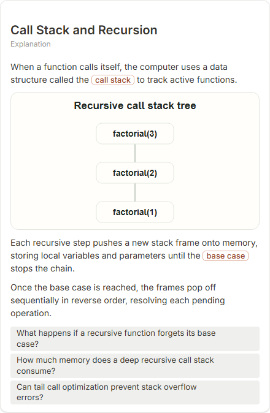

# Call Stack and Recursion

- Prompt: how does the call stack work during recursion?
- Depth: balanced (balanced)
- Expected shape (owner): layers or block-stack: frames pushed and popped, base case
- Authored by: google / gemini-3.5-flash-lite
- Card as saved: 440 x 673 px at 100% zoom, KaTeX nodes 0 (errors 0)

## Body (as saved, visual markers in place)

When a function calls itself, the computer uses a data structure called the call stack to track active functions.

[[visual:1]]

Each recursive step pushes a new stack frame onto memory, storing local variables and parameters until the base case stops the chain.

Once the base case is reached, the frames pop off sequentially in reverse order, resolving each pending operation.

## Visuals

- [[visual:1]] diagram, kind **tree**, title "Recursive call stack tree", caption "" ([spec](visual-1.json), [svg](visual-1.svg), [png](visual-1.png))

## Follow-up questions

1. What happens if a recursive function forgets its base case?
2. How much memory does a deep recursive call stack consume?
3. Can tail call optimization prevent stack overflow errors?

## Pipeline

- Planner (jev): visualType/plan visuals [{"type":"diagram","choose":["tree","layers"]}], depthTreatment **mechanism**, kind **tree** (two offered / not fixed), confidence {"kind":0.52,"visualType":1}, flags {"needsPlot":0.09,"isPhysical":0.1,"needsWorkedExample":0.8}; per-kind probabilities are not in the server log (only the confidence of the chosen kind). secondVisual: not in this build.
- Visuals decided by: [{"winner":"plan","kinds":["tree","layers"],"wordHeuristics":"off"}]
- References selected: attempt 0: shape-tree
- Model: profile google-low v1 (hash 7a65d850970c6aad); steps [{"provider":"google","model":"gemini-3.5-flash-lite","outcome":"artifact"}]; google/gemini-3.5-flash-lite reasoning effort low, author temperature = provider default (none sent), repair temperature 0.3, fallback fireworks gpt-oss-120b (used: no)
- Timing: planner 298 ms; model call(s) 2161 ms (sum 2161 ms); whole card 2519 ms
- Tokens (author + repair calls): input 2985, output 424; cost US$0.001956
- Repaired: no; attempts 1
- Server corrections: {"block.diagramCorrections":null,"explanation_diagram_corrected events":[],"visualFallback":null,"diagramsSimplified":null,"diagram smells logged":[]}
- Page errors while rendering: none
