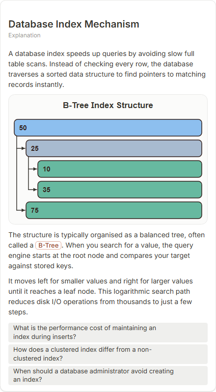

# Database Index Mechanism

- Prompt: how does a database index speed up a query?
- Depth: balanced (balanced)
- Expected shape (owner): tree (B-tree) or comparison: scan vs index lookup
- Authored by: google / gemini-3.5-flash-lite
- Card as saved: 440 x 797 px at 100% zoom, KaTeX nodes 0 (errors 0)

## Body (as saved, visual markers in place)

A database index speeds up queries by avoiding slow full table scans. Instead of checking every row, the database traverses a sorted data structure to find pointers to matching records instantly.

[[visual:1]]

The structure is typically organised as a balanced tree, often called a B-Tree. When you search for a value, the query engine starts at the root node and compares your target against stored keys.

It moves left for smaller values and right for larger values until it reaches a leaf node. This logarithmic search path reduces disk I/O operations from thousands to just a few steps.

## Visuals

- [[visual:1]] diagram, kind **tree**, title "B-Tree Index Structure", caption "" ([spec](visual-1.json), [raw as the model wrote it](visual-1.raw.json), [svg](visual-1.svg), [png](visual-1.png))

## Follow-up questions

1. What is the performance cost of maintaining an index during inserts?
2. How does a clustered index differ from a non-clustered index?
3. When should a database administrator avoid creating an index?

## Pipeline

- Planner (jev): visualType/plan visuals [{"type":"diagram","kind":"tree"}], depthTreatment **mechanism**, kind **tree** (fixed), confidence {"kind":0.81,"visualType":1}, flags {"needsPlot":0.1,"isPhysical":0.09,"needsWorkedExample":0.62}; per-kind probabilities are not in the server log (only the confidence of the chosen kind). secondVisual: not in this build.
- Visuals decided by: [{"winner":"plan","kinds":["tree"],"wordHeuristics":"off"}]
- References selected: attempt 0: shape-tree; attempt 1: shape-tree
- Model: profile google-low v1 (hash 7a65d850970c6aad); steps [{"provider":"google","model":"gemini-3.5-flash-lite","outcome":"artifact"}]; google/gemini-3.5-flash-lite reasoning effort low, author temperature = provider default (none sent), repair temperature 0.3, fallback fireworks gpt-oss-120b (used: no)
- Timing: planner 93 ms; model call(s) 2459 + 2255 ms (sum 4714 ms); whole card 4878 ms
- Tokens (author + repair calls): input 6350, output 987 (2972/468 + 3378/519); cost US$0.004373
- Repaired: yes; attempts 1
- Repair causes (first attempt invalid):
  - attempt 0: explanation_bad_diagram: the rh-diagram spec is not valid (diagram.nodes.0.parent: Use a simple ID starting with a letter (at most 32 characters); diagram.nodes: A tree needs one root)
- Server corrections: {"block.diagramCorrections":null,"explanation_diagram_corrected events":[],"visualFallback":null,"diagramsSimplified":null,"diagram smells logged":[]}
- Page errors while rendering: none
