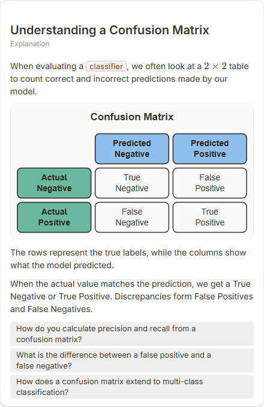

# Understanding a Confusion Matrix

- Prompt: how does a confusion matrix work?
- Depth: balanced (balanced)
- Expected shape (owner): matrix: actual vs predicted, TP/FP/FN/TN, with precision and recall derived
- Authored by: google / gemini-3.5-flash-lite
- Card as saved: 440 x 676 px at 100% zoom, KaTeX nodes 1 (errors 0)

## Body (as saved, visual markers in place)

When evaluating a classifier, we often look at a $2 \times 2$ table to count correct and incorrect predictions made by our model.

[[visual:1]]

The rows represent the true labels, while the columns show what the model predicted.

When the actual value matches the prediction, we get a True Negative or True Positive. Discrepancies form False Positives and False Negatives.

## Visuals

- [[visual:1]] diagram, kind **matrix**, title "Confusion Matrix", caption "" ([spec](visual-1.json), [svg](visual-1.svg), [png](visual-1.png))

## Follow-up questions

1. How do you calculate precision and recall from a confusion matrix?
2. What is the difference between a false positive and a false negative?
3. How does a confusion matrix extend to multi-class classification?

## Pipeline

- Planner (jev): visualType/plan visuals [{"type":"diagram","kind":"matrix"}], depthTreatment **mechanism**, kind **matrix** (fixed), confidence {"kind":1,"visualType":1}, flags {"needsPlot":0.63,"isPhysical":0.09,"needsWorkedExample":0.87}; per-kind probabilities are not in the server log (only the confidence of the chosen kind). secondVisual: not in this build.
- Visuals decided by: [{"winner":"plan","kinds":["matrix"],"wordHeuristics":"off"}]
- References selected: attempt 0: shape-matrix
- Model: profile google-low v1 (hash 7a65d850970c6aad); steps [{"provider":"google","model":"gemini-3.5-flash-lite","outcome":"artifact"}]; google/gemini-3.5-flash-lite reasoning effort low, author temperature = provider default (none sent), repair temperature 0.3, fallback fireworks gpt-oss-120b (used: no)
- Timing: planner 147 ms; model call(s) 2480 ms (sum 2480 ms); whole card 2692 ms
- Tokens (author + repair calls): input 2944, output 251; cost US$0.001511
- Repaired: no; attempts 1
- Server corrections: {"block.diagramCorrections":null,"explanation_diagram_corrected events":[],"visualFallback":null,"diagramsSimplified":null,"diagram smells logged":[]}
- Page errors while rendering: none
