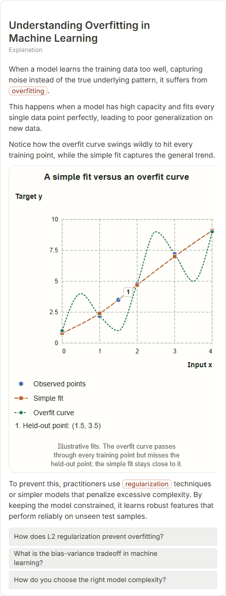

# Understanding Overfitting in Machine Learning

- Prompt: what is overfitting?
- Depth: balanced (balanced)
- Expected shape (owner): coordinate-plot: observed points once as scatter, a simple-fit line, an overfit line, one annotated held-out point (reference ml-fit-quality-comparison); caption says what to notice
- Authored by: google / gemini-3.5-flash-lite
- Card as saved: 440 x 1157 px at 100% zoom, KaTeX nodes 0 (errors 0)

## Body (as saved, visual markers in place)

When a model learns the training data too well, capturing noise instead of the true underlying pattern, it suffers from overfitting.

This happens when a model has high capacity and fits every single data point perfectly, leading to poor generalization on new data.

Notice how the overfit curve swings wildly to hit every training point, while the simple fit captures the general trend.

[[visual:1]]

To prevent this, practitioners use regularization techniques or simpler models that penalize excessive complexity. By keeping the model constrained, it learns robust features that perform reliably on unseen test samples.

## Visuals

- [[visual:1]] diagram, kind **coordinate-plot**, title "A simple fit versus an overfit curve", caption "Illustrative fits. The overfit curve passes through every training point but misses the held-out point; the simple fit stays close to it." ([spec](visual-1.json), [svg](visual-1.svg), [png](visual-1.png))

## Follow-up questions

1. How does L2 regularization prevent overfitting?
2. What is the bias-variance tradeoff in machine learning?
3. How do you choose the right model complexity?

## Pipeline

- Planner (jev): visualType/plan visuals [{"type":"diagram","kind":"coordinate-plot"}], depthTreatment **mechanism**, kind **coordinate-plot** (fixed), confidence {"kind":0.94,"visualType":1}, flags {"needsPlot":0.09,"isPhysical":0.09,"needsWorkedExample":0.6}; per-kind probabilities are not in the server log (only the confidence of the chosen kind). secondVisual: not in this build.
- Visuals decided by: [{"winner":"plan","kinds":["coordinate-plot"],"wordHeuristics":"off"}]
- References selected: attempt 0: shape-coordinate-plot, ml-fit-quality-comparison-single
- Model: profile google-low v1 (hash 7a65d850970c6aad); steps [{"provider":"google","model":"gemini-3.5-flash-lite","outcome":"artifact"}]; google/gemini-3.5-flash-lite reasoning effort low, author temperature = provider default (none sent), repair temperature 0.3, fallback fireworks gpt-oss-120b (used: no)
- Timing: planner 145 ms; model call(s) 3665 ms (sum 3665 ms); whole card 3857 ms
- Tokens (author + repair calls): input 4009, output 1038; cost US$0.003798
- Repaired: no; attempts 1
- Server corrections: {"block.diagramCorrections":null,"explanation_diagram_corrected events":[],"visualFallback":null,"diagramsSimplified":null,"diagram smells logged":[]}
- Page errors while rendering: none
