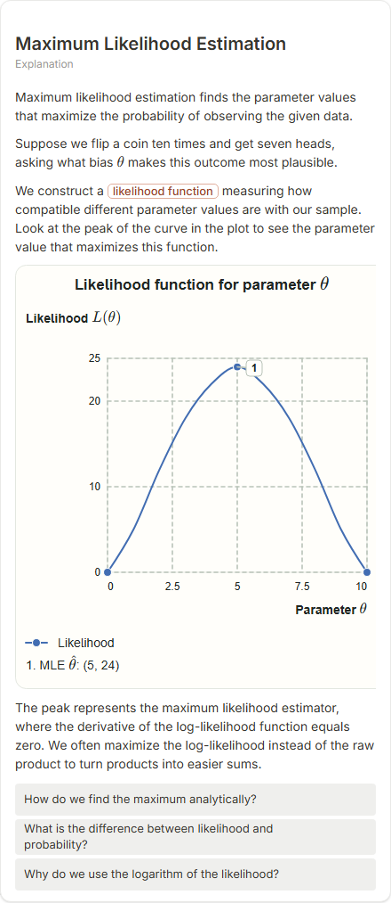

# Maximum Likelihood Estimation

- Prompt: what is maximum likelihood estimation?
- Depth: balanced (balanced)
- Expected shape (owner): coordinate-plot: likelihood against the parameter with the maximum marked and labelled; or a flow data -> likelihood -> maximise -> estimate
- Authored by: google / gemini-3.5-flash-lite
- Card as saved: 440 x 1012 px at 100% zoom, KaTeX nodes 5 (errors 0)

## Body (as saved, visual markers in place)

Maximum likelihood estimation finds the parameter values that maximize the probability of observing the given data.

Suppose we flip a coin ten times and get seven heads, asking what bias \(\theta\) makes this outcome most plausible.

We construct a likelihood function measuring how compatible different parameter values are with our sample. Look at the peak of the curve in the plot to see the parameter value that maximizes this function.

[[visual:1]]

The peak represents the maximum likelihood estimator, where the derivative of the log-likelihood function equals zero. We often maximize the log-likelihood instead of the raw product to turn products into easier sums.

## Visuals

- [[visual:1]] diagram, kind **coordinate-plot**, title "Likelihood function for parameter \(\theta\)", caption "" ([spec](visual-1.json), [svg](visual-1.svg), [png](visual-1.png))

## Follow-up questions

1. How do we find the maximum analytically?
2. What is the difference between likelihood and probability?
3. Why do we use the logarithm of the likelihood?

## Pipeline

- Planner (jev): visualType/plan visuals [{"type":"diagram","kind":"coordinate-plot"}], depthTreatment **mechanism**, kind **coordinate-plot** (fixed), confidence {"kind":0.94,"visualType":1}, flags {"needsPlot":0.25,"isPhysical":0.08,"needsWorkedExample":0.8}; per-kind probabilities are not in the server log (only the confidence of the chosen kind). secondVisual: not in this build.
- Visuals decided by: [{"winner":"plan","kinds":["coordinate-plot"],"wordHeuristics":"off"}]
- References selected: attempt 0: shape-coordinate-plot
- Model: profile google-low v1 (hash 7a65d850970c6aad); steps [{"provider":"google","model":"gemini-3.5-flash-lite","outcome":"artifact"}]; google/gemini-3.5-flash-lite reasoning effort low, author temperature = provider default (none sent), repair temperature 0.3, fallback fireworks gpt-oss-120b (used: no)
- Timing: planner 172 ms; model call(s) 3226 ms (sum 3226 ms); whole card 3442 ms
- Tokens (author + repair calls): input 3597, output 612; cost US$0.00261
- Repaired: no; attempts 1
- Server corrections: {"block.diagramCorrections":null,"explanation_diagram_corrected events":[],"visualFallback":null,"diagramsSimplified":null,"diagram smells logged":[]}
- Page errors while rendering: none
