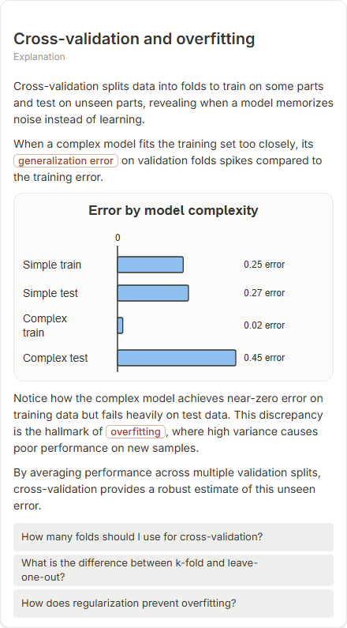

# Cross-validation and overfitting

- Prompt: how does cross-validation detect overfitting?
- Depth: balanced (balanced)
- Expected shape (owner): grouped bar-chart: training versus validation error per fold with a steady gap; never a trend line over folds
- Authored by: google / gemini-3.5-flash-lite
- Card as saved: 440 x 795 px at 100% zoom, KaTeX nodes 0 (errors 0)

## Body (as saved, visual markers in place)

Cross-validation splits data into folds to train on some parts and test on unseen parts, revealing when a model memorizes noise instead of learning.

When a complex model fits the training set too closely, its generalization error on validation folds spikes compared to the training error.

[[visual:1]]

Notice how the complex model achieves near-zero error on training data but fails heavily on test data. This discrepancy is the hallmark of overfitting, where high variance causes poor performance on new samples.

By averaging performance across multiple validation splits, cross-validation provides a robust estimate of this unseen error.

## Visuals

- [[visual:1]] diagram, kind **bar-chart**, title "Error by model complexity", caption "" ([spec](visual-1.json), [svg](visual-1.svg), [png](visual-1.png))

## Follow-up questions

1. How many folds should I use for cross-validation?
2. What is the difference between k-fold and leave-one-out?
3. How does regularization prevent overfitting?

## Pipeline

- Planner (jev): visualType/plan visuals [{"type":"diagram","kind":"bar-chart"}], depthTreatment **mechanism**, kind **bar-chart** (fixed), confidence {"kind":0.64,"visualType":1}, flags {"needsPlot":0.45,"isPhysical":0.09,"needsWorkedExample":0.75}; per-kind probabilities are not in the server log (only the confidence of the chosen kind). secondVisual: not in this build.
- Visuals decided by: [{"winner":"plan","kinds":["bar-chart"],"wordHeuristics":"off"}]
- References selected: attempt 0: shape-bar-chart
- Model: profile google-low v1 (hash 7a65d850970c6aad); steps [{"provider":"google","model":"gemini-3.5-flash-lite","outcome":"artifact"}]; google/gemini-3.5-flash-lite reasoning effort low, author temperature = provider default (none sent), repair temperature 0.3, fallback fireworks gpt-oss-120b (used: no)
- Timing: planner 166 ms; model call(s) 2674 ms (sum 2674 ms); whole card 2885 ms
- Tokens (author + repair calls): input 3489, output 477; cost US$0.00224
- Repaired: no; attempts 1
- Server corrections: {"block.diagramCorrections":null,"explanation_diagram_corrected events":[],"visualFallback":null,"diagramsSimplified":null,"diagram smells logged":[]}
- Page errors while rendering: none
