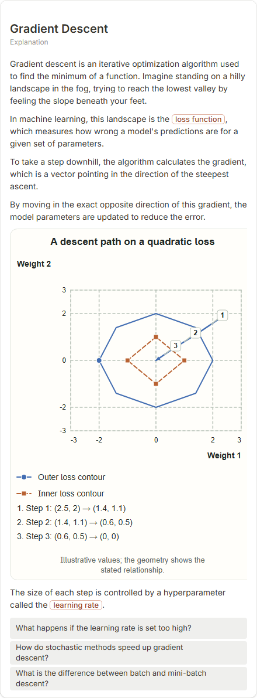

# Gradient Descent

- Prompt: how does gradient descent work?
- Depth: balanced (balanced)
- Expected shape (owner): coordinate-plot: loss against the parameter with the step path downhill; or a cycle compute gradient -> step -> repeat (no setup step in the cycle)
- Authored by: google / gemini-3.5-flash-lite
- Card as saved: 440 x 1191 px at 100% zoom, KaTeX nodes 0 (errors 0)

## Body (as saved, visual markers in place)

Gradient descent is an iterative optimization algorithm used to find the minimum of a function. Imagine standing on a hilly landscape in the fog, trying to reach the lowest valley by feeling the slope beneath your feet.

In machine learning, this landscape is the loss function, which measures how wrong a model's predictions are for a given set of parameters.

To take a step downhill, the algorithm calculates the gradient, which is a vector pointing in the direction of the steepest ascent.

By moving in the exact opposite direction of this gradient, the model parameters are updated to reduce the error.

[[visual:1]]

The size of each step is controlled by a hyperparameter called the learning rate.

## Visuals

- [[visual:1]] diagram, kind **coordinate-plot**, title "A descent path on a quadratic loss", caption "Illustrative values; the geometry shows the stated relationship." ([spec](visual-1.json), [svg](visual-1.svg), [png](visual-1.png))

## Follow-up questions

1. What happens if the learning rate is set too high?
2. How do stochastic methods speed up gradient descent?
3. What is the difference between batch and mini-batch descent?

## Pipeline

- Planner (jev): visualType/plan visuals [{"type":"diagram","kind":"coordinate-plot"}], depthTreatment **mechanism**, kind **coordinate-plot** (fixed), confidence {"kind":0.83,"visualType":1}, flags {"needsPlot":0.66,"isPhysical":0.08,"needsWorkedExample":0.82}; per-kind probabilities are not in the server log (only the confidence of the chosen kind). secondVisual: not in this build.
- Visuals decided by: [{"winner":"plan","kinds":["coordinate-plot"],"wordHeuristics":"off"}]
- References selected: attempt 0: shape-coordinate-plot, gradient-descent-contours
- Model: profile google-low v1 (hash 7a65d850970c6aad); steps [{"provider":"google","model":"gemini-3.5-flash-lite","outcome":"artifact"}]; google/gemini-3.5-flash-lite reasoning effort low, author temperature = provider default (none sent), repair temperature 0.3, fallback fireworks gpt-oss-120b (used: no)
- Timing: planner 197 ms; model call(s) 3399 ms (sum 3399 ms); whole card 3640 ms
- Tokens (author + repair calls): input 3983, output 766; cost US$0.00311
- Repaired: no; attempts 1
- Server corrections: {"block.diagramCorrections":null,"explanation_diagram_corrected events":[],"visualFallback":null,"diagramsSimplified":null,"diagram smells logged":[]}
- Page errors while rendering: none
