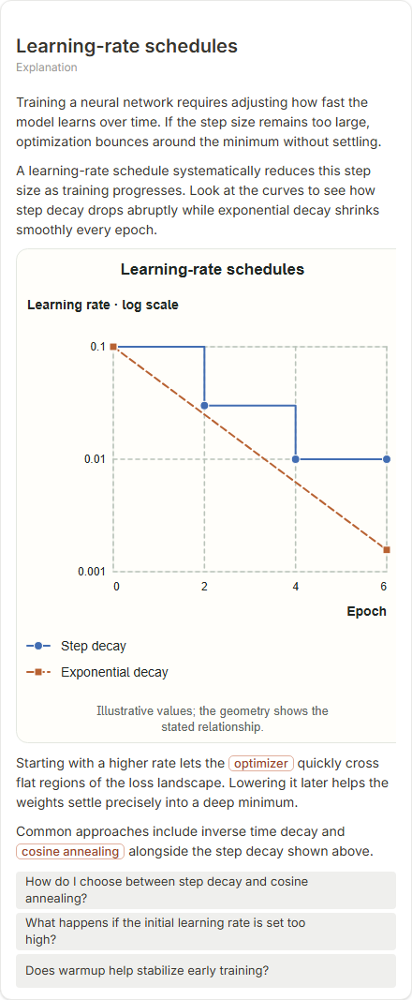

# Learning-rate schedules

- Prompt: what is a learning-rate schedule?
- Depth: balanced (balanced)
- Expected shape (owner): coordinate-plot: learning rate against epoch for step decay and exponential decay, 7-12 points or smoothed curves
- Authored by: google / gemini-3.5-flash-lite
- Card as saved: 440 x 1067 px at 100% zoom, KaTeX nodes 0 (errors 0)

## Body (as saved, visual markers in place)

Training a neural network requires adjusting how fast the model learns over time. If the step size remains too large, optimization bounces around the minimum without settling.

A learning-rate schedule systematically reduces this step size as training progresses. Look at the curves to see how step decay drops abruptly while exponential decay shrinks smoothly every epoch.

[[visual:1]]

Starting with a higher rate lets the optimizer quickly cross flat regions of the loss landscape. Lowering it later helps the weights settle precisely into a deep minimum.

Common approaches include inverse time decay and cosine annealing alongside the step decay shown above.

## Visuals

- [[visual:1]] diagram, kind **coordinate-plot**, title "Learning-rate schedules", caption "Illustrative values; the geometry shows the stated relationship." ([spec](visual-1.json), [svg](visual-1.svg), [png](visual-1.png))

## Follow-up questions

1. How do I choose between step decay and cosine annealing?
2. What happens if the initial learning rate is set too high?
3. Does warmup help stabilize early training?

## Pipeline

- Planner (jev): visualType/plan visuals [{"type":"diagram","kind":"coordinate-plot"}], depthTreatment **mechanism**, kind **coordinate-plot** (fixed), confidence {"kind":1,"visualType":1}, flags {"needsPlot":0.93,"isPhysical":0.08,"needsWorkedExample":0.74}; per-kind probabilities are not in the server log (only the confidence of the chosen kind). secondVisual: not in this build.
- Visuals decided by: [{"winner":"plan","kinds":["coordinate-plot"],"wordHeuristics":"off"}]
- References selected: attempt 0: shape-coordinate-plot, learning-rate-schedules
- Model: profile google-low v1 (hash 7a65d850970c6aad); steps [{"provider":"google","model":"gemini-3.5-flash-lite","outcome":"artifact"}]; google/gemini-3.5-flash-lite reasoning effort low, author temperature = provider default (none sent), repair temperature 0.3, fallback fireworks gpt-oss-120b (used: no)
- Timing: planner 152 ms; model call(s) 3482 ms (sum 3482 ms); whole card 3681 ms
- Tokens (author + repair calls): input 3873, output 828; cost US$0.003232
- Repaired: no; attempts 1
- Server corrections: {"block.diagramCorrections":null,"explanation_diagram_corrected events":[],"visualFallback":null,"diagramsSimplified":null,"diagram smells logged":[]}
- Page errors while rendering: none
