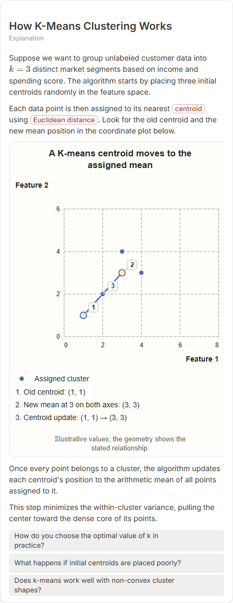

# How K-Means Clustering Works

- Prompt: how does k-means clustering work?
- Depth: balanced (balanced)
- Expected shape (owner): coordinate-plot scatter: points, centroids, one re-assignment step; a cycle without the initialise step is acceptable
- Authored by: google / gemini-3.5-flash-lite
- Card as saved: 440 x 1134 px at 100% zoom, KaTeX nodes 1 (errors 0)

## Body (as saved, visual markers in place)

Suppose we want to group unlabeled customer data into $k=3$ distinct market segments based on income and spending score. The algorithm starts by placing three initial centroids randomly in the feature space.

Each data point is then assigned to its nearest centroid using Euclidean distance. Look for the old centroid and the new mean position in the coordinate plot below.

[[visual:1]]

Once every point belongs to a cluster, the algorithm updates each centroid's position to the arithmetic mean of all points assigned to it.

This step minimizes the within-cluster variance, pulling the center toward the dense core of its points.

## Visuals

- [[visual:1]] diagram, kind **coordinate-plot**, title "A K-means centroid moves to the assigned mean", caption "Illustrative values; the geometry shows the stated relationship." ([spec](visual-1.json), [svg](visual-1.svg), [png](visual-1.png))

## Follow-up questions

1. How do you choose the optimal value of k in practice?
2. What happens if initial centroids are placed poorly?
3. Does k-means work well with non-convex cluster shapes?

## Pipeline

- Planner (jev): visualType/plan visuals [{"type":"diagram","kind":"coordinate-plot"}], depthTreatment **mechanism**, kind **coordinate-plot** (fixed), confidence {"kind":0.83,"visualType":1}, flags {"needsPlot":0.17,"isPhysical":0.08,"needsWorkedExample":0.83}; per-kind probabilities are not in the server log (only the confidence of the chosen kind). secondVisual: not in this build.
- Visuals decided by: [{"winner":"plan","kinds":["coordinate-plot"],"wordHeuristics":"off"}]
- References selected: attempt 0: shape-coordinate-plot, kmeans-centroid-update, clustering-elbow-silhouette
- Model: profile google-low v1 (hash 7a65d850970c6aad); steps [{"provider":"google","model":"gemini-3.5-flash-lite","outcome":"artifact"}]; google/gemini-3.5-flash-lite reasoning effort low, author temperature = provider default (none sent), repair temperature 0.3, fallback fireworks gpt-oss-120b (used: no)
- Timing: planner 119 ms; model call(s) 3127 ms (sum 3127 ms); whole card 3297 ms
- Tokens (author + repair calls): input 4013, output 852; cost US$0.003334
- Repaired: no; attempts 1
- Server corrections: {"block.diagramCorrections":null,"explanation_diagram_corrected events":[],"visualFallback":null,"diagramsSimplified":null,"diagram smells logged":[]}
- Page errors while rendering: none
