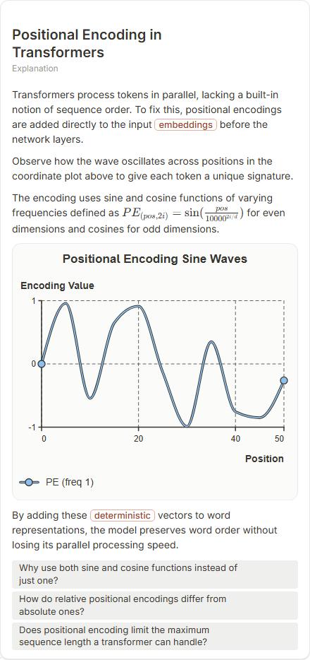

# Positional Encoding in Transformers

- Prompt: how does positional encoding work in a transformer?
- Depth: balanced (balanced)
- Expected shape (owner): the walkthrough step-1 block-stack row or a coordinate-plot of two or three sinusoids over position; maths in $...$
- Authored by: google / gemini-3.5-flash-lite
- Card as saved: 440 x 933 px at 100% zoom, KaTeX nodes 1 (errors 0)

## Body (as saved, visual markers in place)

Transformers process tokens in parallel, lacking a built-in notion of sequence order. To fix this, positional encodings are added directly to the input embeddings before the network layers.

Observe how the wave oscillates across positions in the coordinate plot above to give each token a unique signature.

The encoding uses sine and cosine functions of varying frequencies defined as $PE_{(pos, 2i)} = \sin(\frac{pos}{10000^{2i/d}})$ for even dimensions and cosines for odd dimensions.

[[visual:1]]

By adding these deterministic vectors to word representations, the model preserves word order without losing its parallel processing speed.

## Visuals

- [[visual:1]] diagram, kind **coordinate-plot**, title "Positional Encoding Sine Waves", caption "" ([spec](visual-1.json), [svg](visual-1.svg), [png](visual-1.png))

## Follow-up questions

1. Why use both sine and cosine functions instead of just one?
2. How do relative positional encodings differ from absolute ones?
3. Does positional encoding limit the maximum sequence length a transformer can handle?

## Pipeline

- Planner (jev): visualType/plan visuals [{"type":"diagram","kind":"coordinate-plot"}], depthTreatment **mechanism**, kind **coordinate-plot** (fixed), confidence {"kind":0.66,"visualType":1}, flags {"needsPlot":0.37,"isPhysical":0.1,"needsWorkedExample":0.79}; per-kind probabilities are not in the server log (only the confidence of the chosen kind). secondVisual: not in this build.
- Visuals decided by: [{"winner":"plan","kinds":["coordinate-plot"],"wordHeuristics":"off"}]
- References selected: attempt 0: shape-coordinate-plot
- Model: profile google-low v1 (hash 7a65d850970c6aad); steps [{"provider":"google","model":"gemini-3.5-flash-lite","outcome":"artifact"}]; google/gemini-3.5-flash-lite reasoning effort low, author temperature = provider default (none sent), repair temperature 0.3, fallback fireworks gpt-oss-120b (used: no)
- Timing: planner 158 ms; model call(s) 2881 ms (sum 2881 ms); whole card 3074 ms
- Tokens (author + repair calls): input 3603, output 698; cost US$0.002826
- Repaired: no; attempts 1
- Server corrections: {"block.diagramCorrections":null,"explanation_diagram_corrected events":[],"visualFallback":null,"diagramsSimplified":null,"diagram smells logged":[]}
- Page errors while rendering: none
